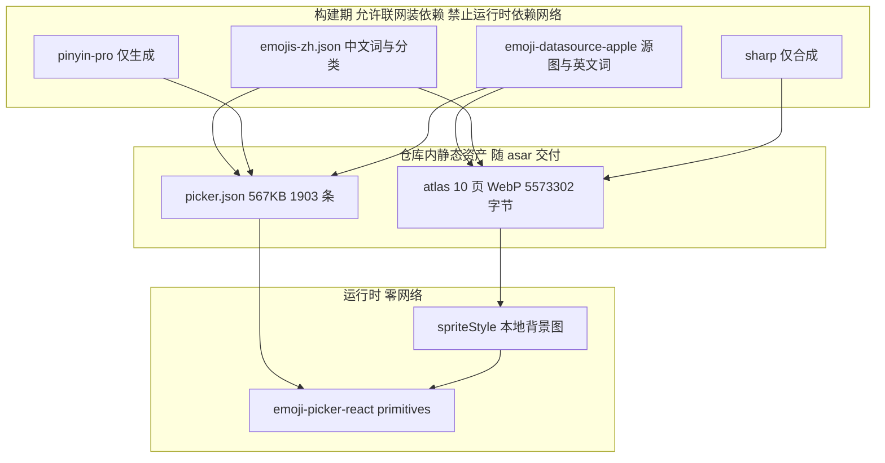
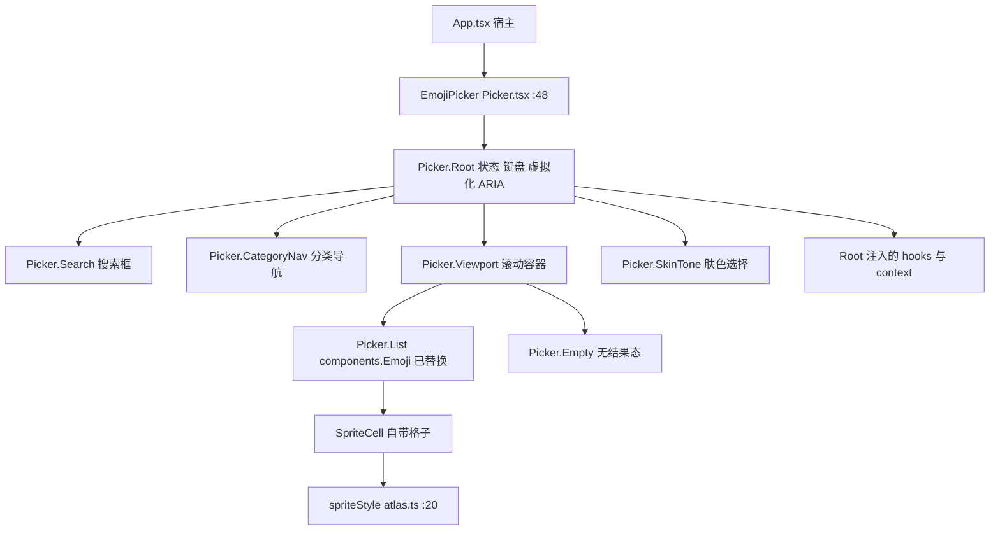
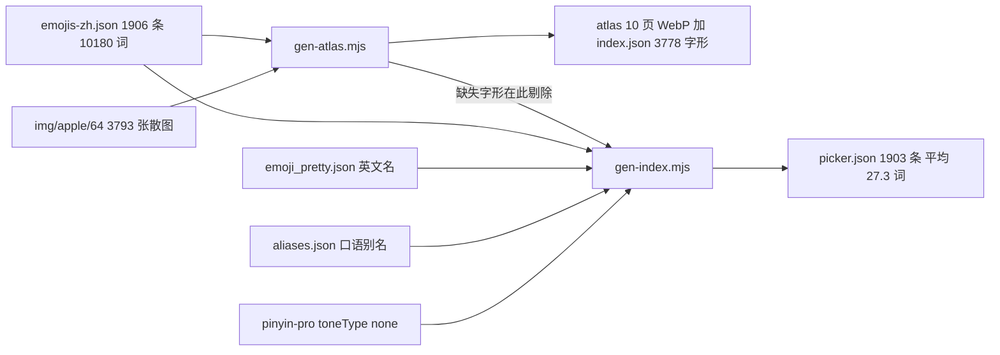
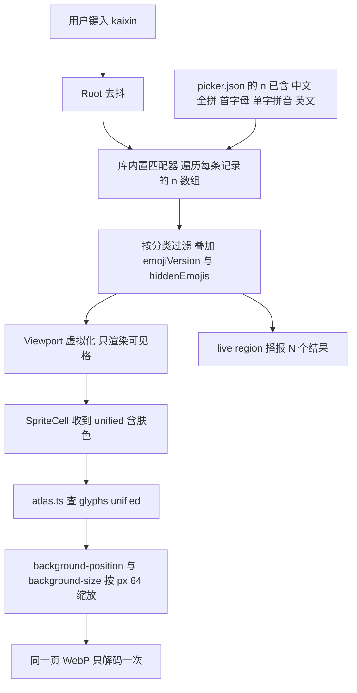
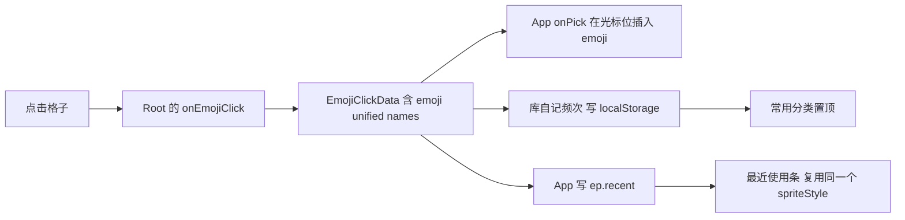
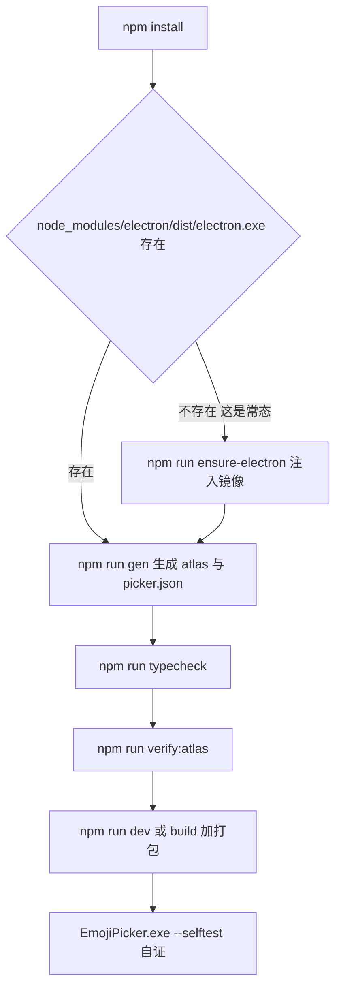
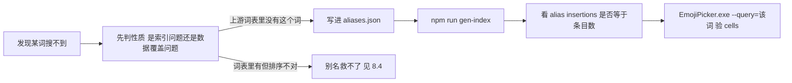

# 表情选择器 · 项目全景

Electron + React 架构下的**全离线**表情/emoji 选择器组件。本文按章节记录：为什么做、用什么做、由哪些文件构成、组件怎么组合、数据怎么流、怎么跑起来、以及每个设计决策的实测依据。

所有数字都是本机实测值（Windows 10.0.26300 / x64，Node v24.21.0），不是估算。运行与打包命令见文末第 9 节指向的操作文档。

---

## 1. 创建目的与解决的问题

### 1.1 要做的东西

一个嵌在桌面应用里的表情选择面板：搜索框 + 分类导航 + 表情网格 + 肤色选择 + 常用置顶，选中后把字符插入宿主输入框。形态参照常见 IM 的表情面板（分类 tab、搜索、贴纸位）。

### 1.2 为什么不是"装个库"就完事

调研阶段对三个主流库做了实测，结论是**它们在"离线 + 跨平台一致 + 中文检索"这三条同时成立时都会失效**：

| 库 | 现状（实测） | 否决理由 |
| --- | --- | --- |
| emoji-mart | 5.6.0 停在 2024-04-25；`@emoji-mart/react` 1.1.1 停在 2023-01-02 | peer 是 `react ^16.8 \|\| ^17 \|\| ^18`，不含 React 19，新工程 `npm install` 直接 ERESOLVE |
| emoji-picker-react v5 | 5.0.0（2026-10-10），活跃 | 图片样式硬编码 CDN，见 1.3 |
| emoji-picker-element | 1.29.1（2026-03-01），427KB，0 依赖 | 质量可以，但是 Web Component，React 里多套一层壳 |

### 1.3 四个必须自己解决的缺口

这四条都是**量出来的**，不是推测：

**① 自带图片样式必须联网，且改不了。** `emoji-picker-react@5` 的 dist 里，非 native 样式的图片地址是硬编码模板串：

```js
`https://cdn.jsdelivr.net/npm/emoji-datasource-${style}/img/${style}/64/${unified}.png`
```

而且 `assetPath` 这个 prop **在整个 dist 目录里 grep 零命中**。两个问题叠加：离线直接不可用；即便联网，它也不是雪碧图，是每张一个 PNG 请求。

**② 中文数据里拼音词数为 0。** 上游 `emojis-zh.json`（225,766 字节 / 1906 条 / 10,180 个关键词）里，ASCII 词只占 3.95%，**拼音词 0 个**。输入 `kaixin` 搜不到"开心"。

**③ 英文完全搜不到。** 同一份数据里 `flag` / `heart` / `cat` / `thumbs up` 命中数**全为 0**，只有 349/1906 条记录含任意 ASCII 词——zh 数据集不带英文名。

**④ 首字母天然撞车，静态数据救不了。** 实测 2772 个首字母 token 中有 232 个冲突 ≥10 条，最大冲突 **326 条**；`kx` 同时命中"开心/空心/细菌/实验/望远镜/问号"。

另外还有两个上游数据质量问题：`emojis-zh.json` **繁简混排**（`食物飲料`/`旅遊地點` 是繁体，`个人活动` 是简体），且 `smileys_people` 被命名为"人体"。

### 1.4 本项目的解法一句话

> **把图、词、索引三样东西全部在构建期落成仓库内静态文件，运行时零网络、零生成逻辑。** 库只用来提供虚拟化、键盘导航与无障碍。

---

## 2. 项目技术栈

### 2.1 运行时与构建链

| 层 | 选型 | 版本 | 为什么是它 |
| --- | --- | --- | --- |
| 桌面宿主 | Electron | 44.7.0 | 目标平台；无 postinstall，二进制要显式拉（见操作文档第 1 节） |
| UI | React / react-dom | 19.3.0 | 用户指定架构 |
| 构建 | Vite | 8.3.4 | 需要 `.mts` 配置与 `base: './'`（`file://` 下绝对路径会白屏） |
| 类型 | TypeScript | **5.9.3** | 主进程 tsconfig 依赖 `moduleResolution: "node"`，**TS7 已移除该取值**；升 TS 主版本是独立任务 |
| 打包 | electron-builder | 26.15.3 | portable / nsis / dir 三口径 |
| 选择器 UI | emoji-picker-react | 5.0.0 | **只用 `primitives` 子入口**，不用它的图片样式 |

### 2.2 数据与资产

| 用途 | 包 | 版本 | 参与阶段 |
| --- | --- | --- | --- |
| 中文词表与分类 | 随 emoji-picker-react 附带 `dist/data/emojis-zh.json` | — | 构建期输入 |
| 英文词表 | emoji-datasource-apple（`emoji_pretty.json`） | 16.0.0 | 构建期输入 |
| 字形位图 | emoji-datasource-apple（`img/apple/64/*.png`，3793 张） | 16.0.0 | 构建期输入 |
| 拼音生成 | pinyin-pro | 3.29.5 | **仅构建期**，renderer 不含 |
| 图像合成 | sharp | 0.35.5 | **仅构建期** |

关键口径：**`dependencies` 是空的**。react / emoji-picker-react 由 Vite 打进 `dist/`，主进程与 preload 由 tsc 打进 `dist-electron/`，运行时只 `require` `electron` 与 `node:*`。electron-builder 会把 `dependencies` 的 `node_modules` 无条件塞进 asar，`files` 白名单拦不住——所以判据是"asar 顶层只有三族"。



---

## 3. 项目架构

### 3.1 三层分离

架构的唯一主线是**把"生成"和"使用"彻底切开**：生成侧可以慢慢算、可以依赖原生图像库和拼音库；使用侧只读静态 JSON 和位图。

| 层 | 位置 | 职责 | 网络 |
| --- | --- | --- | --- |
| 生成层 | `bin/gen-atlas.mjs`、`bin/gen-index.mjs` | 把上游数据合成成本地资产 | 否（读 node_modules） |
| 资产层 | `src/emoji/atlas/`、`src/emoji/data/` | 提交进仓库的静态文件，即"离线"的全部内容 | 否 |
| 使用层 | `src/emoji/*.ts(x)`、`src/App.tsx`、`electron/` | 渲染与交互 | 否 |

### 3.2 目录布局

```
emoji前端组件/
├── index.html                 Vite 入口，必须在根
├── package.json               main = dist-electron/main.js；dependencies 为空
├── vite.config.mts            base './'，.mts 后缀避开 CJS 告警
├── tsconfig.json              只管渲染层类型，产物由 Vite 出
├── electron-builder.yml       files 白名单三族
├── electron/                  主进程 + preload + 自己的 tsconfig（CJS）
├── src/                       渲染层
│   ├── emoji/                 表情子系统（本文重点）
│   └── styles/app.css         单明暗浅色 token
├── bin/                       全部脚本：dev/build/gen/verify/icon/capture
├── doc/                       运行与构建（T0Level）.md
└── dist/ dist-electron/ release/   产物
```

### 3.3 两条硬约束的落点

**雪碧图必须分页。** 含肤色变体共 3931 字形（1906 基础 + 2025 变体）。若单页排布，`smileys_people` 会到 2048×4864，**纵向顶穿 4096 纹理上限**。所以按 `32×32 = 1024` 字形/页切分，横竖都锁 ≤2048，脚本末尾 `over-limit pages` 非 0 就自身 `exit(1)`。

> 这个坑是真踩出来的：第一版只约束了横向列数，纵向漏管，跑出来 4864 才发现。**限幅必须两个轴都咬住。**

**运行时不能出现任何远程 URL。** 因此 `emojiStyle` 显式设成 `"native"`（阻止库构造 CDN 地址），可见字形全部由自带的 `SpriteCell` 从本地 atlas 画。

---

## 4. 代码地图

全仓 TypeScript/TSX 共 623 行（`src/` 288 + `electron/` 325 + `src/types/window.d.ts` 10），构建脚本 `bin/*.mjs` 共 419 行，样式 181 行。

### 4.1 生成层（`bin/`）

| 文件 | 行数 | 入口 | 产出 | 判据 |
| --- | --- | --- | --- | --- |
| `gen-atlas.mjs` | 117 | `npm run gen:atlas` | `src/emoji/atlas/*.webp` + `index.json` | `over-limit pages : 0 ok`，否则 exit 1 |
| `gen-index.mjs` | 133 | `npm run gen:index` | `src/emoji/data/picker.json` | 打印 `category labels`、`ambiguous 2-letter`、各插入计数 |
| `verify-atlas.mjs` | 111 | `npm run verify:atlas` | 无产物，纯校验 | `suspect : 0`；负对照 `SHIFT_CELLS=1` 必须 exit 1 |
| `dev.mjs` | 27 | `npm run dev` | — | 打出 vite 地址 + `window-shown` |
| `build.mjs` | 31 | `npm run build` | `dist/` + `dist-electron/` | 末尾 `==> build done` |
| `electron-win-build.ps1` | — | 一键构建打包 | `release/` | 末尾 `==> done` |
| `make-icon.ps1` / `verify-icon.ps1` | — | 生成/校验 ico | `electron/icon.ico` | `icon-check=ok` |
| `shot-window.ps1` / `capture-screen.ps1` | — | 抓原生窗口 | PNG | 用于原生菜单这类 `capturePage` 拍不到的东西 |
| `stop-dev.ps1` | — | 清理 | — | `remaining=0`；**按工程路径匹配，不按进程名批量杀** |

### 4.2 资产层（`src/emoji/`，提交进仓库）

| 文件 | 体积 | 内容 |
| --- | --- | --- |
| `atlas/index.json` | 161 KB | `{cell:64, atlases:[{cat,page,file,cols,rows,width,height,glyphs,bytes}], glyphs:{unified → {a,x,y}}}` |
| `atlas/*.webp` | 5,573,302 B 共 10 页 | `smileys_people`（3 页）、`animals_nature`、`food_drink`、`travel_places`、`activities`、`objects`、`symbols`、`flags` |
| `data/picker.json` | 567 KB | `EmojiData` 形状：`{cell, categories:{10}, emojis:{8 类共 1903 条}}`，每条 `{n,u,a,v?}`，`n` 里已烘进拼音与英文 |
| `data/aliases.json` | 手编 | `[{t, u:[...], why}]`，补上游缺失的口语说法 |

### 4.3 使用层

| 文件 | 行数 | 关键符号 | 职责 |
| --- | --- | --- | --- |
| `src/emoji/atlas.ts` | 39 | `spriteStyle(unified, px)` :20、`import.meta.glob('./atlas/*.webp')` :6 | 把 unified 换算成一段 CSS 背景样式；glob 让 Vite 把 webp 变成带 hash 的本地 URL |
| `src/emoji/SpriteCell.tsx` | 20 | `SpriteCell` :11、`GLYPH_PX = 30` :4 | 自定义格子：`managed` 全部 spread 到 `<button>`，内部放 sprite span |
| `src/emoji/Picker.tsx` | 76 | `emojiData` :9、`components` :10、`categoryUnificodes` :16、`EmojiPicker` :48 | 用 primitives 组面板；分类图标也走 sprite |
| `src/App.tsx` | 143 | `send` :37、`onPick` :67、`drawable` :85 | 演示宿主：输入框、最近使用条、聊天气泡 |
| `src/main.tsx` | 10 | — | StrictMode 挂载 |
| `src/styles/app.css` | 181 | `--ep-*` token、`.ep-glyph{flex:none}`、`[data-epr-part='emoji']{border:0}` | 浅色单套 token + 两处必要的库样式补丁 |
| `electron/main.ts` | 317 | `APP_TITLE` :6、`themeSource` :21、`menuTemplate` :26、`LAYOUT_JS` :113、`PROBE_JS` :149 | 窗口、中文菜单、以及六个自证旗标 |
| `electron/preload.ts` | 8 | `contextBridge.exposeInMainWorld('api', …)` | 只暴露 `ping`/`env`，sandbox 下不放业务 |

### 4.4 主进程的六个自证旗标

这是本工程"不靠人眼看弹窗"的关键设计——`electron/main.ts:7-14`：

| 旗标 | 作用 | 输出 |
| --- | --- | --- |
| `--selftest` | 弹开面板并跑渲染探针 | `ipc-roundtrip=ok`、`renderer-probe …`、`menu …` |
| `--shot=<path>` | `capturePage()` 落 PNG | `screenshot=… bytes=…`；便携版 stdout 不冒泡时当存活标记 |
| `--query=<文本>` | 聚焦搜索框并打真按键 | `typed=… cells=… announced="N 个结果"` |
| `--pick=<序号>` | 点第 N 个格子 | `pick[i]=<unified> after={"textarea":…,"stored":…}` |
| `--layout` | 量**闭态**布局（不弹面板） | `layout(closed) …` + 点触发器后 `layout(open) …` |
| `--send=<文本>` | 往输入框打字并点发送（不弹面板） | `send focused=… click=… after={"bubbles":…}` |

---

## 5. 组件架构

### 5.1 组合关系

`emoji-picker-react@5` 的 primitives 入口把"状态与行为"和"外观"分开了：`Root` 持有搜索、分类、虚拟化、键盘、ARIA，children 由调用方排布。本项目只替换最内层的格子。



### 5.2 每个组件的边界

| 组件 | 归谁 | 本项目的责任边界 |
| --- | --- | --- |
| `Root` | 库 | 提供 `emojiData`（BYOD）、`suggestedEmojisMode="frequent"`、`labels` 中文文案、`categoryIcons` |
| `Search` / `CategoryNav` / `Viewport` / `Empty` / `SkinTone` | 库 | 只管排布与样式，不接管行为 |
| `List` | 库 | 通过 `components.Emoji` 换掉格子渲染 |
| `SpriteCell` | **本项目** | 把 `managed`（含 `type`/`class`/`position style`/`tabIndex`/`aria-label`/`data-epr-*`）原样 spread 到 `<button>`，内部换成 sprite |
| `spriteStyle` | **本项目** | unified → CSS 背景四件套；查不到返回 `null` |
| `App` | **本项目** | 插入光标位、最近使用、发送入日志 |

`SpriteCell` 的契约很窄但关键：库托管的属性**一个都不能丢**，否则虚拟化、键盘导航、无障碍会静默失效。所以签名是 `({ emoji, children, ...managed })`，`emoji` 单独取用，其余全 spread。

### 5.3 两处必要的样式补丁

库对"消费者自带格子"没有做完整的按钮重置，且它的格子是 flex 容器：

```css
.ep-glyph { display: block; flex: none; }        /* 否则固定宽度被压扁：实测 30 → 24 */
.ep-picker [data-epr-part='emoji'] { border: 0; } /* 裸 <button> 吃了 UA 边框 */
```

`border` 只重置这一项是有意为之：`background`/hover 色归库通过 `--epr-hover-bg-color` 管，写 `background: transparent` 会连带干掉悬停反馈。

---

## 6. 数据流图

### 6.1 构建期：三份输入 → 两份产物



`gen-index.mjs` 读 `atlas/index.json` 做**过滤基准**：没有位图的字形不进 `picker.json`，因此也不会出现在搜索命中里。这保证了"搜到但渲染空白"这类问题在结构上不可能发生。

实测被剔除的：3 条基础形（`2640-fe0f` ♀、`2642-fe0f` ♂、`2695-fe0f` ⚕）与 150 条肤色组合（Apple 不提供该位图）。

### 6.2 运行时：一次搜索的完整路径



注意 `unified` 是**含肤色的完整码**（如 `1f44d-1f3fd`），所以切肤色时不需要重新查基础形——atlas 里每个肤色变体都是独立一格。

### 6.3 运行时：一次选择的路径



这里有**两套频次存储并存**，是刻意的分工：库那套（它自己的 key）驱动"常用"分类的排序，本项目无法干预；`ep.recent` 驱动宿主顶部那条最近使用栏。二者不共享，也不需要。

### 6.4 体积与耗时（实测）

| 项 | 值 |
| --- | --- |
| `picker.json` 解析 | 5.0 ms |
| `atlas/index.json` 解析 | 2.6 ms |
| 启动合计（静态 import，模块求值时） | 7.6 ms |
| 检索首次调用 | 22.34 ms（库惰性建索引） |
| 检索后续调用 | 0.02 – 0.78 ms |
| 线性扫全表（对照） | 0.52 – 0.66 ms |

**1903 条这个量级下，性能根本不是瓶颈**——连最笨的线性扫都不到 1ms。所以本项目把精力放在"准"而不是"快"上，也没有做异步分片。

---

## 7. 工作流程

### 7.1 从零到跑起来



第 2 步那个判断是本项目最容易踩的坑：**Electron 44 没有 `postinstall`**，`npm install` 退出码 0 但二进制从未下载，要等第一次构建才炸。唯一有效口径是检查文件存在，不是看退出码。

### 7.2 补一个口语别名



判据链上有一环专门防静默失败：别名指向的字形若没被 atlas 收录，`gen-index.mjs` 会打 `! alias "…" -> … skipped (no atlased glyph)` 而不是悄悄吞掉。

### 7.3 换 emoji 版本

顺序不可颠倒，因为 `gen-index` 以 `atlas/index.json` 为过滤基准：

```
npm run gen:atlas   →   npm run gen:index   →   npm run verify:atlas   →   npm run typecheck
```

### 7.4 验收判据一览

| 判据 | 命令 | 通过条件 |
| --- | --- | --- |
| 类型 | `npm run typecheck` | 渲染层与主进程两侧 exit 0 |
| atlas 对齐 | `npm run verify:atlas` | `suspect : 0`；负对照 `SHIFT_CELLS=1` 必须 exit 1 |
| 渲染与 IPC | `EmojiPicker.exe --selftest` | `ipc-roundtrip=ok`、`cells>0`、`catIcons=9`、`glyphBox=30x30`、`decoded=` 真实尺寸、`theme-consistent=true` |
| 中文菜单 | 同上 | `menu top=["文件","编辑","视图","窗口"]`、`latin-leftover=0` |
| 检索 | `--query=kaixin` | `announced` 与 node 端 `searchEmojis` 命中数一致 |
| 选择链路 | `--pick=0` | `textarea` 收到字符、`stored` 落盘 |
| 发送链路 | `--send=` 正反两例 | 正例 `bubbles+1`；负例 `was-disabled` 且 `bubbles` 不变 |
| 布局 | `--layout` | `recentSpan` 非 0×0、`doc` 的 scroll 与 client 相等 |
| 包内容 | `listPackage(app.asar)` | 顶层只有 `dist` / `dist-electron` / `package.json` 三族 |
| 图标 | `bin/verify-icon.ps1` | 四点取样全中，含一个 off-dot 点 |

---

## 8. 工作原理

### 8.1 为什么用雪碧图而不是字体或散图

| 方案 | 跨平台一致 | 离线 | 网络请求数 | 结论 |
| --- | --- | --- | --- | --- |
| 系统字体 `native` | ✗ Win10 是 Segoe、Win11 是 Fluent、Linux 可能豆腐 | ✓ | 0 | 造型不可控 |
| 库自带 CDN 散图 | ✓ | ✗ | 1903 | 直接否决 |
| 本地散图 | ✓ | ✓ | 1903 次本地解码 | 首屏卡 |
| **本地分页 atlas** | ✓ | ✓ | **10** | 采用 |

渲染手法是单张背景图 + `background-position` 平移，所以一屏几十个格子只有一张位图在解码。缩放靠 `background-size` 按 `px / 64` 等比换算，不需要为不同尺寸生成多套 atlas。

### 8.2 为什么拼音要烘进 `n` 而不是自建索引

最初设计是自己建一套倒排索引（也实测过：19021 token、构建 70ms、查询 <0.01ms）。但后来用库自带的 `searchEmojis` 直接测烘进 `n` 的数据：

```
kaixin → 12 条 top1 😄      kai → 50 条（证明库做前缀匹配）
大拇指 → 1 条 👍            heart → 35 条      flag → 276 条
```

全部命中。**结论：库的匹配器语义已经够用，自建索引是多余的复杂度**，于是删掉，`gen-index.mjs` 退化成"只生成带拼音的 `EmojiData`"。运行时因此不含任何检索代码。

`pinyin-pro` 有个必须显式指定的参数：默认输出带声调（`kāi xīn`），要传 `toneType: 'none'` 才得到 `kai xin`。

### 8.3 atlas 对齐为什么需要独立校验

前面所有判据（`glyphBox=30x30`、`decoded=2048x2048`、`cells>0`）都只能证明"**画出了一个表情**"，证明不了"**是这一个表情**"。偏移错位时尺寸、数量、解码全部正常，只有内容是错的。

`verify-atlas.mjs` 的做法：把每个字形记录的矩形从 atlas 抠出来，与它当初合成用的源 PNG 比像素。

**度量必须铺白底只比 RGB。** 第一版按 RGBA 四通道求均值，13 个字形全部 SUSPECT、差值 12–61/255——不是 atlas 错，而是 emoji 的 64×64 里大半是全透明像素，**alpha=0 下的 RGB 本来就是任意值**，WebP 往返后必然不同。改成 flatten 后差值立刻降到 0.61–3.88/255。

**对照组不能用相邻格。** 布局顺序是"基础形 + 它的肤色变体"，即使跨基础形，相邻也常是近似脸（`1f600` 隔壁就是 `1f603`）。用相邻格当"错位应有的距离"，正确对齐的 atlas 也会被报成 SUSPECT。换成隔半页的远格后比值升到 18.7x 以上。

**负对照**：`SHIFT_CELLS=1` 让每次查找读右边一格，13 项里抓出 12 项、exit 1。唯一漏网的正是 `1f600`（因为隔壁 `1f603` 与它几乎一样）——这一个例外反过来量化了上一条结论。

### 8.4 首字母排序：明确不解决的问题

`kx` 实测 34 条命中，top1 是 😃 而不是 😄。同类还有 `爱心` → top1 是 🥰 而不是 ❤️。

原因是首字母冲突无法靠静态数据消歧（283 个双字母 token 有 ≥10 条记录，最极端 326 条），而 **emoji-picker-react v5 没有暴露任何搜索排序钩子**——`searchValue`/`onSearchChange` 只管原始文本，打分不可干预。

本项目的取舍：用 `suggestedEmojisMode="frequent"` 让库把用户点过的表情置顶到"常用"分类，**用高频置顶覆盖排序问题，而不是重排搜索结果**。要真做重排，得连列表一起接管（`List` 换成自己的虚拟化），那是另一套工作量。

### 8.5 分类图标为什么也要走 sprite

库的默认分类导航画的是 native 文字表情，在 Windows 上渲染成灰色轮廓、在无 emoji 字体的 Linux 上直接是豆腐。这与"跨平台一致"的立项理由直接冲突，所以用 `categoryIcons` 逐项替换成本地 atlas 里的同一套字形（`Picker.tsx:16`）。

同时 `suggested`/`custom` 两个分类在上游数据里**没有自己的字形**，如果只按"有字形才发分类名"来生成，它们会被漏掉，常用分类就回落成库内置的英文 "Frequently Used"。这个缺陷是看截图发现的，不是推理出来的——`gen-index.mjs` 的 `nameOverrides` 因此显式补了这两个键。

### 8.6 原生菜单与 `capturePage` 的边界

`electron/main.ts:26-66` 自建中文菜单。必要性由实测确定：`app.getLocale()` 已返回 `zh-CN`，但默认菜单仍是 `["File","Edit","View","Window"]`，**连 `role` 自动生成的子项都是英文 "Exit"** —— Electron 44 的默认应用菜单不跟随 l10n。所以每一项都显式写 `label`，`role` 只用来保行为与快捷键。

判据用 `Menu.getApplicationMenu()` 递归取全部 label，断言无纯 ASCII 残留（`latin-leftover=0`）。这比截图强：它读的是真实菜单模型。截图只作为补充证据，且**必须用桌面抓屏**——`capturePage()` 抓的是 Chromium 的 web 内容，原生菜单条不在其中。

### 8.7 单明暗主题的钉法

`nativeTheme.themeSource = 'light'` 是**显式赋值**而非留默认 `'system'`。只做一个明暗时若留 `system`，系统切到深色后表单控件、滚动条与 `prefers-color-scheme` 会跟内容打架。渲染层对应 `:root { color-scheme: light }` 且**不写**任何 `@media (prefers-color-scheme: dark)` 分支。

判据：主进程 `shouldUseDarkColors` 与渲染层 `matchMedia(...).matches` 必须一致 → `theme-consistent=true`。

---

## 9. 运行与构建

本文只讲"是什么、为什么"。**怎么跑、每条命令的实测输出、以及踩过的坑，全部在 [`doc/运行与构建（T0Level）.md`](doc/运行与构建（T0Level）.md)**，那里是零基础上手的唯一操作入口，包含：

- 第 0 节 前置（版本表、镜像策略与"HEAD 通但 GET 超时"的实测依据）
- 第 1 节 首次构建（含 `npm install` 成功但 `electron.exe` 不存在这一坑）
- 第 2 节 本地调试、第 3 节 打包三口径与全部自证判据的真实输出
- 第 4 节 改标题、第 5 节 改图标、第 6 节 发布（标为未验证并说明原因）
- 第 7 节 换表情集/补词表、第 8 节 交付前目录收敛
- 文末「注意事项」表与「未验证项汇总」

---

## 10. 当前状态与已知边界

| 项 | 状态 |
| --- | --- |
| Unicode 表情选择、拼音/英文/中文检索、肤色、常用置顶 | 已实现并逐项验 |
| 中文原生菜单、中文标题、像素图标 | 已实现并逐项验 |
| 自定义贴纸 / 动图 / 分组（截图里的 `定制`/`动态`/`贴纸`/`手势`） | **本轮按决定未做**；`CustomEmoji = {names, imgUrl, id, group?}` 通路已确认存在，缺资产管线 |
| 搜索结果重排 | 未做，见 8.4 |
| 发布/分发脚本 | 未做（无分发目标），操作文档第 6 节标为未验证 |
| 高 DPI、Linux 渲染、安装版启动耗时 | 未验证，原因见操作文档「未验证项汇总」 |
| `release/` 目录 | 当前处于半删除状态：本机外部监视进程锁住新写入的 `app.asar`，非本工程缺陷，处置办法见操作文档注意事项表 |
