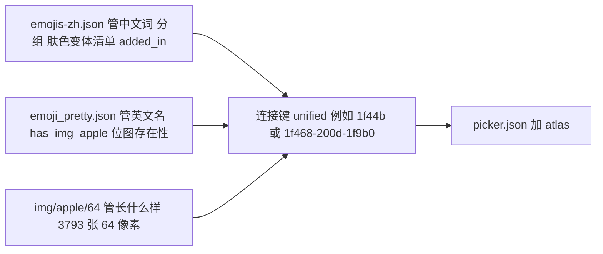
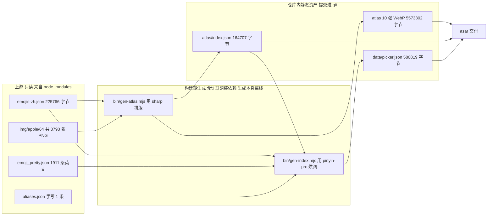
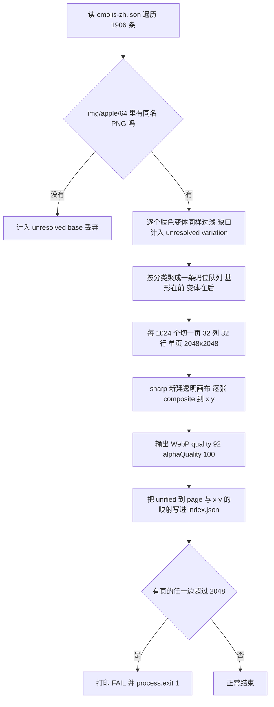
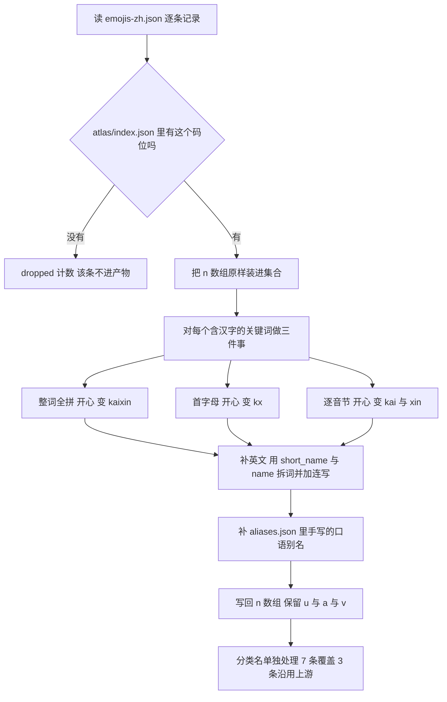
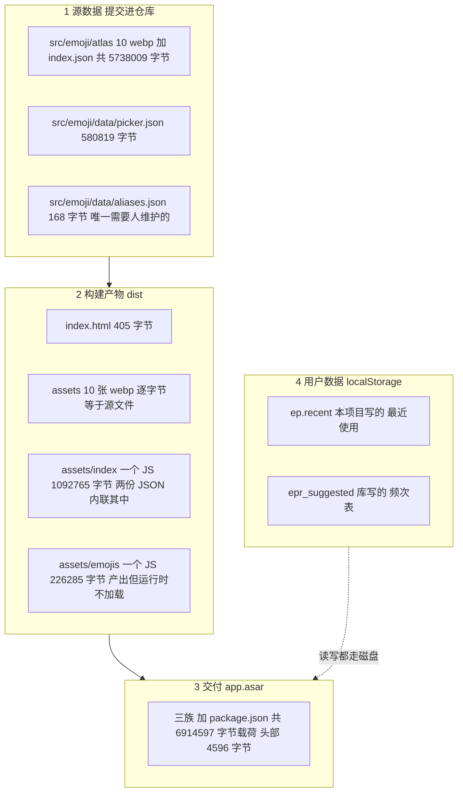

# 表情数据层：来源、获取方式、数据结构与离线存储

本文只讲数据：表情从哪来、怎么变成仓库里的文件、文件长什么样、交付时存在哪里、以及"运行时不联网"这句话是用什么判据证明的。组件与交互的部分见 `README.md`，命令怎么敲见 `doc/运行与构建（T0Level）.md`。

文中数字除两处明确标为"历史"的以外，都是 2026-10-11 本轮实测；出处在括号里标"本轮实测"或直接给 `文件:行号`。

---

## 0. 五分钟版

**新人小结**：把这套东西想成做一本带插图的字典。上游给了三样原料——一本中文词条本（`emojis-zh.json`）、一本英文词条本加一张"哪个词该配哪张照片"的清单（`emoji_pretty.json`）、一摞 3793 张 64 像素的证件照（`img/apple/64/*.png`）。我们的两个脚本是装订车间：车间把证件照按分类拼成 10 张大拼版（雪碧图），再把中文词、拼音、英文词统统抄进每个词条的关键词栏，装订出两本成书（`atlas/index.json` + `picker.json`）。成书之后，车间的全部工具（sharp、pinyin-pro、那 3793 张散图）都可以留在仓库里不进包——读者手上只有成书。

三条必须记住的结论：

| 结论 | 判据 |
| --- | --- |
| 运行时需要多少文件，就是那 10 个，全是 `file://` | `electron.exe --selftest` 打出 `network remote=0 local-files=10 [...]`（asar 与散目录两条路径各跑一次，同一份清单） |
| 拼音不是运行时算的，是构建期烘进数据的 | `bin/gen-index.mjs:73-80`；`picker.json` 每条记录平均带 27.3 个关键词，其中中文 9759 个、纯 ASCII 39942 个（本轮实测） |
| 上游数据有三个已知硬缺口，不是我们的 bug | `has_img_apple=false` 恰好 3 个，与 atlas 报的 3 个无法解析的字形是同一批（`emoji_pretty.json` / `bin/gen-atlas.mjs:115`） |

---

## 1. 数据来源

### 1.1 三份上游，各管一段

数据层只有一个真源原则：**位图归 emoji-data，中文词归 emoji-picker-react，两者的连接键是 Unicode 码位串**。

| # | 文件 | 所在包 / 版本 | 字节 | 提供什么 | 不提供什么 |
| --- | --- | --- | --- | --- | --- |
| 1 | `dist/data/emojis-zh.json` | emoji-picker-react@5.0.0 | 225,766 | 1906 条记录的中文关键词、分组归属、`added_in`、肤色变体列表、12 个分类名 | 位图、英文词、拼音 |
| 2 | `emoji_pretty.json` | emoji-datasource-apple@16.0.0 | 2,193,040 | 1911 个条目的英文名与 `short_names`、Unicode 归属、`has_img_apple` 位图存在性 | 中文、雪碧图本身 |
| 3 | `img/apple/64/*.png` | emoji-datasource-apple@16.0.0 | 3793 个文件 | 每个码位一张 64×64 的 Apple 风格 PNG | 任何文字信息 |
| 4 | `src/emoji/data/aliases.json` | 本项目，手写 | 168 | 上游词表缺的口语别名，当前 1 条 | — |

第 1 份的绝对路径是 `node_modules/emoji-picker-react/dist/data/emojis-zh.json`，两个生成脚本都从那里读（`bin/gen-atlas.mjs:14`、`bin/gen-index.mjs:19`）。

三份原料靠同一个键对齐——**小写零填充的 unified 码位串**。这张图就是整份文档的坐标：



**新人小结**：三本资料没有共同的编号体系，但都记着同一串十六进制码位，就像三个部门的档案都用身份证号索引。`1f44b` 是 👋，`1f468-200d-1f9b0` 里那个 `200d` 是零宽连接符，表示"男人 + 红发"拼起来的一个字形——这类序列在数据里保持原样，不做拆解。

**新人小结**：为什么中文词不从 emoji-data 拿？因为 emoji-data 只跟 Unicode 官方的 CLDR 英文 `short_name` 走，它压根没有中文。emoji-picker-react 是另一条线——它自己维护了 28 个语言的词表（本轮实测 `dist/data/` 下 29 个 `emojis*.json`：28 个带语言后缀，外加一份无后缀的默认 `emojis.json`，238,373 字节与 `emojis-en.json` 同尺寸），中文 `emojis-zh.json` 是其中之一，繁体 `emojis-zh-hant.json` 另算一份。所以要"中文 + Apple 图"，就必然跨两个包。

### 1.2 为什么是"三份拼一份"而不是换一个全包的数据集

被否掉的路线和它们的实测代价：

| 路线 | 为什么不走 |
| --- | --- |
| 用 emoji-mart / decoder-lite 这类自带 CDN 图片方案的选择器 | 图片运行时从 jsDelivr 拉，离线场景直接白框。emoji-picker-react 自己也一样：`dist/primitives/index.js` 里图片样式硬编码 `https://cdn.jsdelivr.net/npm/emoji-datasource-${f}/img/${f}/64/`，且 **没有 `assetPath` 之类的覆盖项**（本轮在该文件 grep 到模板串，且在产物 `dist/assets/index-*.js` 里也命中 1 次） |
| 用系统字体渲染原生 emoji | Windows 上是灰色轮廓、无 emoji 字体的 Linux 上是豆腐块，跨平台不一致，而这正是用户第一轮就定死的约束 |
| 只要 emoji-data 一份，中文自己做 | emoji_pretty 里没有任何 CJK 字符，等于要自己维护 1900 条中文词表 |
| 只要 emoji-picker-react 一份，图片用它的 CDN | 违反离线 |

所以最终是"各取一半，构建期拼接"。

### 1.3 许可与出处（交付物里要能答得上来）

| 资产 | 许可证 | 版权 / 仓库 | 取法 |
| --- | --- | --- | --- |
| emoji-picker-react@5.0.0 | MIT | `github.com/ealush/emoji-picker-react`（`package.json` 的 `license`/`repository` 字段） | `devDependencies`，构建期输入 |
| emoji-datasource-apple@16.0.0 | MIT | `Copyright (c) 2013 Cal Henderson`，`github.com/iamcal/emoji-data`（`LICENSE` 前 3 行本轮实测） | `devDependencies`，构建期输入 |
| 生成的 `atlas/*.webp`、`picker.json` | 派生作品 | 上游两个包都是 MIT 且**不要求第三方二进制再分发时附随源码**；MIT 要求的是"保留版权声明" | 提交进仓库 |

要落一行署名时的最短做法：把两份上游的 copyright 行写进关于面板或 `doc/`，并注明生成时间（`atlas/index.json` 里有 `generatedAt`，`picker.json` 里也有）。

### 1.4 上游中文数据的四处真实形状问题

这些不是推测，是本轮把 `emojis-zh.json` 全量读出来得到的：

| 现象 | 实测 | 后果与处置 |
| --- | --- | --- |
| **零拼音** | 上游 6081 个去重关键词里，纯 ASCII 只有 41 个（本轮实测） | 输 `kaixin` 搜不到 😄。必须由 `bin/gen-index.mjs` 烘进去 |
| **繁简混排** | 分类名里 `食物飲料`、`旅遊地點` 是繁体，其余简体（本轮读出 12 个分类名原文） | `gen-index.mjs:50-58` 用 7 条 `nameOverrides` 覆盖成简体 |
| **分类名不对题** | `smileys_people` 上游叫"人体"，`objects` 叫"物件"，`symbols` 叫"人的符号" | 同上，改成 笑脸与人物 / 物品 / 符号 |
| **特殊分类没有记录** | `emojis` 只有 9 个分组且 `custom: []`，`suggested` 不在 `emojis` 里 | 只在 `categories` 里补这两个名字（`gen-index.mjs:59-62`），否则选择器会回落英文标签 |

`emojis-zh.json` 的 1906 条按分组分布（本轮实测）：`smileys_people 555`、`animals_nature 159`、`food_drink 131`、`travel_places 218`、`activities 85`、`objects 264`、`symbols 224`、`flags 270`、`custom 0`。

### 1.5 覆盖率的硬边界：三个 Unicode 字形没有 Apple 位图

```
zh 需要的码位（含肤色变体）   3931   （本轮实测）
img/apple/64 有 PNG          3778
缺口                          153
  ├─ 基形 3 个   2640-fe0f  ♀️ 女性符号
  │              2642-fe0f  ♂️ 男性符号
  │              2695-fe0f  ⚕️ 医学符号
  └─ 肤色变体 150 个（Apple 对某些"人 × 肤色"组合没有出图）
```

这 3 个基形在 `emoji_pretty.json` 里被上游明确标了 `has_img_apple: false`，且**整个文件里为 false 的只有这 3 个**（本轮实测：`has_img_apple=false: 3 ["2640-FE0F","2642-FE0F","2695-FE0F"]`）。也就是说：我们这边报"找不到位图"，和上游报"这个平台没有图"，两件事完全对上——缺口是上游数据的事实，不是合成脚本漏了图。

反过来还有 15 张 PNG 是我们没用的：5 个单独的肤色修饰符（`1f3fb`–`1f3ff`，它们只作为变体后缀存在，本身不进格子）和 10 个 zh 词表没有收录的 ZWJ 序列（如 `1f468-200d-2764-200d-1f468`）（本轮实测）。

---

## 2. 获取方式

### 2.1 "获取"这一步不写下载脚本

**新人小结**：像买原料不是自己去山里采，而是下订单。订单就是 `package.json` 的 `devDependencies`，物流就是 npm。

| 时机 | 是否联网 | 取什么 | 落在哪 |
| --- | --- | --- | --- |
| `npm install` | **要** | emoji-picker-react、emoji-datasource-apple、pinyin-pro、sharp | `node_modules/` |
| `npm run ensure-electron` | **要** | Electron 44.7.0 运行时 zip（新版 Electron 没有 postinstall，必须显式跑；判据是 `node_modules/electron/dist/electron.exe` 存在，不是退出码 0） | `node_modules/electron/dist/` |
| `npm run gen` | **不要** | 只读 `node_modules` 与 `src/`，只写 `src/emoji/` | — |
| `npm run build` | **不要** | Vite + tsc | `dist/`、`dist-electron/` |
| 运行 | **零** | 见 §4.5 判据 | — |

版本号是钉死的：`emoji-datasource-apple`、`emoji-picker-react`、`pinyin-pro`、`sharp` 在 `package.json` 里写的都是精确版本（无 `^`），为的就是"换机重跑拿到同一份数据"。

> 一处需要人工维护的地方：`bin/gen-atlas.mjs:99` 把 `source: 'emoji-datasource-apple@16.0.0 img/apple/64'` **写成了字面量**。本轮核对它与实际安装版本一致（都是 16.0.0），但升级包时这行不会自动跟着变。

### 2.2 全链路



注意 `atlas/index.json` 同时是产物和输入：`gen-index.mjs:21,28` 读它来筛掉"没有格子的字形"。所以两条命令**有先后**，`npm run gen` 就是按这个顺序串的。

### 2.3 gen-atlas：把散图拼成分页雪碧图



关键常数的出处与作用：

| 常数 | 值 | 位置 | 为什么是这个值 |
| --- | --- | --- | --- |
| `CELL` | 64 | `gen-atlas.mjs:18` | 上游 `img/apple/64` 的原生尺寸；渲染时再用 CSS 缩到 30 或 18，不重采样位图 |
| `MAX_EDGE` | 2048 | `:19` | GPU 纹理上限通常 4096，取一半留余量；**同时约束宽和高** |
| `PER_AXIS` | 32 | `:20` | `floor(2048/64)` |
| `PER_PAGE` | 1024 | `:21` | `32 × 32`，一页装满就翻页 |

> `MAX_EDGE` 只卡宽是这一版修过的 bug：第一版按"宽 2048、高不限"排，得到一张 2048×4864 的图，直接翻过 4096 纹理上限，表现为部分格子不显示。现在用 `:107,117` 的 `over-limit pages` 自检挡住——超限时**脚本自己失败**，不靠人眼看日志。

本轮 `npm run gen:atlas` 的真实产出：

```
records with a sprite : 1903 / 1906
glyphs atlased        : 3778 (1903 base + 1875 variations)
atlas pages           : 10, 5,573,302 bytes total
largest edge (both)   : 2048 px  (limit 2048)
over-limit pages      : 0 ok
unresolved base       : 3 ["2640-fe0f","2642-fe0f","2695-fe0f"]
unresolved variations : 150 (Apple ships no bitmap for these skin combinations)
```

### 2.4 为什么不用上游已经拼好的整图

`emoji-datasource-apple` 其实自带预制雪碧图，本轮实测：

| 文件 | 尺寸 | 字节 |
| --- | --- | --- |
| `img/apple/sheets/64.png` | 4092×4092 | 19,999,794 |
| `img/apple/sheets-clean/64.png` | — | 19,995,622 |
| `img/apple/sheets/` | 另有 `16.png`、`20.png`、`32.png` | — |

不用它的三条理由：

1. **体积**：一张 20 MB 的 PNG，而我们真正需要的 3778 个格子合成 WebP 后是 5.57 MB（`gen-atlas` 汇总行），差 3.6 倍。
2. **纹理上限**：4092 已经贴着 4096 的上限走，没有余量。
3. **坐标体系是别人的**：`emoji_pretty.json` 里的 `sheet_x`/`sheet_y` 最大到 61（本轮实测），那是 emoji-data 自己的 62×62 网格顺序，包含我们不用的条目，也没有"按我们的分类分页"这件事。用它的整图等于把排序、分页、缺图过滤三件事在运行时重做一遍。

> 顺带纠正一个早期错误结论：本项目一开始判断"emoji-datasource 没有现成雪碧图"，**这句话是错的**，`sheets/` 一直在。上面的取舍是拿到事实之后重做的，不是原始结论。

### 2.5 gen-index：把搜索能力烘进数据



三步展开的必要性，用一个真实记录验证（本轮从 `picker.json` 里取 `1f44b` 👋，它共 44 个关键词）：

```json
["嗨","手","挥手","你好","再见","在吗","等等","等一下","该走了",
 "hei","h","shou","s","huishou","hs","hui","nihao","nh","ni","hao",
 "zaijian","zj","zai","jian","zaima","zm","ma","dengdeng","dd","deng",
 "dengyixia","dyx","yi","xia","gaizoule","gzl","gai","zou","le",
 "wave","waving","hand","sign","wavewavewavinghandsign"]
```

- 只有全拼：输 `hs`（挥手）搜不到。
- 只有首字母：`h` 会命中几百条，且 `huishou` 搜不到。
- 只有逐音节：`kaixin` 这种连着打的常见输入搜不到。
三样都放进去，选择器自带的匹配器（对 `n` 做子串匹配）就能一次覆盖，**运行时不需要任何搜索代码**。这是本项目数据层最重要的一条设计取舍。

这条取舍不是推论，本轮用交付物自己跑了一遍——`--query=` 会把文本真的一格格打进选择器搜索框，然后读库自己的 `aria-live` 播报：

| 输入 | 走的是哪条烘焙 | 结果数（本轮实测） |
| --- | --- | --- |
| `kx` | 首字母（开心） | 34 |
| `kaixin` | 整词全拼 | 12 |
| `xiaolian` | 整词全拼（笑脸） | 12 |
| `大拇指` | `aliases.json` 手写别名 | 1 |
| `绿色` | 中文原词 | 7 |
| `lüse` | 全拼（带 `ü`） | 7 |
| `lvse` | 用户实际会打的 ASCII 形式 | **0，"没有匹配的表情"** |

最后一行是数据层当前一个真实缺口，机制与修法见 FAQ Q9。

> 读探针输出时的一个口径差：`cells=` 是 `[data-epr-unified]` 的 DOM 计数，本轮 `kaixin` 时它比播报多 1（13 vs 12），因为有一个非结果节点也带这个属性。**结果数以 `announced=` 的播报为准**，别拿 `cells` 当命中数。

英文侧的覆盖率本轮实测：1906 条 zh 记录里 **1906 条都能在 `emoji_pretty.json` 找到对应条目**（按 `unified` 小写匹配），所以没有"只有中文没有英文"的记录。

### 2.6 判据与确定性

| 判据 | 命令 | 本轮实测结果 |
| --- | --- | --- |
| 没有超限页 | `npm run gen:atlas` | `over-limit pages : 0 ok`，退出码 0；有超限则 `:117` 直接 `exit 1` |
| 格子对齐 | `npm run verify:atlas` | 13 个抽样字形，最大同位差 3.88/255（闸门 6），最小正确/远格比值 18.7×（闸门 3），`suspect: 0` |
| 上述闸门会失败 | `SHIFT_CELLS=1 npm run verify:atlas` | 退出码 **1**，12/13 判为 SUSPECT，最大差 77.52——证明判据不是摆设 |
| 生成可复现 | 重跑 `npm run gen` 前后对比 12 个产物 md5 | **全部 12 个字节相同**（10 张 WebP + `index.json` + `picker.json`） |
| 烘焙后的搜索面真的可用 | `electron.exe . --selftest --query=<词>` | 中文 / 全拼 / 首字母 / 别名 四挡各出结果（逐条数字见 §2.5 的表） |

> 确定性的边界要说清：`index.json` 与 `picker.json` 各含一个 `generatedAt`（`gen-atlas.mjs:97`、`gen-index.mjs:107`，取 `new Date().toISOString().slice(0,10)`，日期粒度）。本轮两次重跑在同一天，所以整体 md5 相同；**跨天重跑这两份 JSON 的哈希会变**，10 张 WebP 不含时间戳所以仍相同。要比对哈希就排除这两份，或先归一 `generatedAt`。

---

## 3. 数据基本结构

### 3.1 四层，各司其职

| 层 | 文件 | 谁读它 | 回答的问题 |
| --- | --- | --- | --- |
| 契约层 | `node_modules/emoji-picker-react/dist/data/emojis-zh.d.ts:18-23` | 类型检查 | 一条记录必须有哪些字段 |
| 词表层 | `src/emoji/data/picker.json`（580,819 字节） | `Picker.tsx:3` 静态 import | 搜什么出什么、分类叫什么、有没有肤色变体 |
| 位图层 | `src/emoji/atlas/*.webp`（10 张，5,573,302 字节） | CSS `background-image` | 这个码位长什么样 |
| 坐标层 | `src/emoji/atlas/index.json`（164,707 字节） | `atlas.ts:2` 静态 import | 这个码位在哪一页的哪个 x,y |

**新人小结**：词表像图书馆的目录卡片，位图是那排书，坐标层是"这本书在第几排第几格"。三者用同一个键串起来——Unicode 码位串（如 `1f44b`），全小写、零填充、多码位用 `-` 连接，变体形式 `-fe0f` 和零宽连接 `200d` 都留在串里。

### 3.2 记录契约：四个字段

上游 `DataEmoji` 的声明（本轮直接读 `emojis-zh.d.ts:18-23`）：

```ts
interface DataEmoji {
    n: string[];   // 关键词，也是唯一的搜索面
    u: string;     // unified 码位串
    v?: string[];  // 肤色变体的完整码位串列表
    a: string;     // added_in，Emoji 版本
}
```

`picker.json` 里 1903 条记录实际只出现两种形状（本轮实测）：

| 字段组合 | 条数 |
| --- | --- |
| `a,n,u` | 1580 |
| `a,n,u,v` | 323 |

没有多余字段，也没有缺字段——因为 `gen-index.mjs:99` 是重新构造对象而不是原地改：`{ n: [...names], u: rec.u, a: rec.a, ...(v.length ? { v } : {}) }`。注意最后一项：**变体全被过滤掉的记录不会留下一个空 `v`**，否则选择器会渲染出一排点不出图的肤色按钮。

| 字段 | 值的形状 | 实测分布 |
| --- | --- | --- |
| `u` | `[0-9a-f]+(-[0-9a-f]+)*` | 含 `-fe0f`（变体选择符）与 `-200d-`（ZWJ）序列 |
| `n` | 字符串数组，无重复 | 平均 27.3，最多 84（`1f972`），全体去重 18,310 个 |
| `a` | Emoji 版本号字符串 | `0.6` 719 条、`0.7` 139、`1` 170、`2` 271、…、`16` 8（本轮实测 16 个不同取值，合计 1903） |
| `v` | 子码位串数组 | 323 条带 `v`，展开 1875 个变体码位，全部在 atlas 里有格子 |

`a` 的取值范围与上游一致：`emoji_pretty.json` 的 `added_in` 最小 0.6 最大 16（本轮实测），说明这个字段是从 zh 数据原样透传、没有加工。

### 3.3 坐标层结构

```jsonc
// src/emoji/atlas/index.json
{
  "generatedAt": "2026-10-11",
  "cell": 64,
  "source": "emoji-datasource-apple@16.0.0 img/apple/64",
  "atlases": [
    { "cat": "smileys_people", "page": 0, "file": "smileys_people.webp",
      "cols": 32, "rows": 32, "width": 2048, "height": 2048,
      "glyphs": 1024, "bytes": 1430124 }
    // ... 共 10 条
  ],
  "glyphs": {
    "2615": { "a": 4, "x": 640, "y": 512 }   // a = atlases 的下标
    // ... 共 3778 条
  }
}
```

10 页的真实参数（本轮从 `index.json` 读出）：

| 下标 | 文件 | 列×行 | 像素 | 格子数 | 字节 |
| --- | --- | --- | --- | --- | --- |
| 0 | `smileys_people.webp` | 32×32 | 2048×2048 | 1024 | 1,430,124 |
| 1 | `smileys_people-p2.webp` | 32×32 | 2048×2048 | 1024 | 1,485,412 |
| 2 | `smileys_people-p3.webp` | 20×20 | 1280×1280 | 382 | 567,820 |
| 3 | `animals_nature.webp` | 13×13 | 832×832 | 159 | 338,194 |
| 4 | `food_drink.webp` | 12×11 | 768×704 | 131 | 236,954 |
| 5 | `travel_places.webp` | 15×15 | 960×960 | 218 | 401,556 |
| 6 | `activities.webp` | 10×9 | 640×576 | 85 | 163,352 |
| 7 | `objects.webp` | 17×16 | 1088×1024 | 264 | 463,124 |
| 8 | `symbols.webp` | 15×15 | 960×960 | 221 | 227,984 |
| 9 | `flags.webp` | 17×16 | 1088×1024 | 270 | 258,782 |
| | **合计** | | | **3778** | **5,573,302** |

三点值得注意：

- 只有 `smileys_people` 需要翻页，因为**全部 1875 个肤色变体都落在这一个分组里**（本轮实测：其余 7 个分组的变体数都是 0，且没有任何变体跨页存放）。它的格子数 555 + 1875 = 2430，正好是 `1024 + 1024 + 382` 三页。分页规则是**先按分类切、再按 1024 切**，所以同一分类的格子永远连续排在相邻页，翻页只影响该分类；8 个分组的格子数相加 3778 与 atlas 总数吻合。
- 末页不满时 `cols/rows` 会缩小（`p3` 是 20×20 而不是 32×32，`gen-atlas.mjs:65-66` 取 `ceil(sqrt(n))` 再夹到 `PER_AXIS`），产物是接近正方形的图，不给空白的 2048×2048 交矩形。
- `symbols` 221 格 = zh 的 224 条 − 那 3 个没有位图的基形。这一处对得上，就是 §1.5 那条因果链的验证。

### 3.4 词表层结构

```jsonc
// src/emoji/data/picker.json
{
  "generatedAt": "2026-10-11",
  "cell": 64,
  "categories": {                       // 10 条
    "smileys_people": { "category": "smileys_people", "name": "笑脸与人物" },
    "animals_nature": { "category": "animals_nature", "name": "野生动物" },
    "suggested":      { "category": "suggested",      "name": "常用" },
    "custom":         { "category": "custom",         "name": "自定义表情" }
    // ...
  },
  "emojis": {                           // 8 个分组 1903 条
    "smileys_people": [ /* 555 */ ],
    "animals_nature": [ /* 159 */ ]
    // ...
  }
}
```

分类名的两个来源，本轮实测清点下来是 **7 条覆盖 + 3 条沿用**：

| 分类 | 名 | 来源 |
| --- | --- | --- |
| smileys_people / food_drink / travel_places / objects / symbols | 笑脸与人物 / 食物饮料 / 旅游地点 / 物品 / 符号 | `gen-index.mjs:50-58` 覆盖（上游是 人体 / 食物飲料 / 旅遊地點 / 物件 / 人的符号） |
| suggested / custom | 常用 / 自定义表情 | 同上覆盖，且这两个在 `emojis` 里没有记录，只靠 `categories` 提供标签 |
| animals_nature / activities / flags | 野生动物 / 个人活动 / 旗帜 | 沿用上游（`gen-index.mjs:102` 的回填分支） |

`cell: 64` 是从 `atlas/index.json` 透传进 `picker.json` 的（`gen-index.mjs:108`），两份产物的格子基准因此不会各自漂移。

### 3.5 统计口径汇总（全部本轮实测）

| 指标 | 值 |
| --- | --- |
| 词表记录数 | 1903（上游 1906 − 缺位图 3） |
| 分组数 | 8（`suggested`/`custom` 无记录） |
| 关键词总数 | 51,985（含重复），去重 18,310 |
| 每条平均关键词 | 27.3 |
| 汉字关键词 / 纯 ASCII 关键词 | 9759 / 39942 |
| 构建期插入量 | 拼音 44,652、英文 13,761、别名 1 |
| 带肤色变体的记录 | 323，变体码位 1875 |
| atlas 格子 | 3778 = 基形 1903 + 变体 1875 |
| 词表长度分布 | 1–4 字符 36,251；5–8 字符 10,413；9–12 字符 2,334；13+ 字符 2,987 |

---

## 4. 数据离线存储

### 4.1 四类落点，谁都不许碰网络



### 4.2 sprite 定位的数学：一个格子怎么算出来

`src/emoji/atlas.ts:20-33` 是全项目唯一产生像素位置的地方。**新人小结**：拿一张大壁纸，把窗口推到它上面——背景图整体缩小，然后把要露出来的那一格推到左上角。缩小比例必须同时作用在"整张图"和"格子偏移"上，否则推的位置就不对。

以 ☕ `2615` 为例（`index.json` 里真实值）：

```
格子坐标     a=4  x=640  y=512      → 第 4 页 food_drink.webp，768×704
源格子      CELL=64（atlas.ts:18 读 index.json 的 cell）
目标尺寸    GLYPH_PX=30（SpriteCell.tsx:4）
缩放        scale = 30 / 64 = 0.46875

width / height        = 30px  30px
backgroundSize        = 768×0.46875 = 360px    704×0.46875 = 330px
backgroundPosition    = -640×0.46875 = -300px  -512×0.46875 = -240px
backgroundRepeat      = no-repeat
```

两个必须留意的实现细节：

1. `atlas.ts:6-10` 用 `import.meta.glob('./atlas/*.webp', {eager:true, query:'?url'})` 拿 URL。**这一步是离线的关键**：Vite 把每个 `.webp` 变成带哈希的相对路径（`vite.config.mts:6` 的 `base: './'` 决定它是 `./assets/...` 而不是 `/assets/...`），于是运行时解析成 `file://`。若 `base` 留默认值 `/`，`file://` 会把 `/assets/` 解析到磁盘根，表现是白屏且不报错。
2. `atlas.ts:14` 找不到文件时**抛异常**而不是返回 `null`：`atlas "x" was not bundled - rerun npm run gen:atlas`。缺图不能静默降级成文字，那样只有肉眼能发现。

分类图标走同一套数学，只是 `CATEGORY_ICON_PX = 18`（`Picker.tsx:15-32`）——如果这里改用系统 emoji 字体，Windows 上会是一排灰色轮廓，等于把离线的意义抹掉一半。

### 4.3 交付链路的字节配平

本轮把 `dist/`、`dist-electron/`、`package.json` 打包成 `app.asar` 后逐文件核对。这份 asar 是用 `node bin/make-asar-probe.mjs` 手拼的（`@electron/asar` + 拷一份本地 Electron 运行时），**不是** `electron-builder` 的产出——builder 本轮连续三次卡在解包阶段的文件锁上，处置与影响范围见 §5 的"未验证"表：

| 项 | 字节 | 说明 |
| --- | --- | --- |
| 10 张 WebP | 5,573,302 | **与 `src/emoji/atlas/` 里的源文件逐字节相同**（Vite 不做二次压缩） |
| `index-CGOHk1F0.js` | 1,092,765 | 含 app 代码 + 两份 JSON 的内容（词表与坐标表被转成对象字面量内联，`dist/` 里没有独立的 JSON 文件；bundle 内可 grep 到 `大拇指`、`gaizoule`） |
| `emojis-6L3GRBAP-JwMwUiq0.js` | 226,285 | 库自带英文数据集的分块，见 §4.6 |
| `index-_QWspCg8.css` | 2,286 | |
| `index.html` | 405 | |
| `dist-electron/main.js` + `preload.js` | 17,945 + 390 | |
| `package.json` | 1,219 | |
| **载荷合计** | **6,914,597** | |
| `app.asar` 实际 | 6,919,193 | 差额 **4,596 字节 = asar 头部索引** |
| asar 顶层族 | 3 | `dist=16`、`dist-electron=3`、`package.json=1`，**没有 `node_modules`** |

`node_modules` 之所以不在里面：`package.json` 的 `dependencies` 是空的（本轮读出 `{}`），全部依赖都在 `devDependencies`。electron-builder 会按 `dependencies` 无条件附带 `node_modules`，`files` 白名单拦不住它——所以"三族"是数据层离线方案能成立的结构性前提。

### 4.4 用户数据存在哪

| 键 | 谁写 | 内容 | 出处 |
| --- | --- | --- | --- |
| `ep.recent` | 本项目 | 最近使用的码位串数组，上限 12 个（`src/App.tsx:8` `RECENT_MAX`） | `src/App.tsx:7,12,29` |
| `epr_suggested` | emoji-picker-react | 频次表，喂给 `suggestedEmojisMode="frequent"` 的"常用"分类 | `node_modules/emoji-picker-react/dist/primitives/index.js` 里 grep 到该键名 |

两条都在 Chromium 的 LevelDB（`userData/Local Storage/`）里，不是文件系统上的自定义 JSON。**这意味着数据层是"只读静态资产 + 两个用户态键"**：清掉这两个键，表情数据和搜索能力完全不受影响，只是"常用"退回默认集。

### 4.5 "运行时零网络"的判据

这句话原来只是推断，现在有一条会自己失败的断言。实现在 `electron/main.ts:113-143`：

```ts
// main.ts:115-129
session.defaultSession.webRequest.onBeforeRequest({ urls: ['<all_urls>'] }, (details, callback) => {
  const scheme = details.url.slice(0, details.url.indexOf(':')).toLowerCase();
  if (scheme === 'file' || scheme === 'data' || scheme === 'blob') {
    if (scheme === 'file') { /* 记进 localFiles */ }
    callback({});
    return;
  }
  remoteRequests.push(details.url);
  callback({ cancel: true });      // 不只是统计，真的掐断
});
```

设计上刻意做了三件事，防止判据自己骗自己：

| 做法 | 防的是哪种假绿 |
| --- | --- |
| 同一条钩子**同时数 `file://`** | 钩子根本没挂上时，`remote=0` 也成立。本地计数 > 0 才证明它在收事件 |
| 远程请求 `cancel: true` | 只观测不阻断，那么即使 CDN 真被请求到，页面照样正常显示，"零网络"就成了事后诸葛 |
| 加 `--netprobe` 反向对照 | 主动发一次那条 CDN 请求，看钩子接不接得住 |

本轮在两条代码路径上各跑一次（散目录用 `node_modules/electron/dist/electron.exe`，asar 用手工拼的 `release-asar/asar-probe/electron.exe`）：

```
# 正常自证
network remote=0 local-files=10 [activities-BtbfQXju.webp, animals_nature-D675x_Qi.webp,
  flags-B0yFFqUZ.webp, food_drink-BSwL7za4.webp, index-CGOHk1F0.js, index-_QWspCg8.css,
  index.html, objects-yuFLJoJ-.webp, smileys_people-DQENCrhP.webp, travel_places-Bb8pMWgk.webp]

# 反向对照 --netprobe
netprobe control-fetch=REJECTED Failed to fetch
network remote=1 local-files=10 [...同样 10 个...] ["https://cdn.jsdelivr.net/npm/emoji-datasource-apple@16.0.0/img/apple/64/1f600.png"]
```

两条路径的清单**逐项相同**，说明 asar 这层不影响网络行为，也说明上面 §4.3 的载荷确实就是运行时读到的全部。

复现这两条命令（`release-asar/` 不在交付清单里，随时可删可重建）：

```
node bin/make-asar-probe.mjs                                   # 拷 Electron 运行时 + 手拼 resources/app.asar
node_modules/electron/dist/electron.exe . --selftest --netprobe # 散目录路径
cd release-asar/asar-probe && ./electron.exe --selftest --netprobe # asar 路径
```

从这份清单还能读出三件附带事实：

1. **只读了 7 张 WebP，不是 10 张**：`symbols`、`smileys_people-p2`、`p3` 没被请求。首屏不必解码全部拼版，分页在这里有实测收益（虽然它们在同一个包里，省的是解码开销不是体积）。
2. **`emojis-*.js` 没被请求**（清单里没有它），这就是 §4.6 那条死路径没走通的直接证据。
3. **同一次运行的两次 `new Image()` 探测没有增加文件数**，说明按去重后的文件计数是对的口径（钩子里用 `Map` 记次数，本轮所有条目都是 1 次）。

顺带一条交叉校验：探针打出 `atlas=animals_nature-...webp decoded=832x832`，而 `index.json` 里 `animals_nature.webp` 的尺寸正是 832×832——运行时解码到的位图尺寸和构建期清单记的尺寸一致，说明取到的是对的那一页。

### 4.6 产物里那条 CDN 字符串，和它为什么走不到

诚实的写法是：**`https://cdn.jsdelivr.net/npm/emoji-datasource-` 这个串确实在交付物里**（`dist/assets/index-CGOHk1F0.js` 内命中 1 次，本轮实测）。它的来源是 emoji-picker-react 的图片样式实现，本轮在 `dist/primitives/index.js` 里 grep 到模板：

```js
`https://cdn.jsdelivr.net/npm/emoji-datasource-${f}/img/${f}/64/`   // 拼上 ${unified}.png
```

走不到的原因是我们没让它有机会被调用：

| 挡住它的东西 | 位置 |
| --- | --- |
| `emojiStyle="native"` | `Picker.tsx` 的 `Picker.Root`，库在这个分支不产出图片 URL |
| 自绘格子 `components={{ Emoji: SpriteCell }}` | `Picker.tsx:10`，渲染只走 `atlas.ts` 的 `file://` 背景图 |
| 传入自己的 `emojiData` | `Picker.tsx:9`；`dist/data/defaultEmojiData.js` 开头注释写明 primitives **不注册**默认英文数据集 |
| 兜底断言 | `main.ts` 的网络钩子，一旦有人改回图片样式，`remote` 立刻变非零 |

第三点还有个可见的副作用值得知道：因为库的英文数据集仍是**动态 import** 的目标，Vite 照样把 `emojis-6L3GRBAP-JwMwUiq0.js`（226,285 字节）产出并打进 asar，只是没人去加载它。它现在占包体约 3.3%，是"产物存在"与"运行时用到"必须分开看的活例子。要彻底剔掉它得改库的导入方式，本项目选择不改，判据改为"确认它不被加载"。

---

## 5. 验证台账

### 已核（本轮实跑，含方法）

| # | 命题 | 方法 |
| --- | --- | --- |
| 1 | 三份上游的字节数、条目数、字段集 | `fs.statSync` + `JSON.parse` 全量枚举（`emojis-zh` 1906 条、`emoji_pretty` 1911 条 25 个字段并集） |
| 2 | 3 个基形缺图是上游事实 | `emoji_pretty.json` 里 `has_img_apple=false` 计数与列表，和 `gen-atlas` 的 `unresolved base` 逐值对齐 |
| 3 | 生成可复现 | 重跑 `npm run gen`，前后 12 个产物 md5 全等 |
| 4 | 分页与纹理上限 | `index.json` 读出 10 页尺寸，最大边 2048；`over-limit pages: 0` |
| 5 | 格子对齐 | `npm run verify:atlas` 13 样本，判据 `suspect: 0` |
| 6 | 上述判据会失败 | `SHIFT_CELLS=1` 得 12 SUSPECT、退出码 1 |
| 7 | 搜索面覆盖中文/全拼/首字母/别名/英文 | 数据侧：`picker.json` 里探测 `kaixin`、`kx`、`xiaolian`、`thumbs`、`大拇指`、`heart` 全部存在。交付物侧：`--selftest --query=` 逐条跑出 34 / 12 / 12 / 1 / 7 个结果，并跑 `lvse`=0 与 `lüse`=7 的对照 |
| 8 | 肤色变体全在一个分组内、不跨页 | 逐分组数 `v`：smileys_people 1875，其余 7 组 0；8 组格子数相加 = 3778 |
| 9 | 运行时零网络 | 两条交付路径 × `--selftest` / `--selftest --netprobe` 四组数，`remote=0` 且 `local-files=10`，对照 `remote=1` 且 fetch 被拒 |
| 10 | asar 只有三族 | `@electron/asar.listPackage` 枚举 20 条，族为 `dist` / `dist-electron` / `package.json`（手拼的 asar，见 §4.3） |
| 11 | 载荷字节配平 | 逐文件求和 6,914,597 对 asar 6,919,193，差额 4,596 归头部 |
| 12 | WebP 未被二次压缩 | `dist/assets` 内 10 张逐字节合计 5,573,302，与 `src/emoji/atlas` 合计相同 |
| 13 | 类型与构建 | `npm run typecheck` 双侧 0；`npm run build` 0 |
| 14 | 文档里的图能过语法关 | 5 个 mermaid 块跑静态语法检查（括号/引号/竖线配平、subgraph 与 end 对数、箭头两端与节点声明齐全）全部 0 失败；同一个检查器对故意写坏的样例报出 14 处失败，说明它不是空转。检查器是一次性脚本（放在系统临时目录，**不在本仓库里**）。**没有过真正的 mermaid 解析器** |

### 未验证（说明原因）

| 项 | 原因 |
| --- | --- |
| `electron-builder` 正式产出的 `release/win-unpacked` 上的同一组网络数字 | 本轮三次构建全部卡在解包阶段的文件锁（两次 `EPERM rename win-unpacked.tmp`、一次 `EBUSY unlink default_app.asar`）。**没有用杀进程绕过**。改用手拼 `app.asar` + 复制 Electron 运行的方式取数，两条路径的清单逐项相同，但那是 `resources/app.asar` 的加载路径，不是 builder 的完整交付物 |
| 上游另外几份元数据（`emoji-datasource-apple` 的 `categories.json`、`emoji.json`；`emoji-picker-react` 的 `dist/data/groups.js`）与本项目数据的关系 | 本轮只确认了它们在包里存在（`ls` 结果），没有读内容；本项目一条都没用到 |
| Linux / macOS 上的同一判据 | 本机只有 Windows；`file://` 与钩子行为按 Chromium 语义应当一致，但没有实测 |
| 词表里 15 个未被使用 PNG 的具体清单是否全部符合预期 | 只列了前 8 个样本与总数 15，未逐个核对语义 |

---

## 6. FAQ

**Q1：为什么不直接用 `img/apple/sheets/64.png`，省掉整个 `gen-atlas`？**
体积 19,999,794 字节 vs 我们自己合成的 5,573,302 字节（本轮实测），且 4092 的边长贴着 4096 纹理上限。它的 `sheet_x`/`sheet_y`（最大 61）是 emoji-data 的网格顺序，不是我们过滤后的顺序；用了它就得在运行时重做缺图过滤和分页。自查动作：`npm run gen:atlas` 的 `over-limit pages` 行必须是 0。

**Q2：拼音为什么构建期算，不运行时算？**
`pinyin-pro` 只在 `devDependencies`（本轮 `package.json` 读出 `dependencies: {}`）。若在运行时算，要么把拼音库打进 bundle，要么给每条记录做二次遍历；而搜索是每次击键都跑的。烘进 `n` 之后运行时的搜索代码是 0 行，代价是 `picker.json` 从约 226 KB（上游 zh 原文）涨到 580,819 字节。构建期插入量本轮实测：拼音 44,652、英文 13,761。

**Q3：首字母搜索这么含糊，为什么还敢开？**
数据自己说明了严重程度：`bin/gen-index.mjs:129-133` 的自检打印出 **283 个两字母 token 命中 ≥10 条记录**，最差几个是 `qi` 427 条、`q` 326 条、`shi` 325 条（本轮实测）。所以首字母只能当"能搜到"，不能当"排得对"。库没暴露重排钩子，本项目用"常用"分类（`suggestedEmojisMode="frequent"` + `epr_suggested` 频次表）绕开排序问题。

**Q4：三个没有 Apple 图的字形，界面会出什么问题？**
它们不会进 `picker.json`：`gen-atlas.mjs:33-36` 跳过、`gen-index.mjs:67-70` 再筛一次。所以词表 1903 = 1906 − 3，`symbols` 分类 224 → 221。后果只是 ♀️♂️⚕️ 搜不到——而且上游 `emoji_pretty.json` 对这 3 个正是 `has_img_apple: false`（本轮实测），属于源数据边界，不是合成漏图。

**Q5：产物里为什么还有 jsDelivr 的地址？离线是不是没做干净？**
字符串确实在（`index-CGOHk1F0.js` 内 1 次），调用路径被 `emojiStyle="native"` + 自绘 `SpriteCell` + 自带 `emojiData` 三层挡掉（`Picker.tsx:9-10`）。判据不是"我觉得走不到"，而是 `--netprobe`：主动请求那条 URL 时钩子报 `remote=1` 且 fetch 被拒，正常运行时报 `remote=0`。自查动作：跑 `electron.exe --selftest --netprobe`，看最后两行。

**Q6：为什么 `emojis-6L3GRBAP-JwMwUiq0.js` 这个 226 KB 的文件在包里却没人加载？**
库的英文数据集是动态 import 的目标，即使我们传了 `emojiData`，打包器仍会产出这个分块。`--selftest` 的 `local-files` 清单里没有它，就是"产出但未加载"的直接证据（见 §4.6）。剔掉它需要改库的导入形态，本项目改为用判据守住"不被加载"。

**Q7：换一个 emoji 版本要动哪几处？**
① `package.json` 里 `emoji-datasource-apple` 的版本；② `bin/gen-atlas.mjs:99` 那个**硬编码的 `source` 字符串**（升级时不会自动跟随，本轮核对当前一致）；③ 重跑 `npm run gen`；④ 重跑 `npm run verify:atlas`。新增的字形因为没有格子会被自动跳过，所以不会白屏——但"搜得到却显示不出来"就反过来了：以 `atlas/index.json` 为准筛词表，方向是**图缺则词删**。

**Q8：`picker.json` 里混进了 `:`、空格、`，` 这些没用的 token，要紧吗？**
要紧但不致命，本轮实测：`:` 出现在 336 条记录、空格 349 条。机制是 `gen-index.mjs:74-79` 用 `CJK.test(t)` 判整串——像 `男人: 红发` 这种"汉字夹标点的关键词"判定为真，`pinyin()` 会把 `:`、` ` 当独立音节原样返回，于是它们被当成拼音词加了进去（`pinyin('男人: 红发', {type:'array'})` 本轮实测返回 `["nan","ren",":"," ","hong","fa"]`）。搜索时 `"笑".includes(":")` 为假，所以正常输入不受影响；但用户直接搜 `:` 会命中 336 条。修法：加进 `n` 之前对拼音输出做一次"只留汉字或字母数字"的过滤。

**Q9：为什么 `lvse`（绿色）搜不到，`lüse` 能搜到？**
本轮两组数都在：交付物实跑 `--query=lüse` 报 **7 个结果**、`--query=绿色` 同样 7 个、`--query=lvse` 报 **"没有匹配的表情"**；直接在 `picker.json` 里数持有该 token 的记录数则是 `lüse` 3 条、`lvse` 0 条（两个口径不矛盾：3 是"谁的 `n` 里有这个词"，7 是"子串匹配能捞到谁"，`tianlüse` 之类也含 `lüse`）。机制是 `pinyin-pro` 在 `toneType:'none'` 下给"绿"返回 `lü`（实测 `pinyin('绿')` → `["lü"]`），数据里没有做 `ü → v` 的 ASCII 归一。键盘上多数人会打 `lv`。这是**当前数据层一个真实的覆盖缺口**，不是配置问题；顺带说明那个孤零零的 `lv` token 存在纯属巧合——它来自英文短名 `flag_lv`（拉脱维亚国旗，本轮定位到唯一一条记录）。修法同 Q8 的过滤那一步：为每个含 `ü/ö/ä/ñ` 的 token 追加一份 ASCII 变体。


**Q10：删掉 `src/emoji/atlas/` 或 `picker.json`，应用还能跑吗？**
不能，而且失败得很干脆：`atlas.ts:14` 在文件没被打包时抛异常，`Picker.tsx:3` 的静态 import 在构建期就报错。这两份是**提交进仓库的源数据**，不是构建中间物——`npm run build` 不会重新生成它们（本轮读 `bin/build.mjs` 确认它只跑 Vite 和 tsc），只有 `npm run gen` 会。所以 `.gitignore` 里绝不能有 `src/emoji/atlas`；而 `dist/`、`dist-electron/` 才是可删的中间物。
