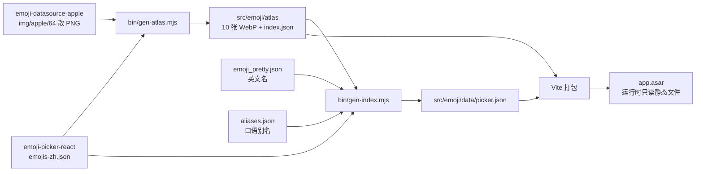

# 表情选择器 零基础上手（T0Level）

读者设定：从没碰过这个工程的人。本文每条命令都在本机（Windows 10.0.26300 / x64）跑过，输出原样贴在对应小节；没跑过的行显式标 `未验证` 并给原因，全部汇总在第 8 节。

一句话概括这个工程在做什么：**把 Unicode 表情的图、词、索引三样东西在构建期全部落成仓库内静态文件，运行时零网络。** 所以只要 `src/emoji/atlas/` 和 `src/emoji/data/picker.json` 在，断网也能跑。

数据管线：



---

## 0. 前置

| 项 | 实测值 | 口径 |
| --- | --- | --- |
| Node | v24.21.0 | `node -v`，装在 `C:\Program Files\nodejs` |
| npm | 11.19.0 | `npm -v` |
| electron | 44.7.0 | `package.json` 精确钉版 |
| react / react-dom | 19.3.0 | 同上 |
| vite | 8.3.4 | 同上 |
| typescript | **5.9.3** | 见下方"为什么不用 TS 7" |
| emoji-picker-react | 5.0.0 | 2026-10-10 发布 |
| emoji-datasource-apple | 16.0.0 | Unicode 16 |
| sharp | 0.35.5 | 仅构建期 |
| pinyin-pro | 3.29.5 | 仅构建期 |

**为什么 typescript 钉 5.9.3**：本工程主进程 tsconfig 用 `moduleResolution: "node"`（Electron 脚手架 skill 的既定口径），而 TypeScript 7 已移除该取值。升 TS 主版本要连带改两侧 tsconfig，属独立任务，不要顺手改。

**registry 与二进制源**：npm registry 可达。Electron/electron-builder 的二进制**默认走 npmmirror**（`bin/electron-win-build.ps1` 注入 `ELECTRON_MIRROR` 与 `ELECTRON_BUILDER_BINARIES_MIRROR`）。原因：`HEAD https://github.com/electron/electron/releases` 返回 200，但 electron-builder 去 GET release 对象时 `connect ETIMEDOUT` —— HEAD 与 GET 打的是不同主机，**探测证不住下载**，所以镜像默认注入，要官方源显式加 `-NoMirror`。注意镜像的 SHASUMS 校验也走同一源，注入即等于信任该源。

**不该提交的东西**：`node_modules/`、`dist/`、`dist-electron/`、`release/`（已在 `.gitignore`）。`src/emoji/atlas/*.webp` 与 `src/emoji/data/picker.json` 是**源文件不是产物**，必须提交——它们就是"离线"的全部内容。

---

## 1. 项目启动（首次构建）

```powershell
powershell.exe -NoProfile -ExecutionPolicy Bypass -File bin\electron-win-build.ps1 -Target dir
```

判据：末尾出现 `==> done`，且 `release\win-unpacked\EmojiPicker.exe` 存在。

首次构建会多两步，都属正常：

1. `==> installing dependencies`
2. `==> Electron binary missing, fetching it` —— **这一步是本项目最容易踩的坑**，见下。

实测（依赖装完后单独复现该坑）：

```
$ npm install --no-audit --no-fund
added 302 packages in 40s
npm warn install-scripts 1 package has install scripts not yet covered by allowScripts:
npm warn install-scripts   electron-winstaller@5.4.0 (install: node ./script/select-7z-arch.js)

$ ls -la node_modules/electron/dist/electron.exe
ls: cannot access 'node_modules/electron/dist/electron.exe': No such file or directory
```

`npm install` 退出码 0，但 `electron.exe` 根本没落地。Electron 44 的 `package.json` 里没有 `scripts.postinstall`，下载逻辑改成了 `bin` 里的 `install-electron`。所以：

```powershell
$env:ELECTRON_MIRROR = 'https://npmmirror.com/mirrors/electron/'
npm run ensure-electron
```

```
> emoji-picker@0.1.0 ensure-electron
> install-electron
```

**唯一有效的就绪口径**是文件存在，不是退出码：

```
$ ls -la node_modules/electron/dist/electron.exe
-rwxr-xr-x 1 webtu 197609 246302208 Jan  1  1980 node_modules/electron/dist/electron.exe
```

`npm warn install-scripts … electron-winstaller` 无害，别误读成 Electron 没装好。

依赖装好后，重建表情资源（只在换 emoji 版本或改词表时需要，见第 7 节）：

```
$ npm run gen
  smileys_people.webp      1024 glyphs  2048x2048    1397 KB
  smileys_people-p2.webp   1024 glyphs  2048x2048    1451 KB
  smileys_people-p3.webp    382 glyphs  1280x1280     555 KB
  animals_nature.webp       159 glyphs   832x 832     330 KB
  food_drink.webp           131 glyphs   768x 704     231 KB
  travel_places.webp        218 glyphs   960x 960     392 KB
  activities.webp            85 glyphs   640x 576     160 KB
  objects.webp              264 glyphs  1088x1024     452 KB
  symbols.webp              221 glyphs   960x 960     223 KB
  flags.webp                270 glyphs  1088x1024     253 KB

records with a sprite : 1903 / 1906
glyphs atlased        : 3778 (1903 base + 1875 variations)
atlas pages           : 10, 5,573,302 bytes total
largest edge (both)   : 2048 px  (limit 2048)
over-limit pages      : 0 ok
unresolved base       : 3 ["2640-fe0f","2642-fe0f","2695-fe0f"]
unresolved variations : 150 (Apple ships no bitmap for these skin combinations)
```

`over-limit pages : 0 ok` 是硬判据，非 0 时脚本自身 `process.exit(1)`。

---

## 2. 本地调试

```powershell
npm run dev
```

实测输出：

```
> emoji-picker@0.1.0 dev
> node bin/dev.mjs
vite dev server: http://localhost:5173/
window-shown title=表情选择器
scaleFactor=1 zoomFactor=1
themeSource=light shouldUseDarkColors=false
ipc-roundtrip=ok
ipc-roundtrip=ok
```

判据：打出 `vite dev server:` 本地地址 + `window-shown title=表情选择器` + `ipc-roundtrip=ok`。改渲染层代码热重载生效。

`ipc-roundtrip=ok` 出现**两次**是预期：`<StrictMode>` 在 dev 下双调 effect，`window.api.ping()` 因此发了两趟。生产构建只一次。

停掉：`npm run dev` 的终端按 Ctrl+C 即可；若窗口残留（子进程不随 wrapper 退出）：

```powershell
powershell.exe -NoProfile -ExecutionPolicy Bypass -File bin\stop-dev.ps1
```

```
killing pid=25004
killing pid=26088
killing pid=23260
killing pid=24412
killed=4 remaining=0
```

判据：`remaining=0`。该脚本**按本工程安装路径匹配**进程，不按进程名批量杀——本机可能跑着别的 Electron 应用。

---

## 3. 打包与启动

```powershell
powershell.exe -NoProfile -ExecutionPolicy Bypass -File bin\electron-win-build.ps1 -Target all
```

实测产物：

```
==> artifacts
        235 MB  win-unpacked\EmojiPicker.exe
      101.3 MB  EmojiPicker_setup.exe
      101.1 MB  EmojiPicker_portable.exe
        0.1 MB  win-unpacked\resources\elevate.exe
          0 MB  builder-debug.yml
      374.3 MB  [installed directory] win-unpacked
==> done
```

三口径语义差别（对比体积/启动耗时前先对齐这一栏）：

| 口径 | 形态 | 代价 |
| --- | --- | --- |
| `dir` | `release\win-unpacked\` | 「安装后目录」，测启动与内存最公平 |
| `portable` | 单 exe，拷了就跑 | 每次启动把整个应用解压到 temp |
| `nsis` | 安装包 | 需要安装动作，装后目录≈`dir` |

**产物自证（不靠人眼看弹窗）**——`--selftest` 让主进程跑完探针后自己退出：

```powershell
.\release\win-unpacked\EmojiPicker.exe --selftest
```

```
ipc-roundtrip=ok
window-shown title=表情选择器
themeSource=light shouldUseDarkColors=false
menu locale=zh-CN top=["文件","编辑","视图","窗口"]
menu labels=19 latin-leftover=0 []
renderer-probe typed= cells=35 announced="n/a" catIcons=9 glyphBox=30x30 atlas=animals_nature-D675x_Qi.webp decoded=832x832
theme-consistent=true surface=#fff dpr=1
```

`menu` 两行的判据：`latin-leftover=0` 表示递归遍历 `Menu.getApplicationMenu()` 取到的 19 个 label 里没有一个是纯 ASCII 文字。**这比截图强**，因为它读的是真实菜单模型。需要视觉确认时不能用 `capturePage()`——原生菜单条由 OS 绘制，不在 Chromium 的内容里，要用 `bin\shot-window.ps1`（内部走桌面抓屏 + 按 pid 取窗口矩形）。

每一栏证明什么：

| 字段 | 判据含义 | 不成立说明什么 |
| --- | --- | --- |
| `ipc-roundtrip=ok` | contextBridge + IPC 从 `file://` 往返通 | preload 不是 CJS，或 sandbox 下 require 了别的东西 |
| `cells=33` | 网格里真的渲染出 emoji 格子 | 数据没加载 / 组合语法不对 |
| `catIcons=9` | 9 个分类导航图标走了本地 sprite | 分类图标回落成 native 文字 |
| `glyphBox=30x30` | 格子尺寸没被 flex 压扁 | `flex: none` 丢了，字形被裁 |
| `atlas=… decoded=2048x2048` | atlas 文件被 Vite 打进包且能解码 | 通配导入没命中，运行时会拿不到图 |
| `theme-consistent=true` | 主进程 `shouldUseDarkColors` 与渲染层 `matchMedia` 一致 | `themeSource` 没钉住 |

`cells` 的具体数值会随窗口高度和已持久化的"常用"内容变（本机实测在 33/34 之间浮动），**判据是 `cells > 0`，不要写死数字**——写死就成了换个环境就红的假阳性。

**搜索链路的 UI 级判据**（`--query=` 会聚焦搜索框并输入，`--shot=` 落一张 PNG）：

```powershell
.\release\win-unpacked\EmojiPicker.exe --query=kaixin --shot=$env:TEMP\q.png
```

```
renderer-probe typed=kaixin cells=12 announced="12 个结果" catIcons=9 glyphBox=30x30 atlas=smileys_people-DQENCrhP.webp decoded=2048x2048
```

`--pick=0` 再点第一个结果，验选择→插入→持久化：

```
renderer-probe typed=kaixin cells=12 announced="12 个结果" ...
pick[0]=1f604 after={"textarea":"😄","strip":1,"stored":"[\"1f604\"]"}
```

**闭态布局探针**（`--layout` 与 `--send=` 是**不**自动弹开面板的旗标，它们要量的就是收起状态；其余探针都会带 `open=1`）：

```powershell
.\release\win-unpacked\EmojiPicker.exe --layout --shot=$env:TEMP\closed.png
```

```
layout(closed) {"inner":"384x495","doc":"384x495 client=384x495","chat":"384x495 ...",
 "log":"360x341 ...","recent":"360x42 display=flex vis=visible","recentItems":3,
 "recentSpan":"22x22 display=block bg=set","composer":"360x72 ...","input":"237x54 ...",
 "inputBox":"52/52 value=0","popover":false}
trigger=clicked layout(open) {"inner":"384x495", ... "popover":true}
```

三件事一次验到：`recentSpan=22x22 display=block` → 最近使用条真的画出图了；`trigger=clicked` 且 `popover:false→true` → 笑脸按钮的开合是通的；`doc` 的 scroll 与 client 相等 → 没有溢出滚动条。

修好之前 `recent` 是 `360x20`、`recentSpan` 是 `0x0 display=inline bg=set`——背景图设上了但 inline 盒不吃宽高，整条塌成只剩 padding。成因见文末「注意事项」表。

**发送链路**（`--send=` 用 `insertText` 打真按键，直接给 `textarea.value` 赋值是驱动不了 React 受控输入的）：

```powershell
.\release\win-unpacked\EmojiPicker.exe --send="测试一下 kaixin 😄"
```

```
send focused=true click=enabled after={"bubbles":2,"last":"测试一下 kaixin 😄","inputLeft":"","gapToBottom":0}
```

判据：`bubbles` 从 1 变 2（种子气泡 + 新发的）、`last` 与输入逐字相同（含中文与 emoji）、`inputLeft` 清空、`gapToBottom=0` 即自动滚到了底。

负对照——只输空格时守卫必须咬住：

```
$ .\release\win-unpacked\EmojiPicker.exe --send="   "
send focused=true click=was-disabled after={"bubbles":1,"last":"表情选择器离线版","inputLeft":"   ","gapToBottom":0}
```

`bubbles` 仍为 1、`last` 还是种子、输入没被清空，且按钮当时就是 `disabled`。

**测量假象一条**：`ready-to-show` 触发时窗口布局还没稳定，此刻读到的 `innerHeight` 会比稳定后大 26px。我一度据此断定"打开面板会冒出横向滚动条"，并为此加了 `overflow:hidden`——实测 `doc` 的 `scrollHeight` 与 `clientHeight` 两态始终相等，根本没有滚动条，那 26px 是**第一次测太早**。给探针加 250ms 沉降后闭态与开态读数完全一致，多余的 `overflow:hidden` 已撤回。**结论：布局探针必须先沉降再读，否则会把时序差当成缺陷去修。**

**两个读数陷阱**（都是本轮实测踩到的）：

- `cells` 是 **DOM 计数**，网格是虚拟化的，结果多于可视行时它必然少读。`kx` 的 `cells=20` 而真值 34。**别拿 `cells` 当结果数**，结果数看 `announced`。
- `announced` 读的是库的 live region 文本。我最初想用 `data-epr-emoji-count` 属性，实测它在搜索态恒为 `0`（那是分类内计数，不是结果数），所以换了真源。

**便携版单独验**：portable 宿主只解壳到 temp 再拉子进程，**stdout 不冒泡**，所以自证只能靠落盘标记。`--shot=` 写的 PNG 就是那个标记：

```
portable: exit=0 ms=6718 shot=56987   (stdout did not bubble - expected for portable)
dir:      exit=0 ms=1180 shot=56987
```

本工程实测 portable/dir = **5.7 倍**（6718ms vs 1180ms）。两者截图字节数完全相同（56987），说明渲染结果一致。脚手架 skill 里记的 12–13 倍来自另外两个应用，不是本工程的口径。

**发布守门**（版本号与产物必须同源）：

```powershell
(Get-Item 'release\win-unpacked\EmojiPicker.exe').VersionInfo | Format-List FileVersion,ProductVersion,ProductName
```

```
FileVersion     : 0.1.0
ProductVersion  : 0.1.0.0
ProductName     : EmojiPicker
```

与 `package.json` 的 `"version": "0.1.0"` 一致才允许拷贝。

**asar 内容核对**（依赖分栏是否写错）：

```
$ node -e "..."   # require('@electron/asar').listPackage('release/win-unpacked/resources/app.asar')
entries: 20
      16 dist
       3 dist-electron
       1 package.json
root files: \dist-electron \dist \package.json
```

判据：只有 `dist`、`dist-electron`、`package.json` 三族。多出第四族 `node_modules` 说明有包错登进了 `dependencies`（见第 8 节）。

---

## 4. 修改标题

真源只有一处，在 `electron/main.ts`：

```ts
const APP_TITLE = '表情选择器';
new BrowserWindow({ title: APP_TITLE, ... })
win.on('page-title-updated', (e) => e.preventDefault());
```

`index.html` 里也有 `<title>表情选择器</title>`，但**它不是真源**——没有 `preventDefault` 那行时它会盖掉主进程设定。

判据：

```powershell
.\release\win-unpacked\EmojiPicker.exe --selftest
```

看 `window-shown title=<新标题>`。

---

## 5. 修改图标

图标本地生成，不联网、不依赖 ImageMagick/Python：

```powershell
powershell.exe -NoProfile -ExecutionPolicy Bypass -File bin\make-icon.ps1 -Letter E
```

```
  layer  16px  cell= 1px  glyph=5x7
  layer  24px  cell= 2px  glyph=10x14
  layer  32px  cell= 2px  glyph=10x14
  layer  48px  cell= 4px  glyph=20x28
  layer  64px  cell= 5px  glyph=25x35
  layer 128px  cell=11px  glyph=55x77
  layer 256px  cell=23px  glyph=115x161
letter=E bg=#2F7A55 fg=#FFFFFF(auto) ico=electron\icon.ico bytes=103780 count=7
  entry 16 BMP bytes=1128
  entry 24 BMP bytes=2440
  entry 32 BMP bytes=4264
  entry 48 BMP bytes=9640
  entry 64 BMP bytes=16936
  entry 128 BMP bytes=67624
  entry 256 PNG bytes=1630
icon-loaded size=32x32
```

规则：5×7 点阵落进 11 格逻辑网格，每格 `floor(Size/11)` 个整像素，所以每一挡都是硬边、无重采样无抗锯齿。16–128 是经典 BMP 帧，256 是 PNG 帧（Vista+ 约定）。

三个配套口径：

1. **像素规则只写一处**——`Get-IconBuffer` 产出一份 BGRA buffer，BMP 层与 PNG 层共用它。写两遍必然改一处漏一处。
2. **表外字符直接报错退出**，不画空方块：
   ```
   !! unsupported -Letter '★' - only A-Z and 0-9 have a 5x7 matrix
   BAD_LETTER_EXIT=1
   ```
3. **字母色省略时按背景相对亮度自动选** `#fff`/`#111`（`0.2126R+0.7152G+0.0722B < 140` → 白），输出里标 `fg=#FFFFFF(auto)`。`-BgHex` 可换底色，`-FgHex` 可显式指定（标 `given`）。

`electron-builder.yml` 的 `win.icon: electron/icon.ico` 指向该文件。**写错不会失败，只会静默回落**：

```
• default Electron icon is used  reason=application icon is not set
```

这条是告警不是错误，所以判据不能靠"打包成功"，要把 exe 内嵌图标取回来逐点比：

```powershell
powershell.exe -NoProfile -ExecutionPolicy Bypass -File bin\verify-icon.ps1
```

```
extracted=32x32  from=release\win-unpacked\EmojiPicker.exe
  corner-bg  ( 2, 2) want=bg got=bg rgb=(47,122,85)  ok
  top-bar    (12,10) want=fg got=fg rgb=(255,255,255)  ok
  off-dot    (15,12) want=bg got=bg rgb=(47,122,85)  ok
  mid-bar    (14,16) want=fg got=fg rgb=(255,255,255)  ok
icon-check=ok
```

四个取样点是按 32px 挡的几何算出来的（cell=2、字形 10×14、原点 (11,9)）：`E` 第 0 行满点 → 白；第 1 行 `10000` → (15,12) 落在点间隙 → 底色。`off-dot` 这点是关键——它证明画的不是实心方块。

> 要品牌 logo 才去 selfh.st/icons 取现成 ico（`https://cdn.jsdelivr.net/gh/selfhst/icons@main/ico/<slug>.ico`，slug 先用 GitHub tree API 核对，别猜）。注意其许可证实测 `CC-BY-4.0`，**交付物必须署名**（记来源 URL + slug + 取用日期），且它的 ico 只有 16–128 五帧、没有 256。本工程未使用外部图标。

---

## 6. 发布 / 分发

**未验证 —— 本工程没有 `bin/publish.ps1`。**

原因：这轮交付的是可复用组件与一个演示宿主，没有指定分发目标（共享目录 / 服务器 / 更新源都没定）。

要接分发时按这个顺序补，别直接拷脚手架 skill 的模板：

1. 改 `package.json` 的 `version`；
2. `bin\electron-win-build.ps1 -Target all`；
3. 先跑第 3 节的 FileVersion 守门，确认产物版本号与 `package.json` 一致（只 bump 不重打包会被旧产物蒙过）；
4. 再写 `publish.ps1`：拷 `EmojiPicker_setup.exe` + `EmojiPicker_portable.exe` 到 `<Share>\<Name>\<version>\`，各带一个 `.sha256`，末尾按 `-KeepVersions` 淘汰旧版并打 `retained-versions=N`。

---

## 7. 换表情集 / 补词表

这是本工程真正需要理解的一节——**离线能力全靠这两个构建脚本，运行时不含任何生成逻辑。**

```powershell
npm run gen:atlas   # 只重算雪碧图
npm run gen:index   # 只重算词表/拼音
npm run gen         # 两个都跑（改了 emoji 版本时按此顺序，gen:index 读 atlas 产物）
```

两个产物都提交进仓库，且脚本是确定性的：同日重跑 `npm run gen` 后 `md5sum -c` 对 `picker.json` 与 `atlas/index.json` 均为 `OK`。**唯一变量是文件里的 `generatedAt` 日期字段**——隔天重跑会产生只有那一行不同的 diff，属预期，不是数据变了。

### 7.1 `bin/gen-atlas.mjs`

输入两样，全在 `node_modules` 里，不联网：

- `emoji-picker-react/dist/data/emojis-zh.json` —— 决定哪些字形、归哪个分类
- `emoji-datasource-apple/img/apple/64/*.png` —— 字形位图（3793 张散图）

输出 `src/emoji/atlas/<分类>[-pN].webp` + `index.json`（`{u → {a 页, x, y}}`）。

三条设计约束，改代码前先读：

- **每页横竖都 ≤ 2048px**。含肤色变体共 3931 字形，单页排布会到 2048×4864，**纵向顶穿 4096 纹理上限**。所以按 `PER_PAGE = 32×32 = 1024` 分页，`smileys_people` 出 3 页。脚本末尾 `over-limit pages` 不为 0 就 `exit(1)`。
  这个坑是本轮真踩的：第一版只约束了横向列数，纵向漏管，跑出来 4864 才发现。
- **只 atlas 有图的字形**。1906 条里 3 条 base（`2640-fe0f` ♀ / `2642-fe0f` ♂ / `2695-fe0f` ⚕）Apple 不给位图，150 条肤色组合同理。这些直接不进 `picker.json`，所以搜索也搜不到——不会出现"搜到了但渲染空白"。
- **`emoji-datasource-apple` 同时有散图和预置整图**（`img/apple/sheets/64.png`，4092×4092 / 19.5MB PNG）。这里选散图自己合成，因为：只要 3778 个字形而不是 3793、能按分类切页懒解码、WebP 比 PNG 小得多。

### 7.2 `bin/gen-index.mjs`

输出 `src/emoji/data/picker.json`，形状就是 emoji-picker-react 的 `EmojiData`：

```
category labels     : smileys_people=笑脸与人物  food_drink=食物饮料  travel_places=旅游地点  objects=物品  symbols=符号  suggested=常用  custom=自定义表情  animals_nature=野生动物  activities=个人活动  flags=旗帜
records shipped       : 1903 across 8 categories
dropped (no sprite)   : 3
variations shipped    : 1875
names per record      : avg 27.3, distinct tokens 18310
  pinyin insertions   : 44652
  english insertions  : 13761
  alias insertions    : 1 of 1 alias entries
picker.json           : 567 KB
ambiguous 2-letter    : 283 tokens with >=10 records (needs frequency rerank)
```

它把检索词**烘进每条记录的 `n` 数组**：中文关键词、全拼、首字母、单字拼音，再加 `emoji_pretty.json` 的英文名。这样库自带的匹配器就能吃拼音，运行时不需要任何检索代码。

分类中文名有两处坑，都在 `nameOverrides` 里处理，改词表时别删：

1. **上游 `emojis-zh.json` 繁简混排**：`食物飲料`、`旅遊地點` 是繁体，而 `个人活动`、`人的符号` 是简体。另外 `smileys_people` 被命名成 `人体`（"human body"），语义上不对，这里改成 `笑脸与人物`。
2. **`suggested` / `custom` 没有自己的字形**，只按"有字形才发分类名"的循环会漏掉它们，于是常用分类回落成库内置的英文 **"Frequently Used"**。这是截图看出来的，不是推理出来的。

实测（`searchEmojis` 走的是与 UI 同一份数据、同一个匹配器）：

```
query      hits   ms     top1
kaixin      12   22.34 1f604
kai         50    0.45 1f603
kx          34    0.55 1f603
xiaoku       1    0.43 1f602
aixin       24    0.56 1f604
大拇指          1    0.02 1f44d
heart       35    0.67 1f970
flag       276    0.66 1f38f
cat         14    0.78 1f63a
开心          12    0.04 1f604
```

- **首次调用 22.34ms，之后 0.02–0.78ms** —— 第一次是库在惰性建索引。别拿首次数当性能结论，也别只看平均。
- 拼音、英文、中文全通；`大拇指` 命中 👍 是 `aliases.json` 的功劳。

**启动成本**（`picker.json` 567KB + `atlas/index.json` 161KB 是静态 import，模块求值时解析）：

```
parse picker.json 5.0 ms | atlas index 2.6 ms
```

合计 7.6ms，不必做异步分片。

### 7.3 补口语别名

编辑 `src/emoji/data/aliases.json`，格式：

```json
[
  { "t": "大拇指", "u": ["1f44d"], "why": "zh 数据里 👍 的词是 好/手/赞/同意/拇指/…，没有「大拇指」" }
]
```

然后 `npm run gen:index`。

判据：输出里 `alias insertions` 要等于你写的条目数。若某条目指向的字形没被 atlas（比如 ♀），会打 `! alias "…" -> … skipped (no atlased glyph)` 而不是静默吞掉。

**为什么要手工别名**：官方中文数据是覆盖问题，不是索引问题。实测 👍 的词表是 `好/手/赞/同意/拇指/真棒/赞成/顶一下/拇指向上`——**没有"大拇指"**，所以任何检索算法都搜不到。

### 7.4 已知未解：首字母排序

`kx` 实测 34 条命中，top1 是 😃（`开心` 的 😄 排第二），因为"空心/细菌/实验/撅嘴/嗨"的首字母都是 `kx`。构建输出量化了这件事：**283 个双字母 token 有 ≥10 条记录，最极端的单 token 挂 427 条**。

静态数据救不了这个，只有用户频次能救。当前工程的处理是 `suggestedEmojisMode="frequent"`——库自己在 localStorage 记点击数并把"常用"分类排到最前。也就是说：**高频表情靠常用分类置顶，而不是靠搜索重排。** 若日后要重排搜索结果，得换成自己接管列表（库没有暴露排序钩子，`searchValue`/`onSearchChange` 只管原始文本）。

同类不完美还有一处，实测记着别当 bug 查：搜 `爱心` 出 5 条，top1 是 🥰（`1f970`，"smiling face with heart-eyes"）而不是 ❤️/🤎。库按词序打分，🥰 的词表里"爱慕/相爱/我爱你/三颗爱心的笑脸"命中更多。要纠正就是往 `aliases.json` 里给 ❤️ 补词，或接管排序——**当前工程没做，因为常用分类已经覆盖了高频场景。**

打包版的频次持久化已实测：`--query=爱心 --pick=0` 之后，`stored` 从 `["1f604"]` 变成 `["1f970","1f604"]`，重启后"常用"分类显示这两个。注意 dev 与打包版**不共享 localStorage**——`userData` 目录名分别取 `package.json` 的 `name`（`emoji-picker`）与 `productName`（`EmojiPicker`），所以 dev 里点过的表情在打包版看不到，属预期。

### 7.5 `bin/verify-atlas.mjs` —— atlas 对齐的独立交叉核对

`npm run verify:atlas`

为什么需要它：atlas 偏移若错位，界面照样显示"一个表情"、格子尺寸也对、数量也对，**只是显示的是错的那个**。前面所有判据（`glyphBox=30x30`、`decoded=2048x2048`、`cells>0`）全都抓不到这类错误。

做法：把每个字形在 atlas 上记录的矩形抠出来，与它当初合成用的源 PNG 比像素。

**度量必须铺底再比 RGB。** 第一版按 RGBA 四通道求均值，13 个字形全部 SUSPECT、correct-offset 差 12–61/255——不是 atlas 错，是 emoji 的 64×64 里大半是全透明像素，**alpha=0 下的 RGB 本来就是任意值**，WebP 往返后必然不同。改成 `.flatten({background:'#ffffff'}).removeAlpha()` 之后，差值立刻降到 0.61–3.88/255。

```
glyph       correct  far-cell  ratio   verdict
1f600          2.32      43.27    18.7x   ok
1f604          2.45      53.99    22.1x   ok
1f4a1          0.61      36.10    59.0x   ok
...
glyphs checked                : 13
worst correct-offset diff     : 3.88 / 255  (gate 6)
smallest correct/far ratio    : 18.7x  (gate 3)
suspect                       : 0
```

**对照组不能用相邻格子**（这是本轮第二次栽在判据设计上）。布局顺序是"基础形 + 它的肤色变体"，于是 `1f600` 的隔壁是 `1f603`（😀 与 😃）、`1f604` 的隔壁是 `1f601`（😄 与 😁）——近似重复图，拿它当"错位应有的距离"，正确对齐的 atlas 也会被报成 SUSPECT（实测 ratio 只有 2.2x/2.5x）。换成**隔半页的远格**做对照后 ratio 升到 18.7x 以上，主判据则改为绝对差 `< 6`。

**负对照（改这个脚本后必须跑一次）**：`SHIFT_CELLS=1` 让每次查找都读右边一格的像素，判据必须报错，否则它等于没判据。

```
$ node bin/verify-atlas.mjs                 → EXIT=0, suspect=0
$ SHIFT_CELLS=1 node bin/verify-atlas.mjs   → EXIT=1, suspect=12
  worst correct-offset diff : 77.52 / 255  (gate 6)
  smallest correct/far ratio: 0.7x  (gate 3)
```

13 项里 12 项被抓出；唯一仍通过的正是 `1f600`（diff 5.01，因为隔壁 `1f603` 与它几乎一样）——这一个漏网反过来量化了"为什么不能用相邻格当对照"。

---

## 8. 交付前精简

删掉中间产物后目录应当只剩"代码 / 文档 / 脚本 / 配置 / 产物"五类。实测 `ls -A`：

```
.gitignore  bin  dist  dist-electron  doc  electron  electron-builder.yml
index.html  node_modules  package-lock.json  package.json
release  src  tsconfig.json  vite.config.mts
```

| 项 | 类别 |
| --- | --- |
| `src/` `electron/` | 代码 |
| `doc/` | 文档 |
| `bin/` | 脚本 |
| 根上 5 个配置 + `index.html` | 配置 |
| `dist/` `dist-electron/` `release/` `node_modules/` | 产物 |

`bin/` 清单：`dev.mjs` `build.mjs` `electron-win-build.ps1` `gen-atlas.mjs` `gen-index.mjs` `make-icon.ps1` `verify-icon.ps1` `stop-dev.ps1`。构建期脚本放 `bin/` 而不是 `scripts/`，是为了让上面这张表只有五类。

**判据一：已打好的包不依赖中间目录。**

```
$ rm -rf dist dist-electron
$ ./release/win-unpacked/EmojiPicker.exe --selftest
ipc-roundtrip=ok
window-shown title=表情选择器
renderer-probe typed= cells=33 announced="n/a" catIcons=9 glyphBox=30x30 atlas=smileys_people-DQENCrhP.webp decoded=2048x2048
theme-consistent=true surface=#fff dpr=1
```

两者已拷进 `resources/app.asar`，所以删了照样全绿。

**判据二：删完能一把重建。**

```
$ powershell.exe -NoProfile -ExecutionPolicy Bypass -File bin\electron-win-build.ps1 -Target all -SkipInstall
==> artifacts
        235 MB  win-unpacked\EmojiPicker.exe
      101.3 MB  EmojiPicker_setup.exe
      101.1 MB  EmojiPicker_portable.exe
      374.3 MB  [installed directory] win-unpacked
==> done
```

产物与上一轮逐项相同，`dist/`、`dist-electron/`、`release/` 全部回来。

---

## 注意事项（本轮实测得出的静默失效）

按"症状 → 真因 → 处置"排，都在这个工程里真实发生过：

| 症状 | 真因 | 处置 |
| --- | --- | --- |
| `npm install` 全绿，构建时找不到 electron | Electron 44 无 postinstall，下载在 `bin/install-electron` | `npm run ensure-electron`，判据看文件不看退出码 |
| 构建脚本里所有路径都"不存在" | `new URL('..', import.meta.url).pathname` 会把**中文目录名百分比编码**（本工程目录名含中文） | 一律用 `fileURLToPath()` |
| `--type=xxx` 传给 exe 后进程直接挂住、无输出 | `--type` 是 Chromium 保留开关（`renderer`/`gpu-process`…） | 自研旗标换名，这里改成 `--query=` |
| `electron tsc failed` 但看不出哪错 | `PROBE_JS` 是模板字符串，注释里写了个反引号，把字符串提前终止 | 模板串内不写反引号；报错时先 `tsc -p` 直跑看行号 |
| 构建已失败，整条命令退出码还是 0 | `npm run build \| tail -1` 的退出码是 `tail` 的，`\|\|`/`&&` 都被骗过 | 关键步骤**不要接管道**，先 `> log 2>&1` 再 `$?` |
| 表情格子被裁成 24×30 | 库的 cell 是 flex 容器，固定宽度的 `<span>` 默认 `flex-shrink:1` | `.ep-glyph { flex: none }` |
| 每个格子带一圈灰边框 | 消费者自带的 cell 是裸 `<button>`，吃了 UA 默认边框 | 只重置 `border: 0`，**别碰 background**，hover 色归库管 |
| 搜索结果显示数恒为 0 | `data-epr-emoji-count` 是分类内计数，不是结果数 | 读库的 live region 文本 |
| `cells` 比真实结果少 | 网格虚拟化，只渲染可见格 | `cells` 只当"渲染通了吗"用，结果数看 `announced` |
| 断网后表情全白 | 用了 emoji-picker-react 的图片样式 | 见下条 |
| 想改成本地雪碧图却找不到开关 | v5 的图片样式硬编码 `https://cdn.jsdelivr.net/npm/emoji-datasource-{style}/img/{style}/64/{u}.png`，**整个 dist 里没有 `assetPath`** | `emojiStyle="native"` + 自带 `List.components.Emoji` 画本地 atlas |
| 中文拼音搜不到 | 现成中文数据 10180 个词里 ASCII 仅 3.95%，**拼音词 0 个** | 构建期用 `pinyin-pro` 烘进 `n`（注意要 `toneType:'none'`，默认出声调 `kāi xīn`） |
| 英文词搜不到 | zh 数据集不带英文名，`flag`/`heart`/`cat` 原本 0 命中 | 合并 `emoji-datasource-apple/emoji_pretty.json` 的 `short_name`/`name` |
| 推荐装 emoji-mart 结果装不上 | 5.6.0 停在 2024-04-25，`@emoji-mart/react` peer 是 `react ^16.8 \|\| ^17 \|\| ^18`，不含 19 | 新工程别用；要用得自己封 |
| 重打包时 `rm -rf release` 报 `Device or resource busy`，且 `release\win-unpacked.tmp\` 残留 | 本机有外部进程（实测 `MsMpEng` 与 `SearchIndexer` 都在跑，另有 IDE/Typora 等文件监视器）对新写入的 `app.asar` 持句柄。**不是本工程缺陷**，也与 sandbox 无关 | 等扫描器放句柄后重试；急用就换输出目录：`node node_modules/electron-builder/cli.js --win dir --config.directories.output=release-check`（实测可行，产物完整）。**不要去杀 `MsMpEng`/IDE 进程** |
| 打包成功但图标是默认 Electron 图标 | `win.icon` 指错文件只告警不失败 | 看日志有无 `default Electron icon is used`，并用 `verify-icon.ps1` 取回像素比 |
| 常用分类标题是英文 "Frequently Used" | `suggested`/`custom` 自己没有字形，按"有字形才发分类名"会漏掉它，库回落内置英文 | `gen-index.mjs` 的 `nameOverrides` 显式补 `常用` |
| 分类名繁简混排 | 上游 `emojis-zh.json` 本身就是混的（`食物飲料` vs `个人活动`），且 `smileys_people` 叫"人体" | 同上，`nameOverrides` 统一成简体 |
| dev 里点过的表情在打包版看不到 | `userData` 目录名 dev 取 `name`、打包取 `productName`，localStorage 不共享 | 预期，别当持久化坏了 |
| 最近使用条是一条空白圆角栏 | 条内 `<span>` 是 inline 元素，`width`/`height` 对 inline 盒无效，sprite 画成 0×0；条本身因 padding 仍有 20px 高，看着像"折叠了" | span 挂 `.ep-glyph`（`display:block`）；并把渲染条件从 `recent.length` 改成"可画出的条数"，换 emoji 版本后也不会再退化成空栏 |
| atlas 偏移错位却全绿 | `glyphBox`/`decoded`/`cells` 都只证明"画出了一个表情"，证明不了"是这一个" | `npm run verify:atlas`，且改脚本后跑一次 `SHIFT_CELLS=1` 负对照 |
| verify-atlas 第一版 13 项全 SUSPECT | 两个判据设计错误：① 按 RGBA 均值比，而全透明像素的 RGB 本是任意值；② 拿相邻格当错位对照，而相邻格常是同一表情的肤色变体（近似重复） | ① 铺白底只比 RGB；② 对照换隔半页的远格，主判据改绝对差 |
| 发送后聊天区永远空 | 演示宿主的 `发送` 只做了 `setText('')`，从不往日志追加 | 改为 `messages` 数组 + 气泡渲染 + 滚到底；`--send=` 正反两例验 |
| 打开面板"冒出 26px 横向滚动条" | **不是缺陷，是测太早**：`ready-to-show` 时布局未稳定；`doc` 的 scroll/client 两态始终相等 | 探针先等 250ms 再读；据此加的 `overflow:hidden` 已撤回 |
| 顶部菜单栏是 File/Edit/View/Window | **Electron 44 的默认应用菜单不跟随 l10n**：实测 `app.getLocale()` 与 `getSystemLocale()` 都是 `zh-CN`，默认菜单仍是英文，连 `role` 自动生成的子项都是 "Exit" | 自建 `menuTemplate` 并**逐项显式写 `label`**，`role` 只用来保行为与快捷键（`electron/main.ts:26-66`） |
| 想用 `capturePage()` 拍原生菜单 | 该方法抓的是 Chromium 的 web 内容，原生菜单条与标题栏由 OS 绘制，不在其中 | 用 `bin\shot-window.ps1`（桌面抓屏 + 按 pid 取 `MainWindowHandle` 矩形） |
| dev 下 `ipc-roundtrip=ok` 打两遍 | `<StrictMode>` 双调 effect | 预期，生产只一遍 |

**依赖分栏**：`dependencies` 是空的。react / react-dom / emoji-picker-react 全走 Vite 打进 `dist/`，主进程与 preload 走 tsc 打进 `dist-electron/`，运行时只 `require` `electron` 与 `node:*`。electron-builder 会把 `dependencies` 的 `node_modules` 无条件塞进 asar，`files` 白名单管不住它——所以第 3 节的"三族"判据就是这条的自检。

**主题**：只做浅色。`nativeTheme.themeSource = 'light'` 是**显式钉住**而非留默认 `'system'`，渲染层 `:root { color-scheme: light }` 且**不写** `@media (prefers-color-scheme: …)` 分支。判据是 `theme-consistent=true`（主进程 `shouldUseDarkColors` 与渲染层 `matchMedia` 必须一致）。

---

## 未验证项汇总

| 项 | 原因 |
| --- | --- |
| 第 6 节发布/分发全部命令 | 没有 `bin/publish.ps1`，且分发目标未定 |
| `-NoMirror`（走 GitHub 官方源） | 本机 GET 官方源会超时，从未成功过，不编造命令输出 |
| 安装版（nsis 装完）的启动耗时 | 只测了 `dir` 与 `portable` 两挡，没实际执行安装 |
| 高 DPI（125%/150%）下的 sprite 清晰度 | 本机 `scaleFactor=1 dpr=1`，没换过显示缩放 |
| Linux 下的渲染 | 只有 Windows 宿主 |
| `--pick=` 在非搜索态（无 `--query`）下的索引稳定性 | 虚拟化列表里 index 依赖已渲染顺序，只在搜索态验过 |
| 动图 / 自定义贴纸分组 | 本轮按决定只做 Unicode，`CustomEmoji` 通路未接 |
