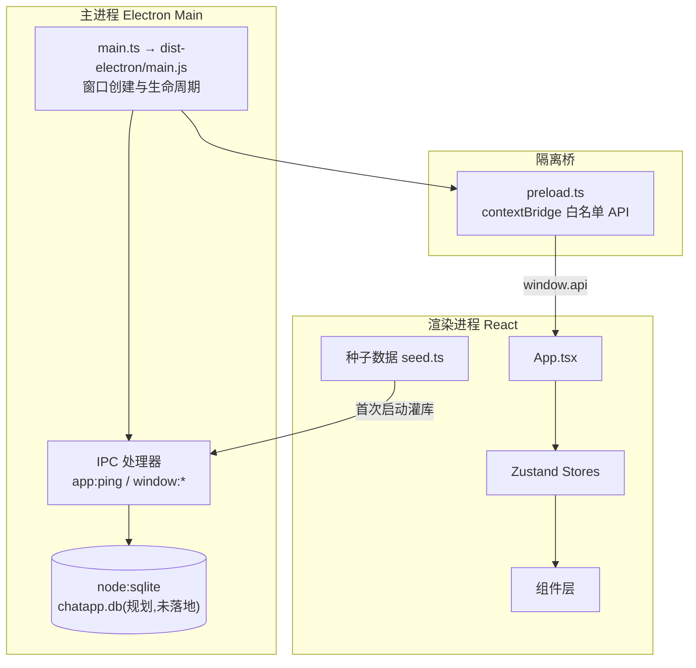
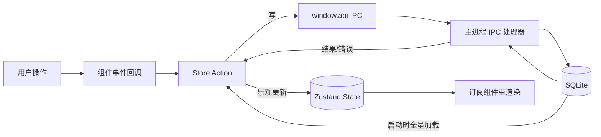
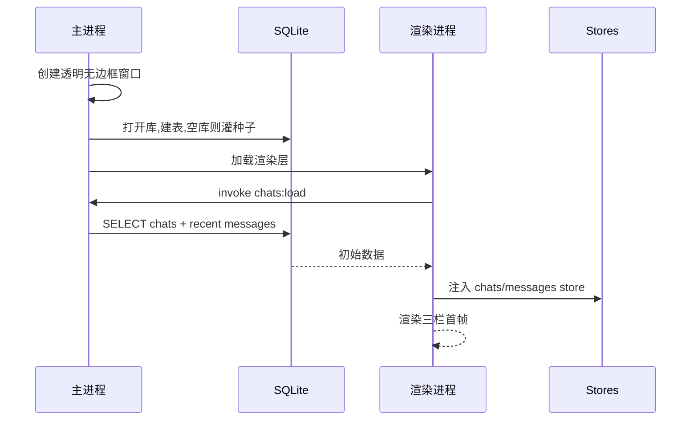
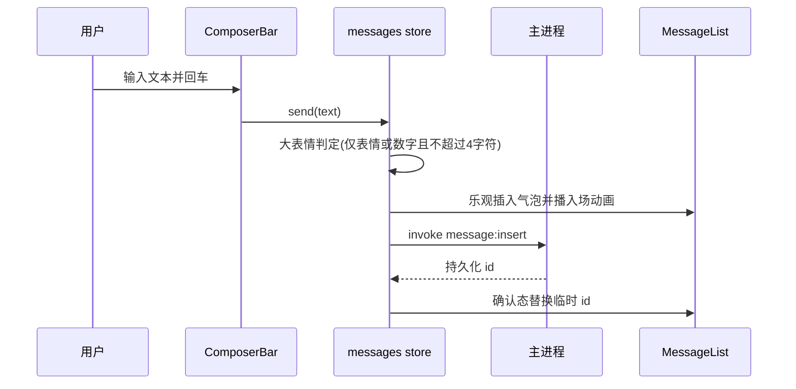
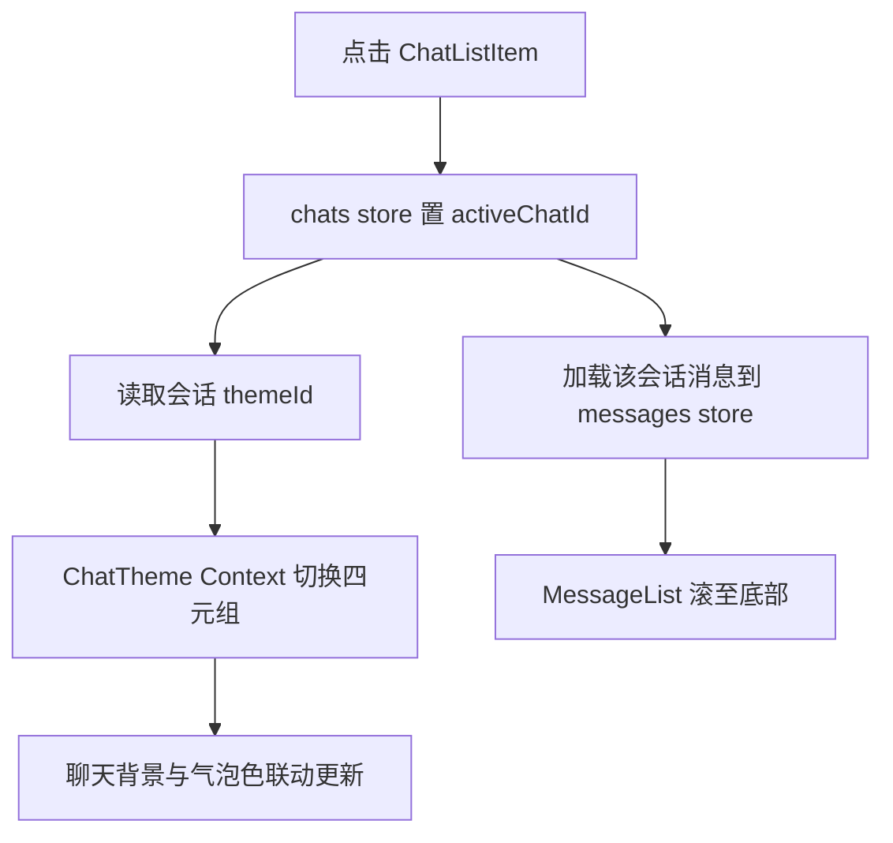

# ChatAPP

> Windows 桌面即时通讯应用,按 `原型图.jpg` 完整复刻界面与功能。
> 本文是项目全景文档:创建目的、技术栈、架构、代码地图、组件架构、数据流、工作流程、工作原理。
> 视觉规格的单一事实来源是 `doc/复刻分析报告与实施手册.md`,本文与其冲突时以代码与原型图为准。

## 目录

- 第一章 创建目的与解决的问题
- 第二章 项目技术栈
- 第三章 项目架构
- 第四章 代码地图
- 第五章 组件架构
- 第六章 数据流图
- 第七章 工作流程
- 第八章 工作原理

---

# 第一章 创建目的与解决的问题

## 1.1 创建目的

以 `原型图.jpg`(Telegram 风格三栏桌面 IM)为唯一视觉基准,从零复刻一款 Windows 桌面即时通讯应用:先产出设计分析与实施手册,再按手册落地代码,最终达到「截图与原型并排难以区分」的还原度。

## 1.2 要解决的问题

| 问题 | 对策 |
|---|---|
| 原型只有一张静态图,无设计稿无标注 | 先行产出《复刻分析报告与实施手册》,把布局/配色/样式/功能固化为令牌与验收清单 |
| 桌面壁纸透出的悬浮圆角窗口形态 | Electron 透明无边框窗口 + 渲染层 `backdrop-filter` 毛玻璃 |
| 复杂自定义视觉(胶囊、气泡、表情五 Tab、双聊天主题) | 不引入整包 UI 库,全部自绘,样式只引用 CSS 变量令牌 |
| 长列表性能(会话/消息/表情网格) | 定高虚拟列表,消息流倒序渲染 |
| 离线可演示 | `node:sqlite` 本地持久化 + 原型种子数据 |

## 1.3 范围声明

- 复刻阶段**不接服务端**:种子数据驱动,协议层留接口不实现;
- 验收基准:`doc/复刻分析报告与实施手册.md` 第 7.6 节逐项清单 + `doc/crops/` 局部放大裁图。

---

# 第二章 项目技术栈

| 层 | 选型 | 版本基线 | 职责 |
|---|---|---|---|
| 桌面壳 | Electron | ^44 | 透明无边框窗口、生命周期、SQLite 宿主 |
| UI 框架 | React + TypeScript | ^18 / ^5 | 组件化界面 |
| 构建 | Vite | ^7(.mts 配置,`base: './'`) | 渲染层开发构建 |
| 样式 | 全局 CSS + CSS 变量令牌(`tokens.css` 单一事实来源) | — | 禁组件内字面量色值;窄窗退避用容器查询 |
| 动效层 | React Bits(vendored 于 `src/components/bits/`) | TS-CSS 变体 | 只叠动效不改几何;许可与逐件适配见 `doc/第三方组件许可.md` |
| 动效依赖 | `motion` / `gsap` / `ogl` | ^12 / ^3.15 / ^1.0 | 由组件真实 import 决定,全部进 devDependencies |
| 状态 | Zustand | ^5 | 单 store `stores/app.ts`(过滤/搜索/面板/消息/短语) |
| 本地存储 | `node:sqlite`(Electron 内置 Node) | — | 规划中;当前为内存态 + `seed.ts` 种子 |
| 打包 | electron-builder | latest | portable + nsis |

## 2.1 环境约束(本机实测)

- Node 与 npm 走 `C:\Program Files` 全局安装,Bash 可直接命中;
- 安装依赖前必须设镜像:`registry=npmmirror` + `electron_mirror`(GitHub 直连下载有超时史);
- `node:sqlite` 禁 `loadExtension`,默认 `foreign_keys=1`;
- TS7 已移除 `moduleResolution: "node"`,用 `"bundler"`。

---

# 第三章 项目架构

## 3.1 进程架构



## 3.2 分层职责

| 层 | 位置 | 职责 | 红线 |
|---|---|---|---|
| 主进程 | `electron/` | 窗口、IPC、数据库 | 渲染层不直连 Node |
| 桥 | `electron/preload.ts`(编译为 CJS) | contextBridge 暴露白名单:窗口壳 7 个方法(`minimize/maximize/close/dragStart/dragMove/dragEnd/onRestore`)+ 业务 IPC | 不暴露整个 `ipcRenderer`;`drag*` **零参数**(位移由主进程现读光标算,见 8.12) |
| 状态 | `src/stores/` | 应用状态与 Action | 组件不越层直接调 IPC |
| 组件 | `src/components/` | 纯渲染 + 事件上报 | 样式只引用令牌 |
| 令牌 | `src/styles/tokens.css` | 全部设计变量 | 组件内禁字面量色值 |

---

# 第四章 代码地图

```
ChatAPP/
├─ 原型图.jpg                  视觉基准
├─ doc/
│  ├─ 复刻分析报告与实施手册.md  设计规格单一事实来源
│  └─ crops/                   局部放大核验图 ×4
├─ package.json
├─ vite.config.mts             base './',React 插件
├─ tsconfig.json               moduleResolution bundler
├─ electron/
│  ├─ main.ts                  透明无边框窗口(minWidth 1248)+ IPC + 自绘拖拽与最小化恢复推送(tsc 编译为 CJS)
│  ├─ preload.ts               contextBridge 白名单(sandbox):minimize/maximize/close + dragStart/dragMove/dragEnd + onRestore
│  └─ tsconfig.json            主进程侧编译配置
├─ bin/
│  ├─ dev.mjs                  开发模式:Vite dev server + 拉起 Electron
│  ├─ build.mjs                生产构建:tsc + vite build
│  ├─ start.bat / start.ps1    一键启动开发模式
│  ├─ stop.bat / stop.ps1      按端口 + 工程路径精确停止(不按名字批量杀)
│  ├─ dist.bat / dist.ps1      一键出便携版 + 安装版 exe(缓存种子 + 占用预检 + 阶段存档)
│  ├─ _common.ps1              共享 helper:Write-Step/Info/Fail、Invoke-Retry、端口与文件锁探测
│  └─ electron-win-build.ps1   一键装依赖/补二进制/构建/打包
├─ src/
│  ├─ main.tsx                 入口(非 Electron 环境加 browser 预览壳)
│  ├─ App.tsx                  三栏骨架组装
│  ├─ styles/
│  │  ├─ tokens.css            手册第三、四章全部令牌(含 --ease-exit / --t-minimize / --col-side-min)
│  │  ├─ global.css            reset + 滚动条 + `.drag-region` 标记(只剩 user-select,无 app-region)
│  │  └─ app.css               组件样式 + 窗口壳(退场动画 `.window--minimizing`、控制条 `.win-menu*`)
│  ├─ stores/app.ts            Zustand 单 store(过滤/搜索/面板/发送/大表情判定)
│  ├─ data/seed.ts             9 条会话(含群号 qq)+ 演示消息 + 表情数据
│  ├─ components/
│  │  ├─ Icons.tsx             线性 SVG 图标库(1.5px 描边)
│  │  ├─ bits/                 React Bits vendored 源码(SoftAurora/FoldText/GooeyNav/…)
│  │  ├─ WindowChrome.tsx      自绘窗口壳:拖拽带判定 + 右键三项控制条 + 最小化退场(8.12)
│  │  ├─ Sidebar.tsx           会话列表栏(搜索/过滤/列表);顶带是第一条 `.drag-region`
│  │  ├─ ChatArea.tsx          头部胶囊(头像/群名/成员数+群号读选中会话) + 消息流 + 上下渐隐带
│  │  │                        + 上划浮出的「回到最新消息」 + 输入栏;头部这条带是第二条 `.drag-region`
│  │  ├─ RightPanel.tsx         表情五 Tab + 群成员 + 快捷短语(折叠/短按追加/按住 1s 直发/右键改名)
│  ├─ lib/
│  │  ├─ palette.ts            从 CSS 变量读色,喂给 JS 侧组件 props
│  │  └─ motionPref.ts         prefers-reduced-motion 统一降级闸门
│  └─ vite-env.d.ts            window.api 类型
├─ .cache/electron-builder/    工程内 builder 缓存(winCodeSign 种子,已 gitignore)
└─ release/                    electron-builder 默认输出(当前被外部进程占用,见 T0Level 第 8 节)
```

---

# 第五章 组件架构

```mermaid
graph TD
  App --> Sidebar
  App --> ChatArea
  App --> RightPanel
  App --> WindowChrome
  Sidebar --> SidebarTopBar
  Sidebar --> GooeyNav
  Sidebar --> ChatList
  SidebarTopBar --> SearchBoxA[SearchBox]
  SidebarTopBar --> DragBandA[drag-region 第一条带]
  ChatList --> ChatListItem
  ChatListItem --> Avatar
  ChatArea --> ChatHeaderPill
  ChatHeaderPill --> FoldText
  ChatArea --> ChatHeaderActions
  ChatArea --> MessageList
  ChatArea --> ChatFadeBand
  ChatArea --> JumpButton
  ChatArea --> DragBandB[chat-header 第二条带]
  ChatArea --> ComposerBar
  WindowChrome --> WinIpc[window.api minimize/maximize/close]
  WindowChrome --> DragIpc[window.api dragStart/dragMove/dragEnd]
  WindowChrome --> RestoreEvt[onRestore,由主进程 win.on restore 推送]
  JumpButton --> ListScroll[message-list scrollTo bottom]
  MessageList --> MessageBubble
  MessageList --> MessageImage
  MessageList --> MessageBigEmoji
  MessageList --> MessageQuote
  MessageList --> DayDivider
  ComposerBar --> IconButton
  ComposerBar --> ComposerInput
  ComposerBar --> SendButton
  RightPanel --> SearchBoxB[SearchBox]
  RightPanel --> EmojiTabs
  RightPanel --> EmojiGrid
  RightPanel --> GroupMembers
  RightPanel --> QuickPhrases
  QuickPhrases --> PhraseChip[HoldButton 短按追加 / 按住 1s 直发 / 右键改名]
  QuickPhrases --> PhraseAdd[+ 添加 → 就地输入框]
  PhraseChip --> DraftStore[store draft / send]
```



## 5.1 组件设计原则

1. **容器/展示分离**:三栏容器(`Sidebar/ChatArea/RightPanel`)接 store;叶子组件只收 props;
2. **主题下行**:`ChatTheme` 四元组经 React Context 注入 `ChatArea` 子树,气泡/引用/大表情自动联动;
3. **复用点**:`SearchBox` 三处复用;`IconButton` 统一 36px 图标钮;`Avatar` 全局唯一头像实现;
4. **虚拟化边界**:`ChatList`(定高 72)与 `MessageList`(倒序)是仅有的两个虚拟列表。

---

# 第六章 数据流图



## 6.1 数据流规则

- **单向**:事件 → Action →(IPC → DB)→ State → 视图;禁止组件反向写 store 之外的共享状态;
- **乐观更新**:发送消息先入 State 渲染,再落库,失败则标记失败态;
- **读取路径**:启动时主进程全量读会话与最近消息,经 IPC 一次性注入 store;
- **面板通讯**:`ComposerBar` 的 😊 与 `RightPanel` 之间只经 `panel store`,不穿透 props。

---

# 第七章 工作流程

## 7.1 启动流程



## 7.2 发送消息流程



## 7.3 会话切换流程



---

# 第八章 工作原理

## 8.1 悬浮圆角毛玻璃窗口

- 主进程 `BrowserWindow` 配 `frame:false + transparent:true + backgroundColor:'#00000000'`;
- 渲染层 `html,body` 透明,外形由 CSS 裁剪而非系统:`.window` 一层同时承担 `border-radius`(决定阴影形状)、`overflow:hidden`(同层裁剪)、窗口填充与磨砂和自绘阴影;`.bg-layer` 只做定位与层级,不需要自己的圆角——`.window` 的裁剪轮廓跟着 `corner-shape` 走,后代一起变形(见 8.7);
- 毛玻璃 = `.window` 上的 `backdrop-filter: blur(28px) saturate(1.4)`,透出橙粉渐变桌面;
- 拖动:**自绘**(`2026-10-11` 本轮12 起)。`-webkit-app-region: drag` 已整条撤掉——它把该区域变成 OS 的 `HTCAPTION`,右键连同菜单一起被 OS 接走,应用侧改不掉。现在拖拽由 `<WindowChrome/>` 在 `pointerdown` 时经 IPC 交给主进程搬窗(8.12),`.drag-region` 只剩 `user-select:none` 与一个给 JS 读的类;
- 已知坑:`backdrop-filter` 必须与"同层裁剪"配套,否则模糊会溢出圆角;祖先链上出现 `filter` 会造 backdrop root,页内磨砂立刻采不到东西——所以带磨砂的元素之上不挂 `filter`。CSS 里唯一的 `filter: blur(60px)` 挂在光影流斑自己的伪元素上(叶子节点),AnimatedContent 的动画 `filter` 只作用在右栏列表项本身,都不在任何磨砂元素的祖先链上。Windows 透明窗口无原生阴影,用 `--shadow-window` 自绘。
- **2026-10-11**:`--r-window` 由 20px 增到 32px,并由主窗口与左右两张卡片共用同一令牌;同轮把可见轮廓从圆弧升到 G2 超椭圆(8.7)。

## 8.2 设计令牌驱动

全部颜色/圆角/阴影/字号出自 `tokens.css` 的 CSS 变量,组件零字面量;换聊天主题 = 切换 `ChatTheme` 变量作用域,整棵聊天气泡子树联动变色。

**窄窗退避也是纯 CSS,但已不再有"浮层"这一挡**(2026-10-11 本轮11 改):`.window` 设 `container-type: inline-size`,侧栏宽由一条 `clamp()` 直接读 `100cqw` 算出(8.11),渲染层**没有** `matchMedia`/resize 监听,也不为此新增 store 状态。原来的 `@container (max-width:1100px)` 浮层块与 `.window[data-panel]` 避让规则一起删掉了;`App.tsx` 仍写 `data-panel`,但只有布局探针读它来断言内联态。

## 8.3 大表情判定

消息体 trim 后仅含 emoji 或数字、且长度 ≤4 个 grapheme 时,`kind` 升格为 `bigemoji`,渲染为浅青胶囊 + 32~40px 大字(原型「9178」样式),否则走普通文字气泡。

## 8.4 虚拟列表

会话列表(定高 72)与消息流(倒序、不定高按测量缓存)自绘虚拟化:仅渲染可视区 ±  overscan 5 行,滚动条为 overlay 自绘样式,idle 淡出。

## 8.5 持久化(规划,未落地)

当前实现:Zustand 内存态 + `seed.ts` 原型演示数据,刷新即还原。规划:`node:sqlite` 单库四表(chats/messages/members/quick_phrases),WAL 模式;首启检测空库灌入种子,保证离线开箱即是原型画面。

## 8.6 动效层与降级

自绘结构负责几何,React Bits 的 vendored 件负责动效与质感(背景 SoftAurora、群名 FoldText、右栏 AnimatedContent、发送钮 ClickSpark+Magnet、左栏过滤行 GooeyNav、快捷短语 HoldButton)。输入栏曾包一层 BorderGlow,2026-10-11 撤下(hover 辉光盖住整条胶囊像"选中背景色",而这里只想要图标自己的悬浮底);窗口三钮也自绘成右键浮出条,查过 reactbits 的 Dock/BubbleMenu 都不合用,依据记在 `doc/第三方组件许可.md`。三条约束:

1. 组件源码与上游一致,冲突改在 `app.css` 的适配段;颜色一律经 `lib/palette.ts` 读 CSS 变量。两个件口径相反,别记混:GooeyNav 的 `color`/`colors` 会被组件内 `parse()` 解析,**只认 hex 与 `rgb()`**,不能传 `var(...)`;而它的 `--gn-*` 主题变量与 FoldText 的 `--fold-text-*` 都写在内联 style 上,CSS 类盖不住 —— GooeyNav 走它自己的 `style` prop 覆盖,FoldText 走 props(它的 `color` 只进 CSS 变量,传 `'var(--text-1)'` 是安全的)。
2. `lib/motionPref.ts` 读一次 `prefers-reduced-motion`,每个接入点据此回退(背景退静态 `--flow`、右栏退直接挂载)。reactbits 组件大多不自带这个判断——两个例外:**GooeyNav**(mount 读 `matchMedia`,reduced 时直接落位不放水珠)与 **FoldText**(不旋转、时长压到 ≤0.22s,CSS 里还有一条 `@media` 硬兜),这两个宿主不再套一层。
3. 接入必须过「布局量表逐格等于基线」这条回归,不接受"看着没坏"。**量表口径自本轮11 改**:原来的四挡(1280/1121/1120/960)里有两挡在 `minWidth: 1248` 下已不可达,现在用 `electron . --cols` 扫 11 挡读 `sideW/chatW/rightW/overlap/sideMinusRight/inputW`(基线见手册 2.8.1)。
4. "满宽"要沿 flex 链一路验到最里层:GooeyNav 的 `nav width:100%` 只拉长外框,而它的 `.gooey-nav__stage` 作为 `inline-flex` 的 flex 子级默认按 max-content 收缩(实测 249.75px),于是每格 `flex:1 1 0` 分不到确定宽度、右侧剩 18.2px 空档(2026-10-11 补 `stage { flex:1 1 auto }` 后四格 60.9 → 65.5px)。判据也别只看"四格等宽"——**等宽 ≠ 铺满**,要读末格 `right` 与容器内沿之差。

## 8.7 圆角几何(G2)与降级

`border-radius` 只有 G1:接缝处曲率从 0 跳到 1/r,32px 这种量级能看出"突然圆起来"的折角感。可见轮廓因此换成超椭圆 `|a/r|^p + |b/r|^p = 1`(p=2 就是圆弧,p=4 即 squircle 家族),用原生 `corner-shape: superellipse(v)`(**p = 2^v**,所以 `superellipse(2)` = p4)一条声明做到,取值集中在 `--g2-shape`,作用元素是 `app.css` 文末列出的 14 个圆角矩形;`--r-pill` 与 `50%` 那批排除在外——它们没有"直线→圆弧"的接缝可谈曲率连续。

为什么一条就够:`corner-shape` 带着 `background`/`border`/`outline`/**`box-shadow`**/**`backdrop-filter`**/**`overflow` 裁切**一起变形,且不收缩点击热区 → 零结构改动。门槛是 Chromium 139+(本工程 Electron 44.7 = Chromium 152),更旧的内核整条忽略声明、画面自动退回圆弧,所以既不需要 JS 也不需要 `@supports` 分支。

曾走的两条路留档在 手册 4.1.1:`clip-path: shape()`(Chromium 150 不支持,12 种写法读回 computed 全是 `none`)与 JS 逐元素生成 `clip-path: path()`(能出形,但 `clip-path` 会裁掉元素自己的 `box-shadow`、不带 `overflow` 裁切、还收缩命中区,要为 5 个带阴影的表面各加一层伪元素重画,最终被原生方案替换)。**降级:把 `--g2-shape` 改成 `round`**,四挡布局表逐格不变(实测)。数字、真值曲线与踩坑清单见 手册 4.1.1,复现命令见 T0Level 第 11 节。

## 8.8 三卡齐平、上下渐隐、两处浮出(2026-10-11)

- **中间列也是第三张卡**:`.chat-area` 加 `border-radius: var(--r-window)` + `overflow:hidden` + 半透明洗色 `--chat-wash`(按会话主题换色相,叠在流动背景之上、底部收淡),进 G2 清单。三栏实测 `top/bottom` inset 全 =10、高全 =780。阴影刻意不给中间卡——它是"更透"的一层,压上浮影会把背景光斑压死。
- **消息流上下渐隐**:列表用 `margin: -68px 0 -64px` + 等量 `padding: 76px` 把内容伸到头/输入栏底下,再叠两条 `.chat-fade`(上 68 / 下 64,与头部和输入栏等高且贴齐卡片边):`mask-image` 线性渐隐 + `--chat-veil` 洗色单层。**2026-10-11 撤掉了原先的 `backdrop-filter: blur(10px)`** —— 那层模糊按 fade 自己的矩形盒合成,卡片的圆角裁不住它,弧外会露出一块没有转角的软方角(楔形采样点饱和差 27 → 撤掉后 0)。层级 列表 < fade(1) < 头部/输入栏(2),`pointer-events:none` 不吃点击。
- **窗口控制改右键浮出**:拖拽带上的 `contextmenu` → 光标处自绘 `.win-menu`(120×44 磨砂条、三颗 34×34),走既有 `window.api.minimize/maximize/close`;`position:fixed` 挂在包裹层 `.win-menu-wrap` 上且经 `createPortal` 挂到 `body`,既躲开 `.chat-area`/`.window` 的 `overflow:hidden` 与 32px 圆角裁剪,也不被 `.chat-area` 的 `z-index:1` 困住(`fixed` 若在 `.win-menu` 自己身上,入场动效的 `translate/scale` 会抢走它的包含块,位置跟着抖 8px —— 见 8.12)。越界光标 clamp 回窗口内 8px;点外部 / Esc / 窗口失焦关闭。**实测 `webContents` 的 `context-menu` 事件对这类输入是 0 次命中**,所以没加主进程转发通路。2026-10-11 本轮12 起这条由 ChatArea 的局部实现上提成共享组件 `<WindowChrome/>`,左栏顶带与聊天头部两条带同一条路。
- **「回到最新消息」浮钮**:32px 正圆,`left:50%` 标在聊天区中线、输入栏上方 12px(`bottom:76px` = 输入栏 64 + 间距 12)。出现判据 = **末条消息底边越过 `.composer-wrap` 顶边**(真被输入栏盖住),读两个真实盒而不是"离底 N px"常数;点击**直跳**到底(不用 smooth:滚动途中那次 scroll 事件里末条还被盖着,会把钮挂回来闪一下)。尺寸变化必须重算 —— 内容不再溢出时往往连 scroll 事件都不派发,所以挂 `ResizeObserver` 在列表盒上(窗口缩放 / 右栏开关面板走同一条路;原来那条"窄窗转浮层"的挡位自本轮11 已不存在)。它的入场关键帧 `jump-in` **自带 `translate(-50%, …)`**:复用 `msg-in`/`pop-in` 那种写 `transform` 的关键帧会在播放期间顶掉居中位移、结束时又弹回来,表现就是"出现后再往左偏一段"(实测过)。
- **输入栏撤掉 BorderGlow 的来由**:除观感(整条胶囊被 hover 辉光洗成"选中背景色")外,撤下时抓出一个真缺陷 —— BorderGlow 的 `.border-glow-inner` 是 column flex,而 `.composer` 的 `flex:1` 本意是给 `.composer-wrap`(行 flex)拿宽,`flex-basis:0%` 顶掉 `height:52` 把胶囊压成 40,与内层 40 的输入胶囊帽沿同心相咬,两端各多出一道弧形亮边。踩坑清单与复现命令见 T0Level 第 14、15 节。

---

## 8.9 快捷短语的三态与上限(2026-10-11)

一颗短语 = 一个 `HoldButton`(`holdTime=1000`),三种输入走三条分支,全在组件内部按"按下→抬起"的时间差判定:

| 手势 | 判据 | 结果 |
|---|---|---|
| 短按 | 抬起时按住 < 250ms 且未漂出 | `appendDraft(p)` 追加进输入框 |
| 按住 | 液面走满 1s | `send(p)` 直接发送,`doneLabel`「已发送」淡出、900ms 复位 |
| 提前松手 | 250ms ~ 1s 之间 | 两件事都不做(实测 527ms 那一枪:消息数与 draft 都没动) |
| 右键 | `contextmenu` | 就地换成 `.phrase-input` 改名,Enter/失焦提交、Esc 取消 |

- **右键能挂上的原因**:HoldButton 自己在按钮上写了 `onContextMenu={e => e.preventDefault()}`,但 `preventDefault` 不阻断冒泡,所以改名处理器挂在**包裹层** `.phrase-slot` 上即可,不必动 vendored 源码(实测 `editing=true`)。
- **短语的单一真源在 store**:`phrases` 初值直接取 `QUICK_PHRASES`(视图里那层"种子 ∪ 用户"的合并去掉了),`updatePhrase` 顺手丢掉空串与重名 —— 否则空短语点不出东西、重复两条会撞 React key。`draft` 也从 ChatArea 的局部 state 提到 store,右栏才够得着输入框。
- **整节上限**:`.phrase-section { max-height: 40% }` + 列表 `flex:1; min-height:0; overflow:auto`。参照是右栏**内容盒**(756 = 卡高 780 − 上下内边距 24),所以上限实测 **302.4px = 卡高的 38.8%**;换成容器查询单位 `40cqh` 是同一个数(cqh 量的同样是内容盒),故没有为此给 `.right-panel` 加尺寸包含。
- **它不进 G2 清单**:液面与盒体共用 `clip-path: inset(0 round var(--hb-radius))`,而 `corner-shape` 不改 `clip-path` 的角形 —— 只换盒体会让按住时液面与角错开。尺寸按用户口径压回 chip 档(28 高 / 12 内边距),几何由组件自己 `offsetWidth/Height` 实量,压小安全。

## 8.10 会话条目按原型重定,与"看不见 / 多出转角"的两层成因(2026-10-11)

左栏条目按原型实测改成 **pitch 72 / 头像 50 / 上下空档 11**(原先 64 / 44 / 10)。原型侧的量法是 `nativeImage` 解 JPEG 后按行找名称字带:中心 735.5 / 807.5 / 879 / 951.5 / 1023 → 间距 71.5~72.5,头像圆盘 ≈50。顺带更正测量基准:**原型图整图其实是 1654×1276**,早期按"整图 1280×987"折算把侧栏算成 300(原型实为 389/1264 ≈ 31%),这条偏差本轮只记账、没有改宽度。

中间卡的角连着查出**两层**问题,两层判据打在两个不同层面上:

| 层 | 症状 | 判据(都是真窗口 1:1 位图) | 处置 |
|---|---|---|---|
| 色差层 | 角"看不见" | 沿弧逐行取两侧亮度差(`.cache/cor-arc.mjs`):改前 mean 15.9 / **p10 4.0** / min 2.8,右卡基准 16.4 / 15.3 | `--chat-veil` 换更深一档 → **26.5 / 21.9 / 20.6**,每一行都过基准 |
| 合成层 | 弧外多出一块**没有转角的软方角** | 弧外那块楔形本该与真底同色:改前 TL 255,246,228(饱和差 **27**),撤掉 blur 后 255,255,255(饱和差 0) | 撤掉 `.chat-fade` 的 `backdrop-filter: blur(10px)` |

第二层的成因:`backdrop-filter` 按**元素自己的矩形 border-box** 合成被模糊的背景,祖先 `.chat-area` 的 `overflow:hidden` + 圆角裁不住这一层。定位靠三条独立差分 —— 关掉 blur、隐掉 fade、给 fade 挂 `border-radius:inherit` 都能把饱和差拉回 0,而 `clip-path: inset(0 round 32px)` **拉不回**(clip-path 同样拦不住 backdrop-filter)。想保留模糊的话,给 fade 挂 `border-radius:inherit;corner-shape:inherit` 是实测可行的替代修法,三档对照图在 `.cache/corner-sheet.png`。

另外两条**实测否决**的路记在这里,免得以后重走:给中间卡补三卡同款 `--shadow-float` 会让弧外被压暗到与洗色同调,弧对比从 15.9 掉到 **3.8**;把 `--chat-wash` 底部 alpha 提到 .42 只到 15.9 / 4.0(弧那几行被 veil 盖住,根本不吃洗色)—— 两处都已回退。

## 8.11 窄窗为什么改成"等比收缩 + 1248 下限"(2026-10-11)

用户口径的三条硬要求:两侧卡片**恒等宽**、中间区**最小宽 = 侧栏的 2 倍**、窄窗**永不相叠**。落法是 `.window` 上一条 clamp:

```css
.window { --side-w: clamp(var(--col-side-min), (100cqw - 2 * var(--gap-side)) / 4, var(--col-side)); }
.sidebar, .right-panel { flex: 0 0 var(--side-w) }   /* 中间区 flex:1 1 0; min-width:0 吃剩下的 */
```

`100cqw` 量的是 `.window` 自己的 content box(窗口宽 − 2×`--gap-window`),所以浏览器预览下也不会错成视口宽。未夹住时中间区恰好 = 2× 侧栏;夹在上限 300(窗口 ≥1248)时 > 2×。`minWidth: 1248` 取的就是"中间区 = 2× 侧栏 = 600"那一格的算术解。

三条实测才知道的东西:

- **等宽不能交给 flex 收缩**。flex 的收缩量按**内容盒**基线分配,而 `box-sizing: border-box` 下要先减 padding;右栏有 12+12 横向内边距,于是每挡都比左栏少缩一点——实测先差 24px、调一轮后仍差 **5.9px**。只有两侧同源写死 `--side-w` 才恒等(实测 `sideMinusRight = 0`)。
- **原来的 `< 1120 右栏转浮层` 整条已删**(`@container (max-width: 1100px)` 那一块 + 四个避让令牌)。浮层是"避让"而不是"共存",它本身就是重叠观感的来源之一;等比收缩 + 下限之后它没必要存在。**连带结果:`.window[data-panel]` 不再被任何 CSS 规则消费** —— `App.tsx` 仍然写它,但现在只有布局探针读它来断言"右栏是内联态"(`--cols` 输出里的 `dataPanel`),它不再是布局参与方。
- **`overflow-y: auto` 会顺手升起横向滚动条**:它把同轴的 `overflow-x: visible` 升格成 `auto`,于是表情网格在窄挡出现幽灵横滚条。改 `overflow-x: clip` + 列写 `repeat(6|9, minmax(0,1fr))`(`1fr` = `minmax(auto,1fr)`,不写 `minmax(0,…)` 轨道缩不到 min-content 以下)。判据要读 `.emoji-grid` **自己**的 `scrollWidth − clientWidth`,读父级得到 0。

11 挡实测在 `electron . --cols`(手册 2.8.1):`overlap` 恒 −14、`sideMinusRight` 恒 0、`chatOverSide` 2.107 → 2.000 且不低于 2;请求 960 时 `winW` 报 1248,证明下限真咬住。

## 8.12 自绘窗口壳:拖拽 + 右键三项控制条 + 最小化退场(2026-10-11)

三个能力必须一起换,因为它们共用同一个前提:**OS 不再参与这条带子**。

| 能力 | 通路 | 为什么只能自绘 |
|---|---|---|
| 拖拽 | `pointerdown` → `send('window:drag-start')`;每帧只发 `window:drag-move`(**零参数**);主进程 `screen.getCursorScreenPoint()` 现读光标算位移 | 渲染层传坐标会把 IPC 往返算进位移,手感变成"窗口追光标";现读则不累计误差、丢帧下一帧补上 |
| 右键三项控制条 | `document` 上吃 `contextmenu`,`.drag-region` 命中且不在 `.no-drag` 内才浮出;`createPortal` 到 body,120×44 | `-webkit-app-region: drag` 把区域变成 `HTCAPTION`,右键被 `DefWindowProc` 接走弹深色系统菜单(六项、条目应用侧改不了);实测 `webContents` 的 `context-menu` 在该情况下**一次都不发** |
| 最小化退场 | `.window` 上一条 `transition: transform/opacity` + `--ease-exit`,播完(`transitionend`,400ms 兜底)才真 `minimize()` | OS 的"缩进任务栏"动画要求 `WS_SYSMENU`,Chromium 不给 `frame:false` 的窗口挂它(三臂对照实测:两种 `frame:false` 都没动画,只有 `frame:true` 有)。好处是不读任何系统渲染路径,**Win10/Win11 跑同一条 transition** |

四条踩过才写进代码的约束:

- **拖最大化的窗口要过阈值才还原**:起手只记 `wasMax`,位移 ≥4(对齐 `SM_CXDRAG`,单位是 DIP,**不乘 `devicePixelRatio`)才 `unmaximize()`。先前在 `drag-start` 里直接还原,症状就是"双击最大化之后再单击一下就恢复"。
- **恢复不反向播**:实测 restore 之后头 ~160ms 渲染器不出帧,而退场态的计算起始值是 `scale .64 / opacity .09`,反向播很可能给出一个近乎透明的窗口。所以挂 `.window--noanim` 摘类,并保留 `void root.offsetWidth` 那次**强制回流** —— 不挡这一下,加类与摘类会被合并进同一帧,transition 照样播。
- **退场不能用入场曲线**:强减速曲线把 85% 的行程压进头 80ms(实测该腿 79ms 就到 scale 0.6577,即全程的 85.6%),观感就是"帧率太低"。换强加速的 `cubic-bezier(.4,0,1,1)` 并给退场期间加 `will-change` 之后,呈现的不同帧 13/16 → **17/19**、主线程帧距 p95 13 → **9ms**、max 20 → **12ms**。仪表教训:先前拿 rAF 间隔报"帧距没问题"是**测错了层** —— rAF 量主线程 BeginFrame 节奏、`getComputedStyle().transform` 按时钟插值,只有 `capturePage` 小块 + 位图哈希能给呈现帧的下限。
- **已声明的未覆盖范围**:`Win+D` 与从任务栏点回来/点下去走 OS 路径,应用拦不到 ⇒ 那两种情况没有动画;放弃 OS 拖拽也放弃 Aero Snap 的**左右分屏吸附**(顶边最大化自己补了)。

样式契约在 `app.css`(`.window--minimizing` / `.window--noanim` / `.win-menu-wrap` / `.win-menu` / `.win-menu-btn`),`fixed` 必须在包裹层而不是 `.win-menu` 上(否则入场动效的 `translate/scale` 会抢走 `fixed` 的包含块,位置跟着抖 8px)。这套能力已抽成用户级 Skill `electron-window-chrome`(可直接拷的示例源文件 + 会自己失败的接线审计),细节见 `doc/运行与构建（T0Level）.md` 第 19 节。

---

## 运行与构建

```bash
npm install        # 先设 npmmirror 与 electron 镜像
npm run dev        # vite + electron 开发模式
npm run build      # 产物:release/ 下 portable + nsis
```
