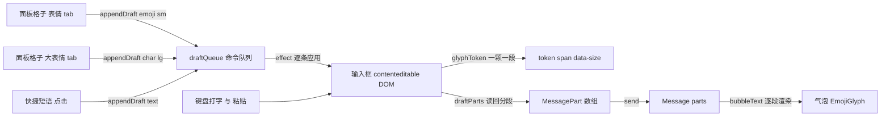

# 大小表情的显示、复制与对齐

> 这篇文档只讲一条链路：一颗 emoji 从右侧面板被点进输入框、再发成气泡，中间要过哪几道**显示 / 尺寸 / 复制 / 对齐**的关卡；每一关遇到过什么问题、试过什么、为什么最终选现在这一种，以及对应到仓库里的哪一段代码。
>
> 假设读者只看过 `src/` 的目录结构，不需要预先了解 `emoji-picker-react`、sprite atlas 或 contenteditable 的选区模型。
>
> 文中所有数字都来自实测（页面探针、Electron 探针或源码），出处在第 7 节集中列出；没量到的东西一律写在第 8 节"已知边界"里，不当结论用。

---

## 0. 一页速览

### 0.1 术语

| 术语 | 在这篇文档里指什么 |
| --- | --- |
| 表情 tab / 大表情 tab | 右侧面板的两个页签。前者是 `emoji-picker-react` 的 picker（有搜索、分类、肤色、虚拟化），后者是工程自己策展的一格一格清单 |
| 档（tier） | 显示尺寸档位。真源是 `EMOJI_PX = { cell: 30, sm: 28, lg: 48 }`：`cell` 是面板格子，`sm` 是"表情 tab"进来的，`lg` 是"大表情 tab"进来的 |
| atlas / 雪碧图 | 工程内的 10 张 `.webp` 位图页，每页把若干 64×64 源格拼在一起；显示时靠 `background-size/position` 缩放裁切 |
| 源格 | atlas 里一颗表情的原生 64×64 格子，是分辨率上限；30/28/48 全是**缩小**，没有放大 |
| token | 输入框（contenteditable）里代表一颗表情的那个 `<span contenteditable="false">`，整块删除、整块携带档位 |
| 盒底 / 画面底 / 墨底 | 三个不同的"底部"：元素边框盒的底边 / 贴图里实际画到的最低一行像素 / 文字字形墨迹的底边。第 6 节的整件事就是这三个底不一样高 |

### 0.2 文件地图（谁管什么）

| 文件 | 在这条链路上的职责 |
| --- | --- |
| `src/types.ts` | `GlyphSize`、`MessagePart`、`Message.parts` 三个类型，是"档"能一路带下去的原因 |
| `src/emoji/atlas.ts` | `EMOJI_PX` 尺寸真源、`unifiedOf()`、`spriteStyle()`、`emojiGlyph()` |
| `src/emoji/SpriteCell.tsx` | 面板格子的贴图渲染（`SpriteCell`）+ 输入框/气泡共用的小组件（`EmojiGlyph`） |
| `src/emoji/Picker.tsx` | picker 的接入参数（native 样式、分类图标、`onPick` 出口） |
| `src/emoji/picker.css` | `.ep-glyph` 的盒子与选中态规则 |
| `src/data/seed.ts` | `EMOJI_SETS` / `BIG_EMOJI`：大表情 tab 的清单 |
| `src/stores/app.ts` | `appendDraft` / `draftQueue` / `ackDraft` / `send`：入框命令队列与发送 |
| `src/components/RightPanel.tsx` | 两个 tab 的格子、点击入框、`swallowSelectPick`（框选那一枪的吞掉） |
| `src/components/ChatArea.tsx` | 输入框本体：`glyphToken()`、`draftParts()`、`bubbleText()`、插入 effect、`submit()` |
| `src/styles/app.css` | 两档字号、`.emoji-img` 的贴图/选中/对齐规则、输入栏四档高度的 CSS 变量 |
| `electron/main.ts` | `--copy` / `--cols` 两挡探针（第 7 节的取证工具） |

### 0.3 六条口径（改动前先对这张表）

这六条是逐条点定的产品口径，不是技术默认值。觉得"别扭"的也先按它办：

1. 两个 tab 点了都**只入框，不立刻发送**。
2. **档跟 tab 走、不跟字符走**：同一个 😂 从"表情"进来是 28，从"大表情"进来是 48。
3. **输入框与气泡同档同尺寸**，输入栏因此允许被撑高。
4. 画风**全部保持 atlas 贴图**，不换回系统 emoji 字形。
5. 复制只把**码位字符**放进剪贴板，不写 PNG。
6. 不再靠文本形状猜级别（`classify()` / `BIGEMOJI_RE` 已删）。

---

## 1. 数据流总览



关键点是**草稿的真源是 DOM，不是 store**：`store` 里只放"待执行的入框命令"队列，不存 draft 字符串（原因见 3.1）。

---

## 2. 表情 tab 与大表情 tab：两份清单，一套素材

### 2.1 实测家底

| 项 | 数值 | 说明 |
| --- | --- | --- |
| atlas 页数 | 10 | `smileys_people` 3 页 + 其余 7 类各 1 页 |
| atlas 键数 | 3778 | 1903 个基形码位 + 1875 个肤色变体 |
| 源格尺寸 | 64×64 | 分辨率上限；`cell 30` / `sm 28` / `lg 48` 全是缩小 |
| 大表情 tab 格数 | 165 | 其中 **155** 格有 atlas 贴图，10 格没有 |
| 无 atlas 的 10 格 | 数字 `0–9` | 来自 `EMOJI_SETS.数字`，走系统字形回落 |
| picker 单屏格数 | ~50 | 列表是虚拟化的，DOM 里只有当前可见行，**不能拿 DOM 格数当全量判据** |

### 2.2 两个 tab 的实质差别

素材完全同源：同一张 `.webp`、同一个码位、同一套 `spriteStyle()`，只有 `px` 不同。实测同一颗 😂 从两个 tab 点进来，页文件、源格坐标、页宽全部相同，只有显示宽 28 与 48 的差别。

所以两个 tab 的差别只剩**清单**与**交互**：

| | 表情 tab | 大表情 tab |
| --- | --- | --- |
| 清单 | 全量 Unicode（1903 基形，9 分类，6 档肤色，拼音/英文搜索） | 策展 165 格（含数字 0–9） |
| 入框档位 | `sm` | `lg` |
| 渲染入口 | `SpriteCell`（库的 `components.Emoji`） | `RightPanel` 里自绘的 `.emoji-cell` |
| 无贴图时 | 回落库给的 `children`（系统字形） | 回落裸字符 `{e}` |

```ts
// src/emoji/atlas.ts —— 尺寸的唯一真源
export const EMOJI_PX = { cell: 30, sm: 28, lg: 48 } as const;
export type EmojiTier = keyof typeof EMOJI_PX;
```

> **推论**：如果要 QQ 那种"大表情"（独立画布、动图、明显大于表情格），需要的是**第二套素材源**，不是把 `EMOJI_PX.lg` 调大——源格只有 64px，48 已经是缩小。

---

## 3. 选择放入输入框：只入框、不发送

### 3.1 问题

- 原先"大表情"是一键直发，被明确否掉：期望两个 tab 都只入框。
- 入框后还要能继续打字、删掉、再点几颗进去 —— 单字号的 `<input>` 连"这一格是表情还是打字"都记不住。
- 如果在 store 里再存一份 `draft` 字符串，就有了**两个真源**：光标在中间时做字符串拼接会写错位置。

### 3.2 方案：命令队列 + DOM 真源

store 只发命令，输入框自己把命令落成 DOM 节点：

```ts
// src/stores/app.ts —— 命令的形状（字段上的两行注释略）
interface DraftInsert {
  text: string;
  size: GlyphSize;
  id: number;
}

appendDraft: (text, size = 'text') =>
  set((s) => ({ draftQueue: [...s.draftQueue, { text, size, id: ++insertSeq }] })),
/* 输入框应用到这里就可以把旧的丢掉;按 id 过滤而不是清空,免得跨拍的插入被误删。 */
ackDraft: (id) => set((s) => ({ draftQueue: s.draftQueue.filter((d) => d.id > id) })),
```

消费端按队列顺序落节点，去重用**命令对象身份**而不是序号：

```tsx
// src/components/ChatArea.tsx
const appliedInsert = useRef<WeakSet<object>>(new WeakSet());

useEffect(() => {
  const box = boxRef.current;
  if (!box) return;
  const pending = draftQueue.filter((d) => !appliedInsert.current.has(d));
  if (!pending.length) return;
  for (const d of pending) {
    appliedInsert.current.add(d);
    box.appendChild(
      d.size === 'text' ? document.createTextNode(d.text) : glyphToken(d.text, d.size)
    );
  }
  ackDraft(pending[pending.length - 1].id);
}, [draftQueue, ackDraft]);
```

### 3.3 这一节踩过的两个坑

| 症状 | 成因 | 修法 |
| --- | --- | --- |
| 同一拍里连点两格，只落进最后一格 | React 同一拍内的多次 store 更新只把最后一条送进渲染，"单个命令字段"会被覆盖 | 通道改成**队列** + `ack(id)` 按 id 过滤 |
| 热更替 store 之后，点格子完全不入框（打字发送正常） | `id` 计数器在 store 模块里、消费游标在组件里；store 被 HMR 换掉后 id 从 1 重来，游标还停在高值，把新命令整批滤掉 | 去重改成按命令对象身份的 `WeakSet` |

---

## 4. 输入框里的大小表情：与气泡同档 + 动态撑高

### 4.1 问题

要求是"大表情在框里也是大表情、小表情在框里也是小表情"，并且框内与气泡**同尺寸**。48px 的贴图塞进原本 32px 高的输入行，会把行撑破。

### 4.2 方案：token 带档 + `:has()` 切一组变量

**（a）框里的表情是一个不可编辑的整块 token**

```ts
// src/components/ChatArea.tsx
function glyphToken(text: string, size: 'sm' | 'lg') {
  const g = emojiGlyph(text, size);
  const span = document.createElement('span');
  span.className = g.className;
  if (g.style) Object.assign(span.style, g.style);
  span.dataset.size = size;
  span.contentEditable = 'false';
  span.textContent = text;
  return span;
}
```

`contenteditable="false"` 顺带解决另一个问题：退格一次删掉**整个码位串**，而不是像 `<input>` 那样逐 UTF-16 单元删、删进 ZWJ/变体选择器中间留下孤立代理对。

**（b）尺寸真源在 TS，不在 CSS**

```ts
// src/emoji/atlas.ts
export function emojiGlyph(text: string, tier: Exclude<EmojiTier, 'cell'>) {
  const style = spriteStyle(unifiedOf(text), EMOJI_PX[tier]);
  return style ? { className: `emoji-img glyph-${tier}`, style } : { className: `glyph-${tier}`, style: undefined };
}
```

`.glyph-sm` / `.glyph-lg` 的字号只服务**没有贴图**的回落路径（数字 0–9）；有贴图时盒子尺寸由内联 style 钉死。

**（c）输入栏高度是一组变量，`:has()` 整组切换**

```css
/* src/styles/app.css */
.chat-area {
  --draft-h: 32px;
  --pill-h: 40px;
  --bar-h: 52px;
  --wrap-h: 64px;
}
.chat-area:has(.composer-input [data-size='lg']) {
  --draft-h: 56px;
  --pill-h: 64px;
  --bar-h: 76px;
  --wrap-h: 88px;
}
```

`--wrap-h` 同时喂给消息列表的 `margin/padding`、底部渐隐带高度、"回到最新消息"钮的 `bottom`，所以撑高时这三处一起跟着走，不需要各自维护常数。纯文本或只有小表情时，这四档数值与旧的写死常数逐格相同。

### 4.3 这一节踩过的三个坑

| 症状 | 成因 | 修法 |
| --- | --- | --- |
| 草稿一长，整条输入胶囊被撑宽并溢出 | `white-space: nowrap` 的内容把 flex 子项的 min-content 顶成了下限 | flex 链上每一层都要 `min-width: 0`（`.composer`、`.composer-input`、`.draft-box`） |
| 发出的消息里两颗表情一起掉回系统字形 | `draftParts()` 把相邻同档的 token 并成了一段，`1f62e-200d-1f4a8-1f602` 这种合并串在 atlas 里查不到 | **只并相邻的文本段**，表情 token 一格一段 |
| `Object.assign(span.style, style)` 后盒子塌成 0 | `spriteStyle` 曾返回数字型 `width/height`，命令式赋值不会补单位 | 尺寸一律返回带 `px` 的字符串 |

---

## 5. 复制与重叠：三处表面、五道问题

### 5.1 三处表面的差异

"三处"指气泡、输入框、右侧面板；面板那一处的两个 tab 格子结构不同，各占一行来写。

| 表面 | 元素 | 码位文本 | 需要额外处理 |
| --- | --- | --- | --- |
| 气泡 | `.bubble .emoji-img` | 有（`EmojiGlyph` 里 `{text}`） | 选中态前景、底对齐 |
| 输入框 | `.draft-box .emoji-img` | 有（`glyphToken` 里 `textContent`） | 同上，且不能因底对齐被裁 |
| 面板 表情 tab | `[data-epr-part='emoji'] > .ep-glyph`（DOM 上另带 `epr-emoji` 类） | 曾经**没有** | 放码位 + 放开 `user-select` |
| 面板 大表情 tab | `.emoji-cell > .ep-glyph` | 曾经**没有** | 同上 |

### 5.2 问题一：贴图能看见，但选不中、复制不出东西

**症状**：面板里点一颗表情、在框里拖选它，`Ctrl+C` 之后粘出来是空的。

**根因链**（三段，都是实测）：

1. 早期为了"看不见系统字形"用了 `font-size: 0`。字号为 0 时那颗字符**没有文本盒**（实测其 Range 墨盒高 0），鼠标拖选和双击都落不上去 —— 程序化 `Range` 却仍读得到字符，所以只看 `getSelection().toString()` 会误判为"能复制"。
2. 面板两 tab 的格子里**根本没有文本节点**：实测 `.emoji-cell` 与 picker 的 `.epr-emoji` 按钮 `textContent` 都是空串，且继承 `body` 的 `user-select: none` —— 没有文本可序列化，怎么拖都是空。
3. `user-select` 这道闸门**只在真实指针下生效**：`setBaseAndExtent` 不受它约束。所以判据必须走真鼠标，程序化选区量出来的绿是假绿。

**处理**：

```tsx
// src/emoji/SpriteCell.tsx —— 格子里放真实码位
{sprite ? <span className="ep-glyph" style={sprite}>{emoji.emoji}</span> : children}
```

```tsx
// src/components/RightPanel.tsx —— 大表情格子同理
{glyph ? <span className="ep-glyph" style={glyph}>{e}</span> : e}
```

```css
/* src/emoji/picker.css */
.ep-glyph {
  display: block;
  flex: none;
  overflow: hidden;
  color: transparent;
  user-select: text;
  font-size: calc(30px / 1.353);
  line-height: 1.333;
}
```

`color: transparent` 是"藏画但保留文本盒"；`user-select: text` 必须显式写 —— `body` 上是 `none`，不翻回来就拖不出选区。`display: block` 与 `flex: none` 管的是另一件事（行内 span 的宽高不生效；库的 cell 是 flex 容器，不锁住 30px 会被压成 24px）。

气泡/输入框那一侧同理：字符留着、涂成透明、超出的字身由 `overflow: hidden` 裁掉 —— 看不见但选得到、复制得到。

### 5.3 问题二：拖选那一枪会顺手把表情插进草稿

格子的职责是"点一下入框"。一旦格子里能框选文字，按下与抬起落在同一格时浏览器**照样派发 click**，一次复制就把表情插进了草稿。

**处理**：在面板根节点的捕获阶段吞掉那一枪。

```tsx
// src/components/RightPanel.tsx
/** 判据取"选区两端都在这一格内"，不取"当前有非空选区"：别处的残留选区不该挡住正常点击。 */
function swallowSelectPick(e: ReactMouseEvent) {
  const cell = (e.target as HTMLElement).closest<HTMLElement>('.emoji-cell, [data-epr-part="emoji"]');
  if (!cell) return;
  const sel = window.getSelection();
  if (!sel || sel.isCollapsed || !sel.toString()) return;
  if (cell.contains(sel.anchorNode) && cell.contains(sel.focusNode)) e.stopPropagation();
}
```

挂在面板根节点上：`<aside className="right-panel" onClickCapture={swallowSelectPick}>`（`RightPanel.tsx:207`）。

**为什么要 `onClickCapture`**：React 的捕获阶段先于目标节点上的冒泡阶段，所以在库自己的 `onEmojiClick` 之前就能截住，不必去改库传下来的 props。

**已知代价**：在**已有选区内**重新按下不会清选区（Chrome 行为），所以"拖选完紧接着再点同一格"这一次不会入框，要先在别处点一下。这条是实测出来的，不是推测。

### 5.4 问题三：一选中就出现"两层 emoji"（重叠）

**症状**：选中一颗 emoji 后，选中区域里 Win11 原生表情盖在 atlas 贴图上，边缘处能看到两套画面叠着。

**根因**：未选中时元素上的 `color: transparent` 是有效的（11 个变体并排实测，未选中态全是 atlas 脸）；**一被选中，Chrome 会把选中文字的前景换成系统 `HighlightText`**，`color: transparent` 在这一步被顶掉，Segoe 的彩色字形就画了出来。

**走过的弯路（已撤销，写在这里防止再走）**：用 `::before` 把贴图"盖在字之上"。两条独立失败：

1. 贴图四周本来就是透明的，字形从透明处露出来 —— 双层只遮掉一半；
2. 伪元素上的 `background: inherit` 在选中时继承到的是**已经套用过 `::selection` 的**背景，于是覆盖层自己变成一块实色，贴图反而彻底消失。

**处理**：不遮字，而是把选中态的前景本身压回透明；底色必须**半透明**（不透明的 `Highlight` 画在元素 `background-image` 之上，会把贴图整个糊掉）。

```css
/* src/styles/app.css */
.emoji-img::selection {
  color: transparent;
  background: color-mix(in srgb, Highlight 32%, transparent);
}
```

```css
/* src/emoji/picker.css —— 面板格子同一条 */
.ep-glyph::selection {
  color: transparent;
  background: color-mix(in srgb, Highlight 32%, transparent);
}
```

`color-mix()` 里可以用系统色关键字，实测解析为 `color(srgb 0 0.470588 0.831373 / 0.32)` —— 与普通文字选中同色系，又透出底下的贴图。

**判据坑**：`::selection` 的效果**不能**用 computed style 判（Chrome 对未改过的默认高亮也报 `rgba(0,0,0,0)`，改前改后逐位相同），只能截图对照。

### 5.5 问题四：原生高亮比图标大出一圈

透明文本的选区墨盒按字体算：实测 48px 字号 → 墨盒 **65.9×64**（宽 1.373、高 1.333 倍），且整体偏上（`line-height: 1` 时墨盒顶边在盒上方 6px）。直接上底色就是一圈比图标大的方框，而且元素自己的 `overflow: hidden` **不裁选区绘制**。

**处理**：把那份透明文本的字号按实测系数缩回贴图尺寸，再配 `line-height` 修纵向偏移。

```css
/* src/styles/app.css */
.emoji-img {
  display: inline-block;
  overflow: hidden;
  vertical-align: middle;
  color: transparent;
  line-height: 1.333;
}
.emoji-img.glyph-sm {
  font-size: calc(28px / 1.353);
}
.emoji-img.glyph-lg {
  font-size: calc(48px / 1.353);
}
```

`line-height: 1.333` 管纵向：它把选区墨盒的顶边压回贴图顶（实测 `offTop` 为 lg 0、sm 0、面板格 −1）。

`1.353` 是宽 1.373 与高 1.333 的几何均数；`line-height` 的候选值是一档一档扫出来的（`1 → offTop −6`、`1.2 → −3`、`1.333 → 0`、`1.5 → +3`）。

**注意只缩 `.emoji-img` 这一支**：没有 atlas 时 `.glyph-*` 的字号就是系统字形的字号，动了会把回落档（数字 0–9）改小。

贴合后的实测：贴图盒 48×48 → 墨盒 48.7×47；28×28 → 28.4×27；面板 30×30 → 30.5×30；`offLeft` 全为 0。

### 5.6 问题五：粘回本应用就变成系统脸（这不是缺陷）

剪贴板里只有 Unicode 码位，渲染由**目标**决定：粘到外部应用就是它的 emoji 字体（Windows 上是 Segoe UI Emoji / Fluent）；粘回本工程的输入框走 `onPaste → execCommand('insertText')`，落的是**文本节点**，属 `text` 档，所以是系统字形、14px。

要让"打字/粘贴进来的 emoji"也吃 atlas，就得在 `input` 时扫文本换 token —— 那会碰光标位置，目前没做（列在第 8 节）。真要复制出图，得主动 canvas 裁那一格并写 `ClipboardItem({ 'image/png': blob, 'text/plain': text })`，与第 0.3 节第 5 条口径相反，需要先改口径。

---

## 6. 大小表情与文本的底部对齐

### 6.1 问题

`vertical-align: middle` 下，48 档 emoji 的**盒底比文字基线低 20.4px**（28 档低 10.4px），而文字行盒底只低 4px —— 视觉上就是大表情整颗往下坠，压到气泡下沿。

### 6.2 三个"底"必须先分清

| 名称 | 定义 | 实测 |
| --- | --- | --- |
| 盒底 | 元素边框盒的下沿 | `middle` 时在基线下 20.4px；`baseline` 时正好压在基线上（belowBase 0） |
| 画面底 | 贴图里实际画到的最低一行 | 源格底部有留白：抽样 8 颗，lg 档 0～1.5px、sm 档 0.9px（canvas 读 alpha 包围盒） |
| 墨底 | 文字字形墨迹的下沿 | 在基线下方：CJK 1px、数字/西文 0px（`measureText().actualBoundingBoxDescent`；带下伸部的 `gp` 是 3px） |

所以只把**盒底**压到基线，画面底仍然比文字墨底**高 0.5～2.5px** —— 这就是"看着还是偏上/文字偏下"的来源。

### 6.3 候选值扫描（同一批混排气泡，单位 px）

| `vertical-align` | 盒底相对基线 | 行盒高 | 单行气泡高 | emoji 上/下内边距 | 输入框 |
| --- | --- | --- | --- | --- | --- |
| `middle`（旧） | +20.4 | 48 | 68 | 10 / 10 | 不裁，gapTop 5.5 / gapBottom 2.5 |
| `baseline` | 0 | 52 | 73.5 | 10 / 15.5 | **被裁**：gapTop 0 且 `scrollHeight > clientHeight` |
| `-2px`（定案） | +2 | — | 71.5 | 10 / 13.5 | 不采用 |
| `-4px` | +4 | 48 | 69.5 | 10 / 11.5 | 不采用 |

### 6.4 方案：气泡按"画面底"对齐，输入框不跟

```css
/* src/styles/app.css */
.bubble .emoji-img {
  vertical-align: -2px;
}
.bubble .emoji-img.glyph-sm {
  vertical-align: -1px;
}
```

- **lg 取 −2px、sm 取 −1px**：正好补掉"源格底部留白 + 文字墨底下探"这两段，画面底落在基线下 0.5px（lg）/ 0.1px（sm），对 CJK 与数字两类文字都在 ±0.5px 附近。
- **只作用在 `.bubble`**：输入框的 `line-height` 就是 `--draft-h`（56px），strut 的基线在盒子腰部，往下挪会把 48 的 emoji 顶出盒外并被 `overflow: hidden` 裁掉（实测 `gapTop 0` + `scrollHeight > clientHeight`）。所以框内保持 `middle`（实测 gapTop 5.5 / gapBottom 2.5，不裁）。
- **代价**：单行气泡高 68 → 71.5（sm 档 48 → 49.5），emoji 的上下内边距视觉变成 10 / 13.5。

### 6.5 残差与极限

单一常量做不到逐格归零：底部留白 0 的格子（🌴、）会低 2px，留白 1.5 的（😂）低 0.5px。要逐格精确，需要一张"码位 → 源格底部留白"的表并在渲染时下发 CSS 变量 —— 当前没做，属于可选优化。

---

## 7. 判据与实测记录

### 7.1 判据要打在缺陷可见的那一层

| 结论 | 错误判据（会假绿） | 正确判据 |
| --- | --- | --- |
| emoji 能复制 | 程序化 `setBaseAndExtent` 后读 `getSelection().toString()` —— 绕开了 `user-select` | `sendInputEvent` 真鼠标按下→多次移动→抬起，再由**主进程 `clipboard.readText()`** 读数 |
| 复制不会顺手入框 | 只看"草稿没变" | 在 `document` 捕获层记一次 click：`{派发过 click, 选区两端在格内}` + 草稿未变，才证明"不吞就会插入" |
| 剪贴板读数可信 | 直接读（可能读到上一次的残留） | 先 `clipboard.writeText(哨兵)`，读回不是哨兵才算这次复制写的 |
| `::selection` 生效 | 读 computed `::selection` 背景 | 截图对照（Chrome 默认高亮本来就报 `rgba(0,0,0,0)`） |
| 高亮贴合贴图 | 目测 | `Range.getClientRects()` 与元素盒逐格比对，容差 ±2px |

### 7.2 现成挡位

```bash
# 面板格子：真拖选 → 真 Ctrl+C → 主进程读剪贴板；含"正常点击仍入框"的对照腿
npx electron . --copy

# 网格与消息几何回归（11 挡窗口宽度）
npx electron . --cols

npm run typecheck
npm run build
```

**这两挡读的是哪个页面**：`electron/main.ts:1700-1705` 只在设了 `VITE_DEV_SERVER_URL` 时走 dev server，否则 `loadFile('dist/index.html')` —— 所以直接 `npx electron . --copy` 测的是**上一次构建的产物**，改完源码不 build 就重跑，拿到的还是旧读数。要么先 `npm run build`，要么让探针挂到已起的 dev server 上：`VITE_DEV_SERVER_URL=http://localhost:5173 npx electron . --copy`。下面这批读数都是改动并 `npm run build` 之后取的。

`--copy` 本轮实测读数（两 tab 各一遍）：

| 腿 | 读数 |
| --- | --- |
| 大表情格真拖选 | `box 30×30`、`userSelect text`、`str "😂"`、`collapsed false`、草稿 `""` 未变 |
| 真 Ctrl+C | 主进程 `clipboard.readText()` = `😂`（一次 `keyDown/keyUp + control` 即生效） |
| 选区那一枪的 click | `{txt "😂", inCell true}` —— click 确实派发了，被捕获层吞掉 |
| 清选区后短按同一格 | 草稿变 `😂`（`tapCleanInserted true`） |
| 短按另一格 | 草稿 `😂😎`（`tapOtherInserted true`） |
| 表情 tab 同一条腿 | `str "😀"`、剪贴板 `😀`、`inCell true` |
| 全程 | `msgs 5` 不变（没有误发送） |

`--cols` 在本轮三次改动（贴图入格、选中贴合、底对齐）之后均与基线**逐字相同**：`emojiCell 40.3`、`emojiClip 0`、`composerClip 0`、`msgClip 0`、`inputW 382 / 362 / 350×9`、`tabs h 45.6 / rows 1 / itemW 65.5 / gapToNav 4`。

复制链路的剪贴板真值（页面侧，真 Ctrl+C → 真 Ctrl+V 到临时 textarea 读回）：气泡 `1f631`、输入框 token `1f602`、面板大表情格 `1f602`。

构建产物：`dist/assets/index-CqitqloT.css 27.09 kB`，typecheck 全绿。

---

## 8. 已知边界与未验证

| 项 | 现状 |
| --- | --- |
| 拖选完紧接着点同一格 | 不入框（Chrome 在已有选区内按下不清选区）。要消掉得把判据换成"本次按下期间发生过 `selectionchange`"，多一个全局监听，未做 |
| 打字/粘贴进来的 emoji | 仍是文本节点 → 系统字形、`text` 档。升格成 token 会碰光标，未做 |
| 种子消息 | 没有 `parts`，整段按文本渲染，不放大 |
| 逐格底部留白 | 单一常量残差 0.5～2px，见 6.5 |
| 撑高动画 | CSS 变量不参与 transition，点大表情那一下输入栏是瞬变（跳 24px） |
| IME 组合态 | `onKeyDown` 里有 `isComposing` 守卫，但组合态分支未实测 |
| 肤色变体 | 只验到索引层（清单 0 项带 tone、atlas 有 1875 个 tone 键）；picker 搜"大拇指"返回的 unified 仍是基形 `1f44d`，端到端未量到 |
| 整条只含大表情的气泡 | 是否恢复 `.bigemoji` 浅青胶囊，未定 |
| `atlas.ts` 报错文案 | 提示 "rerun npm run gen:atlas"，该脚本不在本工程内（资产由 Skill 侧生成） |

---

## 9. FAQ

**Q1：为什么同一个 😂 从两个 tab 点进来大小不一样，是不是 bug？**
不是。档跟 tab 走、不跟字符走（第 0.3 节第 2 条）。素材是同一张 atlas 的同一格，只有显示 px 不同。

**Q2：为什么表情不能一键直发了？**
被明确否掉的口径：两个 tab 都只入框（第 0.3 节第 1 条）。快捷短语才是"短按入框、按住 1s 直发"。

**Q3：我复制表情，粘到微信/浏览器变成了 Windows 脸，为什么？**
剪贴板里只有码位，字形由目标应用决定。这与"我们显示成 atlas"没有因果关系（5.6）。

**Q4：为什么输入框里不跟气泡一样做底对齐？**
输入框的 `line-height` 就是行高（56px），基线在盒子腰上，往下挪会把 emoji 顶出盒外被裁（6.4，实测 `gapTop 0` + `scrollHeight > clientHeight`）。

**Q5：为什么选中表情时高亮是半透明的？用系统实色高亮不行吗？**
不行。Chrome 把选区背景画在元素 `background-image` **之上**，实色 `Highlight` 会把贴图整块糊成一片蓝（实测只剩一块蓝）。

**Q6：为什么不给贴图加一层 `::before` 盖住字形，那样不是更稳？**
试过，两条独立失败：贴图透明处遮不住字形；伪元素的 `background: inherit` 在选中时继承到的是套过 `::selection` 的背景，覆盖层自己变成实色块反而盖掉贴图（5.4）。

**Q7：`user-select: none` 的格子里，我用 `getSelection()` 能读到字符，为什么用户复制不到？**
程序化选区不受 `user-select` 约束，真实指针受。所以"能读到"不等于"能框选"，判据必须走真鼠标（5.2、7.1）。

**Q8：emoji 显示尺寸能再放大吗？**
`lg` 已经是 48，源格只有 64，超过 64 就是放大、会糊。要更大的"大表情"需要第二套素材源（2.2 推论）。
