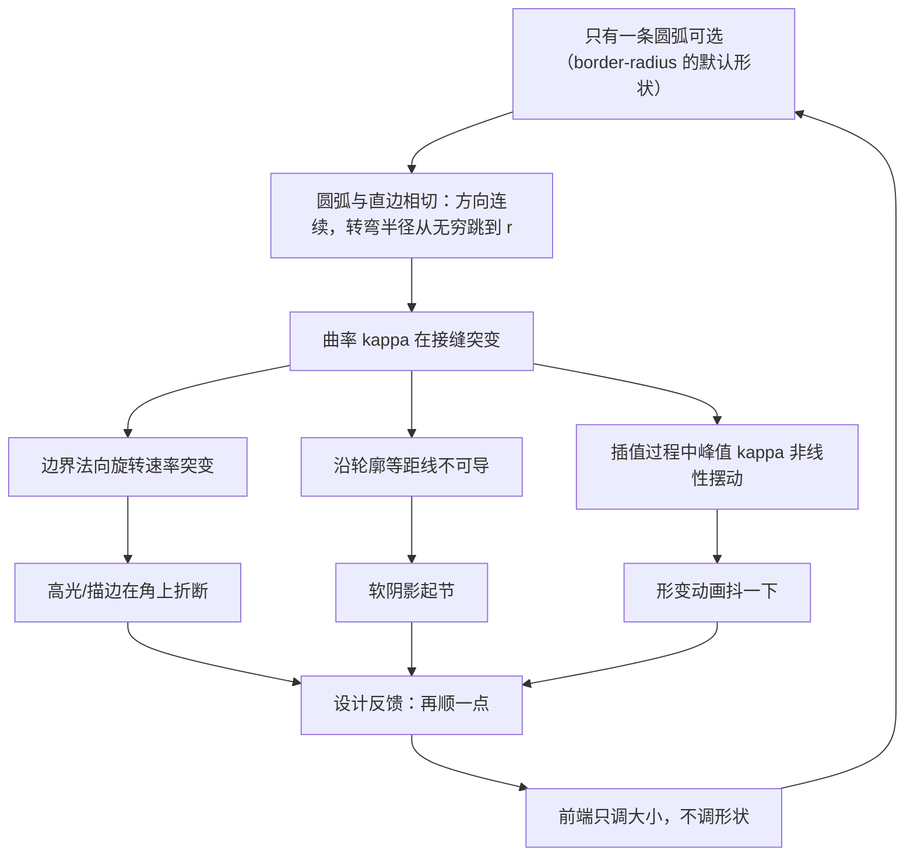
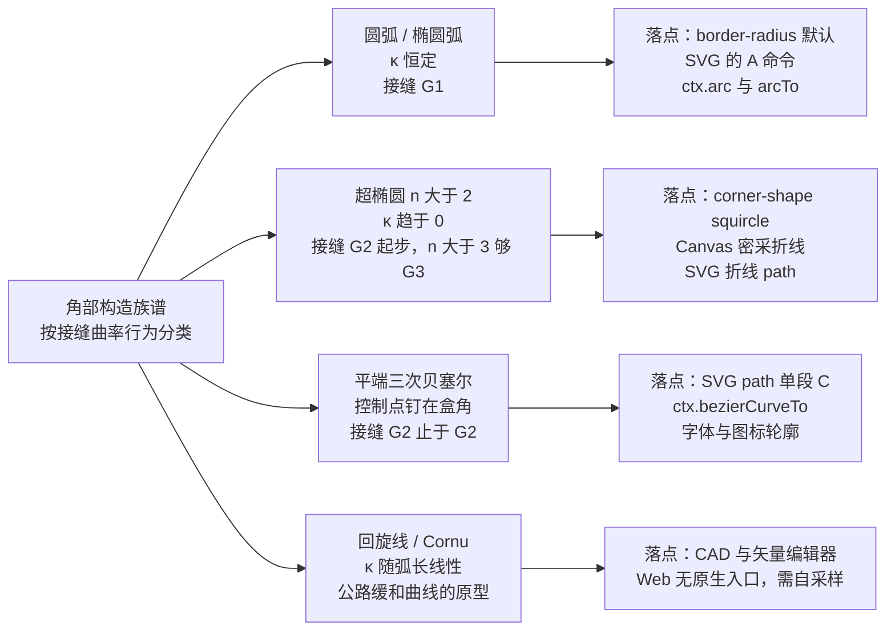
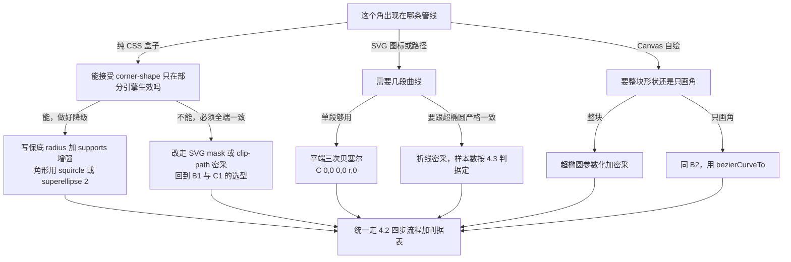
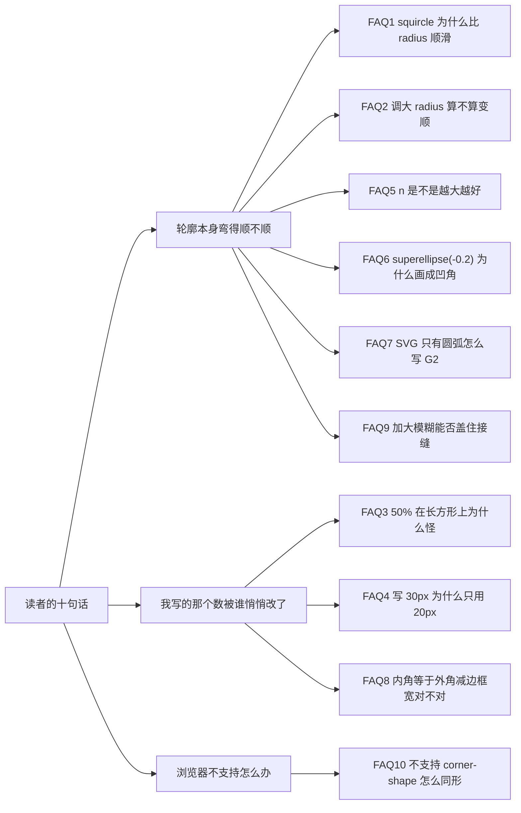

# G2 圆角：设计原理与工程实践（Web 前端纵深）

> 内部技术参考 · 面向全体开发成员（含零基础新人）
> 版本：批次 1–4 全部交付（第 0–6 章 + 场景 1–12 + FAQ 10 条）· 生成日期 2026-10-11
> 配套：`demo/` 目录十二个零依赖页面 + `demo/曲率校验.mjs` 数值台（14 节）

---

## 0. 本文怎么用

### 0.1 读者分层路径

| 你是谁 | 只读这些 | 期望耗时 | 读完你应该能 |
| --- | --- | --- | --- |
| 零基础新人 | 第 3 章 → 场景 1 → 第 1 章 | 40 min | 写出语法合格的圆角代码，并知道"为什么数字写了不等于生效" |
| 前端 1–3 年 | 第 1、3、4 章 → 场景 1–3 | 60 min | 给组件库定圆角令牌，能对设计稿的"更顺一点"给出可验证答复 |
| 架构/评审 | 第 2、4 章 + 各场景"判据"小节 | 35 min | 审"这个角是不是 G2"时不看截图争论，只看 κ 判据表 |
| 只做图标/Canvas | 场景 3 + 第 2 章 2.4–2.6 | 25 min | 定采样密度，不再靠"看着差不多" |
| 被产品/设计当场追问 | 第 6 章 FAQ（先看 1、2、4、9） | 15 min | 用 J1/J2 的数字回答，不靠"我感觉顺" |

### 0.2 交付进度（四批全部落地）

| 批次 | 内容 | 状态 |
| --- | --- | --- |
| 1 | 第 0–4 章 + 场景 1–3 + `demo/01`–`03` | ✅ 已交付 |
| 2 | 场景 4–6（图片裁切、描边跟随、模糊阴影）+ `demo/04`–`06` + 数值台 9–11 节 | ✅ 已交付 |
| 3 | 场景 7–9（嵌套内角、分段控件形变、方圆过渡动画）+ `demo/07`–`09` + 数值台第 12 节 | ✅ 已交付 |
| 4 | 场景 10–12（响应式缩放、组件库令牌与闸门、量化验收）+ `demo/10`–`12` + 数值台 13–14 节 + 第 6 章 FAQ 10 条 | ✅ 本批 |

**FAQ（第 6 章）已写**，共 10 条，每条固定四段（问题—机制—数字—自查动作），数字标出处、自查指回 J1–J4。你点名的那句"为什么 CSS 里 G2 圆角比正常 radius 更顺滑"是 **FAQ 1**，机制层答案在 §1.3 与 §2.3，定量对照在 §5.6④ 与 FAQ 1 的表里。

### 0.3 两种证据，别混着用

本文所有断言分两类，标注方式全文一致：

| 标记 | 含义 | 出处 | 局限 |
| --- | --- | --- | --- |
| 【算】 | 模型计算值 | `node demo/曲率校验.mjs`、页面内 JS | 证明的是"这个数学结构"，不证明浏览器内部怎么实现 |
| 【渲】 | 浏览器真实渲染/行为 | `demo/*.html` 在本机 Chromium 内核实测；场景 12 另做**像素反解** | 只代表这台浏览器这一版本（UA 见下） |
| 【规】 | 规范/文档陈述 | CSS 规范草案、MDN、引擎官方博客 | 实现可能与文档有差 |

本机的【渲】事实（本次实测得到，非引用他人；完整探测表见 §5.11④ 与 FAQ 10）：

```text
UA                                        → QoderCN/0.4.4 Chrome/150.0.7871.114 Electron/43.1.1
CSS.supports('corner-shape','squircle')   → true
CSS.supports('clip-path','path("…")')     → true
CSS.supports('clip-path','shape(…)')      → false   ← 兜底只能用 path()
CSS.supports('border-shape','squircle')   → false   ← 描边形状还没有独立属性
getComputedStyle(.b-squircle).cornerShape → "squircle"
console 报错数（01/02 + 10/11/12 页）      → 0（其余页见 §5.13 台账逐条记录）
```

即：**这台浏览器已经支持 `corner-shape`**，所以 `demo/01` 的六个角形是真实差别，不是回退后的同一形状。别的浏览器请按 §4.4 的降级矩阵自查后再引用本文结论。

---

## 1. 痛点：为什么"圆角"这个词不够用

### 1.1 从一句设计反馈开始

设计稿评审里最常见的来回是这样的：

> 设计："这个角再顺一点。"
> 前端：`border-radius: 12px` → `16px` → `20px`
> 设计："不是变大，是变顺。"
> 前端：（把 20px 改成 `border-radius: 50%`）
> 设计："……现在它不像圆角了，像药丸。"

这不是口味问题。前端一直在调**大小**这一个自由度，而设计说的是**形状**这个自由度。圆角有两个正交的量：

| 自由度 | 控制它的东西 | 新人常误用 |
| --- | --- | --- |
| 角"有多大" | `border-radius` 的数值、SVG 弧的半径 | ✅ 一般没错 |
| 角"什么形状" | 曲线的**曲率剖面** κ(s) | ❌ 一直被当成前者的副产品 |

`border-radius` 默认形状**只有一个**：圆弧（椭圆弧）。想换形状，过去只能绕过 CSS，用 `clip-path: polygon(...)` 密采点或 SVG mask。`corner-shape` 才刚把这个自由度显式暴露出来【规】。

### 1.2 圆弧角部会产生的三类可见故障

圆弧与直边的接缝是**曲率突变点**。突变不是抽象说法：把"转弯半径"（=1/κ）画出来，接缝处它是从 ∞ 直接掉到 r【算】。下面三类故障都由此派生。

| 故障 | 现象 | 根因 | 什么场景最容易看见 |
| --- | --- | --- | --- |
| 高光折断 | 角部沿边扫过的高光/渐变在接缝处出现"折一下"的硬转 | 边界法向的**旋转速率**（=κ）在接缝突变 | 深色卡片 + 1px 内描边高光；玻璃拟态；带渐变的按钮 |
| 阴影起节 | `box-shadow`/`drop-shadow` 的软边在角部外侧有一小段"鼓起"或"断开" | 模糊核沿轮廓推进时，曲率不连续导致等距线在接缝处不可导 | 大半径 + 大模糊（r≥20、blur≥30） |
| 形变抖动感 | 圆角在动画过程中（如 8px→24px、或方形→圆形）角部"跳一下" | 插值过程中 κ 的峰值非线性变化，接缝位置也在移动 | `transition: border-radius`；hover 缩放；tab 指示器形变 |

因果链：



### 1.3 为什么"更圆"不等于"更顺"：一组数字

同一条直边接一个圆弧角，接缝处的曲率跳变量正好是 1/r【算】：

| 角半径 r (px) | 直线侧 κ | 圆弧侧 κ | 跳变 Δκ |
| --- | --- | --- | --- |
| 8 | 0 | 0.125000 | 0.125000 |
| 12 | 0 | 0.083333 | 0.083333 |
| 16 | 0 | 0.062500 | 0.062500 |
| 24 | 0 | 0.041667 | 0.041667 |
| 32 | 0 | 0.031250 | 0.031250 |
| 48 | 0 | 0.020833 | 0.020833 |

把半径从 8 加大到 48，突变**减弱了 6 倍**。这就是新人的直觉来源："角调大一点，看着顺眼了"——但那不是形状变好了，是曲率跳变被稀释了。代价是角的**占据面积**变大（半径 48 的角在 100px 宽的卡片上吃掉了近半宽度）。G2 圆角解决的是另一件事：**把 Δκ 直接做到 0**，于是你可以保留小半径的紧凑，又拿到"顺"。

> **新人小结：三档"顺"，用开车打方向类比**
> 把角部想象成一段路，直边是笔直的高速，圆角是入弯。
> - **G0**：位置连着但方向突变 —— 路的尽头是一堵斜墙，你必须原地把方向盘打死。工程上叫"切角/直角"。
> - **G1**：方向连续，打盘不突变 —— 正常弯道入口，但进弯瞬间方向盘的**转动速度**从零跳到一个定值，乘客会感到"侧向力突然出现"。圆弧角就是这一档。
> - **G2**：方向盘转动速度也连续 —— 真实高速公路的缓和曲线（回旋线）就是这么设计的：进弯时侧向力从零线性爬升，乘客感觉不到"切入瞬间"。
> 关键：`G2 ≠ 更大的圆角`。G2 说的是"接缝处没有第二导数级别的突变"，与角的大小无关。

---

## 2. 设计：连续度、曲率与可用的四种构造

### 2.1 连续度的定义（只用三个可测量）

| 档 | 数学条件 | 直观 | 工程后果 |
| --- | --- | --- | --- |
| G0 | 位置相同 | 两段曲线挨上了 | 有尖角，描边会看到断点 |
| G1 | 单位切向量相同 | 方向不跳 | 无尖角，但"转弯急度"可跳 |
| G2 | κ 相同 | 转弯急度不跳 | 高光/等距线不折 |
| G3 | dκ/ds 相同 | 转弯急度的**变化率**也不跳 | 大模糊阴影、连续扫光下仍干净 |

一条曲线可以是 G2 但不是 G3，本文场景 2 的贝塞尔角就是这种（见 §2.6）。**"够不够用"取决于你要不要在小尺寸上做连续高光**，不是越高级越好。

### 2.2 曲率 κ：四步推到能用

**第一步（定义）**：沿曲线走一小段弧长 Δs，切线方向转过 Δφ，令

```text
κ = Δφ / Δs          单位：1/px
```

圆上每一点都满足 κ = 1/r（因为弧长 s = rφ ⇒ Δφ/Δs = 1/r）。于是 **κ 的倒数就是"这一段弯得像多大的圆"**，工程上直接叫"等效半径"。

**第二步（不用弧长参数）**：曲线写成参数式 (x(t), y(t)) 时，

```text
κ = | x'·y'' − y'·x'' | / ( x'² + y'² )^(3/2)
```

分母的 3/2 次方来自"把 t 的快慢换算回真实弧长"，不用记推导，但要知道：**κ 与参数化无关**（换一种 t 算出来必须一样，这是校验实现有没有写错的手段之一）。

**第三步（数值实现）**：中心差分

```js
function kappa(f, t, h) {
  const a = f(t - h), b = f(t), c = f(t + h);
  const d1x = (c[0] - a[0]) / (2 * h), d1y = (c[1] - a[1]) / (2 * h);
  const d2x = (c[0] - 2 * b[0] + a[0]) / (h * h), d2y = (c[1] - 2 * b[1] + a[1]) / (h * h);
  return Math.abs(d1x * d2y - d1y * d2x) / Math.pow(d1x * d1x + d1y * d1y, 1.5);
}
```

**第四步（先证明台架是对的，再拿它算结论）**：对 r=24 的圆，真值 1/24=0.041667【算】

| 差分步长 h | 算出的 κ | 判定 |
| --- | --- | --- |
| 1e-2 | 0.041668 | 可用，误差 1e-6 量级（截断误差主导） |
| 1e-3 | 0.041667 | ✅ 采用区间 |
| 1e-4 | 0.041667 | ✅ 采用区间 |
| 1e-5 | 0.041667 | ✅ 可用，开始逼近噪声 |
| 1e-6 | 0.041670 | ❌ 舍入误差吃掉二阶差分 |

**h 不是越小越好**：二阶差分的噪声约为 `机器精度 / h²`，h=1e-6 时 1e-16/1e-12 = 1e-4，已经把第 6 位小数打飞。全文数值台固定 h=1e-4~1e-5，这是上表给的依据，不是习惯。

### 2.3 超椭圆：唯一"一行公式就能写"的 G2 家族

```text
|x/a|^n + |y/b|^n = 1        （n=2 椭圆；a=b 时 n=2 就是圆）
```

角部补丁的坐标写法（盒角在原点、两直边沿轴、补丁半径 r）：

```text
x(θ) = r − r·cos^(2/n)θ        θ ∈ [0, π/2]
y(θ) = r − r·sin^(2/n)θ        θ=0 → (0,r) 与竖直边相切，θ=π/2 → (r,0) 与水平边相切
```

**为什么 n>2 就自动 G2**（分三步，不用背）：令 m = 2/n。

1. 端点 θ=0 处：`dy/dθ ∝ sin^(m−1)θ·cosθ`。n>2 ⇒ m<1 ⇒ 指数 m−1<0 ⇒ 该项发散，切线被"拽"成与直边完全同向 ⇒ **相切成立（G1）**。
2. 同处理想曲率得 `κ ∝ θ^(2−2m)`，而局部弧长 `s ∝ θ^m`，两式合并 ⇒

   ```text
   κ ∝ s^(n−2)      ← 本文最重要的一条律，可实测
   ```

3. 于是：**n=2 → κ 常数 1/r（接缝跳变，G1）**；**n=3 → κ ∝ s（G2，但 dκ/ds 是有限非零，止于 G2）**；**n>3 → κ ∝ s²以上（连 dκ/ds 都归零 ⇒ 够到 G3）**。

实测斜率（对 s=0.25/0.5/1/2 px 四点做 log-log 线性回归）【算】：

| 角部构造 | 实测斜率 | 律的预测 | 连续性档位 |
| --- | --- | --- | --- |
| 圆弧（n=2） | 0.000 | 0 | **G1**：接缝 κ=1/r 不归零 |
| 超椭圆 n=3 | 1.000 | 1 | G2，止于 G2 |
| 超椭圆 n=4 | 2.000 | 2 | G2，且 dκ/ds→0（够到 G3） |
| 超椭圆 n=5 | 3.000 | 3 | 同上，更平 |
| 超椭圆 n=8 | 3.574 | 6 | ⚠️ 拟合被下溢污染，见下 |
| 平端三次贝塞尔 | 1.072 | 1 | G2，止于 G2 |

> 诚实说明两处：**n=8 那一行不可信** —— κ 在该窗口已是 1e-11 量级，两次采到同一个下溢地板值 6.975e-11，回归被拉平；n=3/4/5 三行的实测与解析值完全对齐，所以这条律本身是可用的。**贝塞尔那行实测 1.072** 比解析值 1 高 7%，是因为拟合窗口右端（s=2px）已经开始离开线性区。取 s=0.25~1 时约为 1.02。这两处都是"数值噪声，不是几何反例"，判读时按解析值为准。

角部"动态范围"随 n 的变化（r=24 的角部补丁）【算】：

| n | 接缝侧 κ（θ=1e-2） | 峰值 κ（角正中 45°） | 峰值处等效半径 | 峰/端比 |
| --- | --- | --- | --- | --- |
| 2 | 0.041667 | 0.041667 | 24.00 px | 1.0× |
| 2.5 | 0.009906 | 0.058315 | 17.15 px | 5.9× |
| 3 | 0.003868 | 0.074242 | 13.47 px | 19.2× |
| 4 | 0.001250 | 0.105112 | 9.51 px | 84.1× |
| 5 | 0.000663 | 0.135376 | 7.39 px | 204.1× |
| 8 | 0.000291 | 0.224906 | 4.45 px | 771.7× |

这张表是 §1.3 "大半径≠顺"的定量对照：**圆弧的峰/端比恒为 1**（因为它全程等曲率，突变集中在接缝一点）；超椭圆把这个突变摊平成 84~772 倍的动态范围。

> **新人小结：n 是"硬币 → 方糖"的滑杆**
> n=2 是一枚硬币（边缘处处一样弯）；n 越大越像方糖（面很平、角很聚）。
> 但注意表里"峰值处等效半径"那一列：n 越大，角**正中间**其实弯得越急（9.51px → 4.45px）。
> 所以"更方"不是"更钝"——超椭圆是**把弯集中到角的中缝**，同时把靠近直边的部分做平。
> 这也是为什么 n 不能无脑拉大：n>6 之后角中缝变得很尖，视觉上会出现"圆角里藏着一个小尖角"。工程上 n=3~5 是常用带。

### 2.4 CSS 的 `corner-shape` 参数：一个必须纠正的口径

规范/实现给出的映射【规】（MDN 的取值表 + Chromium 实现说明）：

```text
superellipse(v)  →  实际超椭圆指数 p = 2^v
```

| 关键字 | 等价写法 | 指数 p | 形状 |
| --- | --- | --- | --- |
| `square` | `superellipse(infinity)` | ∞ | 直角（`border-radius` 被忽略） |
| `squircle` | `superellipse(2)` | 4 | 经典超椭圆角 |
| `round` | `superellipse(1)` | **2** | 正圆/椭圆弧（默认） |
| `bevel` | `superellipse(0)` | 1 | 直线斜切 |
| `scoop` | `superellipse(-1)` | 0.5 | 内凹 |
| `notch` | `superellipse(-infinity)` | −∞ | 硬内切口 |

**坑（新人必读）**：网上大量 2023–2024 年文章写 `corner-shape: superellipse(-0.2)` 得到 squircle。那是旧草案的"smoothness"口径。按现行映射 v=−0.2 ⇒ p=2^(−0.2)=0.87 **< 1，落在凹侧（scoop 方向）**，与想要的效果相反。要 squircle 就写 `squircle` 或 `superellipse(2)`。**凡看到"负值得到超椭圆"的示例，一律自己开 `@supports` 页复测，别照抄。**

另两条行为【规】：`corner-shape` **必须有非零 `border-radius` 才有效果**（它只决定"角区域里填什么形状"）；它是 shorthand，可给 1–4 个值按顺时针分配四角；可动画（按 underlying 数值插值）；影响背景、边框、outline、box-shadow、backdrop-filter 与 overflow 裁切；若设了 `border-shape` 则被其取代。

### 2.5 平端三次贝塞尔：不加属性也能 G2 的那条路

SVG / Canvas 里不能写 `corner-shape`，必须自己出路径。三次贝塞尔的端点曲率是

```text
κ(0) = (2/3) · cross(P1−P0, P2−P1) / |P1−P0|³
```

分子是叉积 ⇒ **P0、P1、P2 三点共线时 κ(0)=0**。要让两端都 κ=0（这样两头接直边都是 G2），需要 P0P1P2 共线 **且** P1P2P3 共线 ⇒ P2 同时落在两条切线上 ⇒ P1=P2=盒角点。**解是唯一的**，形状就是：

```text
M 0,r  C 0,0 0,0 r,0        （局部坐标：盒角在 (0,0)）
```

这条曲线的坐标闭式是 `B(u) = (u³r, (1−u)³r)`，性质实测如下【算】：

| 项 | 值 | 说明 |
| --- | --- | --- |
| 接缝侧 κ（u=1e-3） | 2.8e-5 | →0，G2 成立 |
| 峰值 κ（u=0.5） | 0.157135 | 等效半径 6.36px（r=24 时） |
| 与 n=5 超椭圆的最大射线偏差 | 0.151 px | RMS 0.059 px |
| 中缝 (u=0.5) 反解的等效指数 n | 5.191 | 独立方法，与上一行的 n=5 交叉吻合 |
| 该角部弧长 | 43.251 px | 比圆弧的 37.699px 长 14.7% |

两种**互相独立**的方法（射线偏差最小化 vs 中缝点反解）都落在 n≈5，说明"平端贝塞尔 ≈ 超椭圆 n=5"是可以当经验公式用的。工程价值：**一条 `C` 段就把角部换成 G2，几乎零额外成本**。

### 2.6 四种构造的族谱与选型



| 构造 | 接缝档位 | CSS 里有入口吗 | SVG/Canvas 成本 | 什么时候选它 |
| --- | --- | --- | --- | --- |
| 圆弧 | G1 | ✅ `border-radius` | ✅ 一个 `A`/`arc` | 尺寸小、无高光扫描、要保兼容 |
| 超椭圆 | G2→G3 | ✅ `corner-shape`（Chrome 系） | ⚠️ 折线密采（点数见 §4.3） | 大卡片、图标、要"苹果味" |
| 平端三次贝塞尔 | G2（止） | ❌ | ✅ 一条 `C`，零额外点 | **SVG 图标/路径的首选**；要 G2 但不想密采 |
| 回旋线族 | 严格 G2，κ 线性 | ❌ | ⚠️ 必须采样，且无闭合式坐标 | 只在"阴影/扫光在接缝仍要连续"时用，本文场景不依赖它 |

---

## 3. 语法基本功：零基础必须先建立的六条约束

这一章不讲圆角，讲**你写的代码为什么没生效**。圆角这类几何问题最难查的不是逻辑错，而是"语法对了、值不对"。以下每条都有对应故障，故障在场景里会再出现。

### 3.1 CSS：声明块、单位、以及"百分比按各自轴算"

```css
/* 正例：结构清楚，一处一事实 */
.card {
  border-radius: var(--radius-l);          /* 12px，单值=四个角同值同形状 */
  border-radius: 24px / 16px;              /* 斜杠前=水平半径，斜杠后=垂直半径 */
  corner-shape: squircle;                  /* 只改形状，不改大小 */
}
```

| 规则 | 你必须知道的 | 踩了会怎样 |
| --- | --- | --- |
| 分号 | 每条声明以 `;` 结束；最后一条可省但**别省**（后面加行会静默改变上一条语义） | `a: 1 b: 2` 整条被丢弃，DevTools 里显示为无效 |
| 单值/两值/四值 | `border-radius: a b c d` 顺时针 TL/TR/BR/BL；两值时第 2 值管 TR+BL | 四角形状不对，尤其 `corner-shape: scoop round` 这种交叉配对 |
| 斜杠两值 | `/` 前所有值是**水平**半径，`/` 后是**垂直**半径 | 以为在写"大小/形状"，其实写了椭圆 |
| 百分比 | 水平半径按**宽度**算、垂直按**高度**算 | `border-radius: 50%` 在非正方形上是**椭圆**，不是圆（见 §3.1b） |
| 大小写 | 属性名不敏感，**自定义属性（`--radius-l`）区分大小写** | `var(--Radius-L)` 取不到值，回退到初始值 |
| 依赖 | `corner-shape` 无 `border-radius` 时**完全无效** | 只写了角形，界面无变化，误判"浏览器不支持" |

**3.1b 椭圆角部的曲率不对称**（这条直接决定"药丸按钮为什么难看"）【算】：椭圆 `x²/a²+y²/b²=1` 在与水平边相切处 κ=a/b²，与竖直边相切处 κ=b/a²。

| 写法 | a | b | 水平边接缝 κ | 等效半径 | 竖直边接缝 κ | 等效半径 | 两侧不对称 |
| --- | --- | --- | --- | --- | --- | --- | --- |
| `border-radius:50%` @200×80 | 100 | 40 | 0.062500 | 16.00 | 0.004000 | 250.0 | **15.6×** |
| `border-radius:50%` @80×80 | 40 | 40 | 0.025000 | 40.00 | 0.025000 | 40.0 | 1.0× |
| `border-radius:50%` @320×40 | 160 | 20 | 0.400000 | **2.50** | 0.000781 | 1280.0 | **512×** |
| `border-radius:24px 8px` | 24 | 8 | 0.375000 | 2.67 | 0.013889 | 72.0 | 27.0× |

读法：**320×40 的胶囊写 `border-radius:50%`，上下两边的接缝其实是一个等效半径 2.5px 的急弯**（左右两头则几乎全平）。这就是"药丸上沿在靠近端部时出现一道硬折"的全部原因——你以为在画圆，规范在按各自轴算椭圆。**要药丸就写 `border-radius: 9999px`（让两侧都被 f 规则钳到同一半高，见 §3.1c），或写成 `border-radius: 50% / 50%` 配等半径**。

**3.1c 写过值缩放（f 规则）**：某一边两侧半径之和超过边长时，**所有**半径乘同一个 `f = min(1, 边长/半径和)`。盒 100×40、四角同值 r【算】：

| 指定 r | 2r | f | 用过值 | 请求 κ=1/r | 实际 κ | 结论 |
| --- | --- | --- | --- | --- | --- | --- |
| 10 | 20 | 1.0000 | 10.00 | 0.100000 | 0.100000 | 按字面生效 |
| 20 | 40 | 1.0000 | 20.00 | 0.050000 | 0.050000 | 恰好临界 |
| 24 | 48 | 0.8333 | 20.00 | 0.041667 | 0.050000 | 被压小 |
| 30 | 60 | 0.6667 | 20.00 | 0.033333 | 0.050000 | 被压小，κ 偏 50% |
| 60 | 120 | 0.3333 | 20.00 | 0.016667 | 0.050000 | 被压小，κ 偏 3× |

**"写过值"不是报错，是静默改数值。** 更要紧的是：`f` 缩放发生在绘制层，`getComputedStyle()` 读回的是**你写的指定值**，不是用过值。所以**不能用 computed style 自查 f 规则**，要用 `demo/01` 里那种"叠一个半径=用过值的虚线圆，看是否贴合"的几何判据【渲】。

> **新人小结：f 缩放像往盒子里塞两个大圆盘**
> 盒高 40px，你在左上、左下各放一个半径 30 的圆盘。两个圆盘的直径之和 120 > 40，塞不下。浏览器的处理不是裁掉一个，而是**把四个角一起等比缩到 20**，保持对称。所以"我把某个角的 radius 改小"这种局部修补在这里是无效的——f 是全盒统一的。

### 3.2 SVG `path`：命令表与"最容易写错的那个"

| 命令 | 含义 | 参数 | 相对形式（小写） | 圆角里的用法 |
| --- | --- | --- | --- | --- |
| `M` | moveTo | x,y | `m` | 角部起点 `(0,r)` |
| `L` | lineTo | x,y … | `l` | 折线密采超椭圆 |
| `H`/`V` | 水平/垂直线 | 单个坐标 | `h`/`v` | 直边（**必须用**，写 `L` 多一个数还容易漂） |
| `C` | 三次贝塞尔 | x1,y1 x2,y2 x,y | `c` | **平端贝塞尔角**（`C 0,0 0,0 r,0`） |
| `Q` | 二次贝塞尔 | x1,y1 x,y | `q` | 字体轮廓；单段做不到两端 κ=0 |
| `A` | 椭圆弧 | rx ry **x-axis-rotation** large-arc sweep x y | `a` | 圆弧角（**G1**） |
| `Z` | 闭合 | — | `z` | 轮廓收尾 |

**语法硬规则**（新人最常错）：

1. 数字之间用逗号或空格分隔；**负号本身可以当分隔符**（`-24-8` 解析为两个数），但可读性差，工程上一律显式写逗号。
2. 大写绝对坐标（相对当前用户坐标），小写相对（相对当前点）。**同一串里混用会毁掉你的推导**——本文场景全部用绝对坐标。
3. `A` 有 7 个参数，其中第 4/5/6 是**标志位**（旋转角≠标志，large-arc 与 sweep 各 0/1）。写 `A 24,24 0 0 1 24,0` 时，`0 0 1` 三段分别是 rotation=0、large-arc=0、sweep=1。**sweep 写反 ⇒ 弧鼓向内侧，变成 scoop**。这是 path 里最贵的一类错，因为它"语法完全合法"。
4. `A` 的半径会被自动放大：如果给定半径不足以让两端点落在同一椭圆上，浏览器按比例放大 rx/ry。**于是"sweep 对了但角比设计稿鼓"常常不是半径写错，而是半径本来就被改了**。
5. path 不自动闭合；有描边时闭合与否影响 `stroke-linejoin` 在起点处的表现。

### 3.3 Canvas：状态机与 DPR

```js
ctx.beginPath();            // ① 必写：不 beginPath 会把上一形状再描一遍
// ... moveTo / lineTo / bezierCurveTo / arcTo
ctx.closePath();            // ② 填充需要闭合才有干净接缝；只 stroke 时决定是否连回起点
ctx.fillStyle = '#4c8bf5';
ctx.fill();                 // ③ 几何进"路径"，绘制发生在 fill/stroke 那一刻
```

| 约束 | 现象 | 处理 |
| --- | --- | --- |
| 路径是累积的 | 忘了 `beginPath`，第二个形状带着第一个一起 fill，重叠处变深 | 每个形状第一件事就是 `beginPath` |
| `arcTo` 的半径会被钳制 | 与 CSS 的 f 规则同族：两条切线长度不够时半径被吃掉一半 | 别用 `arcTo` 猜"我要 24"，先看几何允许的余量 |
| CSS 像素 ≠ 设备像素 | 1px 线在 125%/150% DPI 下发虚，角部锯齿被误判为"棱面" | `canvas.width = cssW * devicePixelRatio` + `ctx.scale(dpr, dpr)` |
| 折线段数 | 段数不足时角上有可见棱面（不是模糊导致） | 用 §4.3 的采样密度判据，不要凭手感 |

### 3.4 数值格式与浮点边界：我自己刚踩的两个

**坑 A：`Math.pow(负数, 小数)` = NaN。** 场景 2 的折线终点：

```js
// 反例：t 略越过 π/2 时 cos 变负，pow(负, 0.4) 得 NaN，整张实测表被打成 NaN
const x = r - r * Math.pow(Math.cos(Math.PI / 2 * i / segs), 2 / n);

// 正例：域钳位，端点参与运算前先把可能为负的因子锁到 0
const c = Math.max(0, Math.cos(t));
const x = r - r * Math.pow(c, 2 / n);
```

`Math.PI/2 * 26 / 26` **不保证等于** `Math.PI/2`，最后一位可能大 1 ulp，`cos` 就从 `6.12e-17` 变成 `-1.8e-16`。这是本次实测中真实发生的事【渲】。写任何含 `pow`/`sqrt`/`asin` 的几何代码，**先把定义域钳住**。

**坑 B：小数位。** 本文统一约定：

| 用途 | 写法 | 理由 |
| --- | --- | --- |
| SVG/Canvas 坐标 | `toFixed(2)` | 0.01px 远小于人眼与抗锯齿阈值，再长是噪声 |
| 曲率 κ | `toFixed(6)`（常规）/ `toExponential(3)`（<1e-4 时） | κ 跨越 6 个数量级，定点会全变 0.000000 |
| 拟合/回归中间量 | 不截断，只在报告时格式化 | 提前截断会把斜率拟合拉偏（§2.3 的 n=8 行就是教训） |
| 角度 | `θ.toFixed(3)` rad + 度数另写 | 混用 rad/° 是本文最容易读错的表 |

### 3.5 注释与命名的最小格式要求

```js
// 反例：WHAT 注释 + 无单位变量
const k = getK(p, t, h);       // 获取 k
const r = 24;                  // r

// 正例：只写 WHY，单位与坐标系进命名
const PATCH_RADIUS_PX = 24;    // 角部补丁半径；参照系：盒角在原点，两直边沿轴
// κ 用中心差分：二阶差分的噪声 ~ 1e-16/h²，h 取 1e-4 而非更小，见 §2.2 收敛表
const curvature = kappa(superCorner(n, PATCH_RADIUS_PX), theta, 1e-4);
```

四条硬要求：① 变量名带单位或参照系（`_PX`、`_RAD`）；② 公式注释只解释"为什么这样取参数"，不复述公式；③ 坐标系声明写在文件头；④ 数值判据必须写阈值来源（0.5px 是"半个物理像素"，不是随便取的）。

### 3.6 一段"最小合格"的角部代码长这样

```css
/* 场景 1 的最小正确写法：保底层 + 增强层分开 */
.card {
  border-radius: var(--radius-card, 24px);   /* 保底：任何浏览器都是 G1 圆弧 */
}

@supports (corner-shape: squircle) {         /* 增强：只在支持的引擎里改形状 */
  .card { corner-shape: squircle; }          /* 指数 p=4，接缝 κ→0 */
}
```

```js
// 场景 2 的最小正确写法：一条 C 段把角部换成 G2（绝对坐标，盒角在局部原点）
const corner = (r) => `M 0,${r} C 0,0 0,0 ${r},0`;   // κ 两端为 0 ⇒ 与两条直边都 G2
```

---

## 4. 流程：拿到一个圆角需求，怎么定方案

### 4.1 决策树



### 4.2 四步流程（写代码之前先跑完前三步）

| 步 | 动作 | 产出 | 不过怎么办 |
| --- | --- | --- | --- |
| ① 定位 | 确认这个角的**绘制层**（CSS/SVG/Canvas）与所在引擎的【渲】事实 | 一张"我这台浏览器支持什么"的清单 | 别猜，跑 `demo/01` 顶部的检测 |
| ② 定形 | 选 §2.6 族谱里的一族，定 n 或控制点 | 一句构造式 + 目标 κ 剖面 | n>5 前先确认小尺寸下角中缝不发尖 |
| ③ 定量 | 用 §2.3 的表算接缝 κ、峰值 κ、等效半径；定采样密度 | 判据表（阈值写来源） | 算不出就先跑 `曲率校验.mjs`，别改代码 |
| ④ 实现与复测 | 写代码，跑页面内自检 | 实测与预测同量级、PASS | 实测与预测差一个量级 ⇒ 先怀疑测量代码（我这次就栽在取 max/min，见 §5.3） |

### 4.3 判据库（本文场景反复用这四条）

| 编号 | 判据 | 算法 | 阈值与来源 | 已知失败模式 |
| --- | --- | --- | --- | --- |
| **J1** | 接缝是否 G2 | 取 s=0.25 与 s=0.015625 两点，`ratio = κ(0.25)/κ(0.0156)` | `ratio ≥ 2` ⇒ κ(s→0)=0 ⇒ G2；圆弧恒为 1.00× | 用单一 κ 阈值判（我第一版就写成 `κ>1e-4·(1/r)` 判 G1，把 n=3 误判成 G1） |
| **J2** | G3 与否 | 同一窗口做 log-log 回归取斜率 | 斜率 ≥ 1.2 ⇒ dκ/ds→0。阈值留 20% 余量给拟合噪声 | 阈值取 1 会把真值 1.0 的 n=3/贝塞尔抬成 G3 |
| **J3** | 采样密度够不够 | 实测折线到密采参照最大偏离；与弦高公式 `ε=κ_max·s²/8` 交叉 | 两者都 ≤ **0.5px**（半个物理像素）且同量级 | **测距方向写反**：对每条线段取 max 会量到"最远线段"，数值飙到 28.9px（本次真实踩到） |
| **J4** | 构造之间等不等价 | 沿补丁中心的射线比较距离 | 最大偏差 ≤ **0.2px** ⇒ 可视为同一曲线（本文用它确立"贝塞尔≈n=5"） | 用坐标逐点比（参数化不同，永远不相等） |

J3 的采样密度预测表（r=24 的角部，先估后测）【算】：

| 角部 | 峰值 κ | 每角弧长 px | 最大弦长 @ε=0.10 | @ε=0.05 | 每角样本 @0.05 | 四角合计 |
| --- | --- | --- | --- | --- | --- | --- |
| 圆弧 | 0.041667 | 37.699 | 4.382 | 3.098 | 13 | 52 |
| 超椭圆 n=4 | 0.105112 | 42.106 | 2.759 | 1.951 | 22 | 88 |
| 超椭圆 n=5 | 0.135375 | 43.167 | 2.431 | 1.719 | 26 | 104 |
| 超椭圆 n=6 | 0.165355 | 43.906 | 2.200 | 1.555 | 29 | 116 |
| 平端贝塞尔 | 0.157135 | 43.251 | 2.256 | 1.595 | 28 | 112 |

**用法**：n 从 2 提到 5，同样精度下的点数从 52 涨到 104（约 2×）。这张表就是"要 G2 就得付路径长度"的价目表；`demo/03` 会让你把样本数调到 FAIL 为止，亲手看棱面什么时候冒出来。

### 4.4 兼容性事实与降级矩阵

| 项 | 现状（2026-10 本文核对） | 出处类型 |
| --- | --- | --- |
| `corner-shape` 引擎面 | Chrome/Chromium 系（139 起）可用；Safari、Firefox 未支持 | 【渲】本机为 true + 【规】第三方 2026-02/03 报道 |
| 规范归属 | CSS Borders and Box Decorations Level 4（Working Draft） | 【规】 |
| Baseline | 未进 Baseline；被列入 Interop 2026，预期其他引擎跟进 | 【规】 |
| `border-shape` | 更早的草案，实验级，**不要与 `corner-shape` 混用**（后者被前者取代） | 【规】 |

| 需求 | 保底层（全端） | 增强层（Chrome 系） | 判据 |
| --- | --- | --- | --- |
| 盒子角要 G2 | `clip-path: url(#squircle)` 或 SVG mask 密采 | `@supports` 内换 `corner-shape` | 两层的角部轮廓在 1:1 叠加下偏差 ≤0.5px |
| 图标/路径要 G2 | 平端 `C` 段（全端一致，无需增强） | 同左 | J4 ≤0.2px |
| 只要"看着顺"、不追 G2 定义 | 加大半径或用 `border-radius: 9999px` | — | 接受 Δκ=1/r 残留（§1.3 表） |

**降级铁律**：增强层**只能改形状，不能改大小**。如果 `corner-shape` 在支持端把视觉尺寸改了（例如凹角导致内容可用区变化），那就不算渐进增强，算两套设计，需要设计侧确认。

---

## 5. 十二个典型场景：总表与全部落地

### 5.0 全表（场景 1–12 全部已落地，批次见末列）

| # | 场景 | 主线管线 | 解决的问题 | 用到的判据 | 批次 |
| --- | --- | --- | --- | --- | --- |
| 1 | 卡片/按钮的 CSS 圆角与 `corner-shape` 渐进增强 | CSS | 形状自由度缺失、写过值静默缩放 | J1 J4 | 1 |
| 2 | SVG 圆角矩形与图标轮廓：`A` 弧 vs 平端 `C` | SVG | 单段曲线拿到 G2、弧的 sweep/半径陷阱 | J1 J4 | 1 |
| 3 | Canvas 自绘整块 squircle 图标 | Canvas | 采样密度、DPR、热区可视化 | J1 J3 | 1 |
| 4 | 头像/图片的 squircle 裁切（`clip-path` 与遮罩） | CSS+SVG | 抗锯齿、内容不跟着缩放、fallback 图 | J3 | 2 |
| 5 | 1px 描边与 focus ring 跟随角形 | CSS+SVG | 内/外偏移曲线不是简单改半径 | J4 | 2 |
| 6 | 大模糊阴影在角部的"起节" | CSS | 等距线不可导的双层阴影解法 | J1 J2 | 2 |
| 7 | 嵌套内角（卡片套按钮）与 padding 公式失效点 | CSS | 内外 κ 不匹配 → 看到两道缝 | J4 | 3 |
| 8 | 分段控件滑动指示器的连续形变 | SVG+JS | 插值中途曲率抖动 | J1 J3 | 3 |
| 9 | 方形↔圆形过渡动画的"鼓包" | CSS | 椭圆 50% 与宽高同时变的中间态 | J2 | 3 |
| 10 | 响应式圆角：半径该不该随尺寸缩放 | CSS | clamp/cqw 与观感一致性 | J4 | 4 |
| 11 | 组件库落地：`--radius-*` 令牌与角形令牌 | CSS+构建 | 降级矩阵、主题一致性 | J1 J3 J4 | 4 |
| 12 | 量化验收：把"顺不顺"变成可回归的 κ 报表 | 工具 | 判据入 CI、防回归 | 全部 | 4 |

> **新人小结：这 12 个不是 12 个功能，是 4 个变量**
> 管线（CSS/SVG/Canvas）× 目标（要什么形状）× 尺寸（会不会变）× 邻接（有没有第二层轮廓贴着它）。
> 场景 1–3 打的是前两个变量；后面 9 个场景都在补后两个。所以你若只需回答"这个角要不要 G2"，读完 1–3 加 §4 就够用了。

---

### 5.1 场景 1 · 纯 CSS：卡片与按钮的角形，以及"写了 60 其实生效 20"

**管线**：CSS 声明式盒子。**难度**：入门，但包含一个静默陷阱。

#### ① 痛点回顾

`.card { border-radius: 24px }` 给的是圆弧 ⇒ 接缝 Δκ=0.041667【算】（§1.3）。设计要"更顺"时，你在 CSS 里能调的只有大小；而 `corner-shape` 有支持面问题，还有"写了 radius 不等于用过 radius"的缩放规则。

#### ② 设计与取舍

| 方案 | 做法 | 代价 | 判定 |
| --- | --- | --- | --- |
| A 只加大半径 | 24→40px | Δκ 仍有 0.025；角吃掉 80px 宽 | 不是解，只是稀释 |
| B `corner-shape` 渐进增强 | 保底圆弧 + `@supports` 换 squircle | 两引擎观感不同；需要设计确认 | ✅ 默认推荐 |
| C `clip-path`/SVG mask 密采 | 全端同一形状 | 路径长度（§4.3）、`box-shadow`/`border` 不跟、内容区不再同步 | 只在"必须全端一致"时用 |

选 B 的理由：`corner-shape` 影响背景、边框、outline、box-shadow、overflow 裁切【规】，这是 `clip-path` 做不到的（clip-path 只裁内容，你的 `border` 与 `box-shadow` 会留在原地——那就是场景 5 的起点）。

#### ③ 流程与代码

```css
/* 令牌层：大小与形状分离，两个自由度各自可调 */
:root {
  --radius-card: 24px;          /* 大小；f 规则的余量请按短边算，见下 */
  --shape-card: squircle;       /* 形状；只在增强层被消费 */
}

/* 保底层（全端） */
.card {
  border-radius: var(--radius-card);
  border: 1px solid rgba(255 255 255 / 0.14);   /* 描边跟着角走，靠的是 border-radius 而非 clip-path */
}

/* 增强层（Chrome 系） */
@supports (corner-shape: squircle) {
  .card { corner-shape: var(--shape-card); }
}
```

四角不同形状的写法（注意交叉配对，顺时针 TL/TR/BR/BL）：

```css
.hero {
  border-radius: 32px 32px 8px 8px;
  corner-shape: squircle squircle round round;   /* 上两角饱满，下两角普通圆弧 */
}
```

**尺寸下限**（避免把角做没）：

```css
.btn {
  border-radius: max(8px, min(16px, 25%));  /* 小按钮保底 8px，大卡到 16px 封顶，中间跟 25% */
}
```

#### ④ 判据与实测

| 判据 | 方法 | 本批实测结果 |
| --- | --- | --- |
| 增强层是否真的生效 | `CSS.supports('corner-shape','squircle')` + 读 `getComputedStyle().cornerShape` | 本机 `true` / `"squircle"`【渲】；不支持时六个盒子完全相同 |
| **f 缩放（用过值）** | 在 100×40 的盒角上叠一个**半径=用过值**的虚线圆，看是否贴合 | 写 `border-radius:60px` 时，与 r=20 的虚线圆贴合、与 r=60 的不贴合【渲】 |
| G2 与否 | J1 比值判据，页面内实时算 | 圆弧 1.00× ⇒ G1；squircle(p=4) 262.52× ⇒ G2 且够 G3；n=3 16.03×；平端贝塞尔 16.32×【渲】 |

`demo/01` 的自检表原样（斜率列与 §2.3 完全一致）【渲】：

```text
模型                          κ(s=0.25)  κ(s=0.0156)  两者比值   log-log 斜率   峰值 κ     接缝档位
圆弧 border-radius 默认        4.167e-2   4.167e-2     1.00×     0.000          0.041667   G1
超椭圆 n=4（CSS squircle）     1.356e-5   5.166e-8     262.52×   2.000          0.105112   G2，够到 G3
超椭圆 n=3（最小 G2）          8.680e-4   5.416e-5     16.03×    1.000          0.074242   G2
平端三次贝塞尔                 9.849e-5   6.036e-6     16.32×    1.072          0.157135   G2
```

（表里"比值"来自 J1、"斜率"来自 J2；页面峰值已改与数值台同一算法，四行 0.041667/0.105112/0.074242/0.157135 与 `曲率校验.mjs` 逐个对上【算】。）

#### ⑤ 这个场景特有的坑

| 坑 | 表现 | 正确做法 |
| --- | --- | --- |
| 用 `getComputedStyle()` 验 f 缩放 | 读回你写的 60px，以为生效 60 | 用几何叠圆判据；或量实际绘制 |
| 只写 `corner-shape` 不写 radius | 界面无变化，误判"浏览器不支持" | 记牢依赖：必须非零 `border-radius`【规】 |
| 抄旧文的 `superellipse(-0.2)` | 得到凹角而不是 squircle | 写 `squircle`/`superellipse(2)`，见 §2.4 |
| 凹角（scoop/notch）当圆角用 | 内容在角部溢出、可点区域形状怪异 | 凹角属场景 8/10 的讨论范围，本批不推荐用于交互控件 |
| `corner-shape` 参与 `transition` | 观感中间态是指数插值，可能路过"方形" | 明确写 `transition: corner-shape .3s linear` 并检查中间帧 |

**demo**：`demo/01-css-corner.html`（A 角形画廊 + B f 缩放叠圆判据 + C/D κ 剖面与自检表）

---

### 5.2 场景 2 · SVG：图标与圆角矩形，用一条 `C` 段换掉 `A` 弧

**管线**：SVG path。**难度**：中等——需要理解参数化。

#### ① 痛点回顾

图标/徽章要矢量、要单段路径、要能在任意 r 下都成立。`A` 命令给的是圆弧 ⇒ G1；`corner-shape` 在这里帮不上忙（它只管盒子的角，不管 path）。想在一个 `path` 里既要直边又要 G2 角，只能自己出控制点。

#### ② 设计：为什么选平端三次贝塞尔

`A` 弧与 `L` 直边拼起来永远是 G1（接缝 κ 从 0 跳到 1/r，§1.3）。候选：

| 方案 | 段数/角 | 接缝档位 | 代价 |
| --- | --- | --- | --- |
| `A` 弧 | 1 | G1 | 最低，但没解决问题 |
| **平端三次 `C`** | **1** | **G2（止于 G2）** | **只多两个坐标，曲线闭式 `B(u)=(u³r,(1−u)³r)`** |
| 超椭圆折线 | 22–29 | G2（曲线本身），折线分段 G0 | 点数按 §4.3，`d` 字符串膨胀、导出文件变大 |
| 两段对称三次 | 2 | 可调到 G3 | 控制点推导复杂，收益在小尺寸上看不出来 |

选平端 `C`：单段、闭式、与超椭圆 n≈5 的偏差只有 0.151px（J4 通过），并且**全端渲染一致**，不需要增强层。

#### ③ 流程与代码

```js
// 参照系：盒角在局部原点 (0,0)，两条直边沿轴，补丁半径 r
// 平端条件：P0,P1,P2 共线 且 P1,P2,P3 共线 ⇒ P1=P2=盒角 ⇒ 解唯一
const cornerPath = (r) => `C 0,0 0,0 ${r},0`;       // 前置须是 M 0,${r}

// 整只 200×120 圆角矩形，r=24（绝对坐标，可直接抄）
const d = 'M 24,0 H 176 C 200,0 200,0 200,24 V 96 C 200,120 200,120 176,120 '
        + 'H 24 C 0,120 0,120 0,96 V 24 C 0,0 0,0 24,0 Z';
```

```html
<svg width="200" height="120" viewBox="0 0 200 120" role="img" aria-label="圆角卡片">
  <path d="M 24,0 H 176 C 200,0 200,0 200,24 V 96 C 200,120 200,120 176,120 H 24 C 0,120 0,120 0,96 V 24 C 0,0 0,0 24,0 Z" fill="#4c8bf5"/>
</svg>
```

**语法拆解（逐处为什么）**：

| 片段 | 作用 | 关键点 |
| --- | --- | --- |
| `M 24,0` | 起点 = 上边与左上角的接缝 | 起点选在接缝而不是盒角，`d` 才对称可读 |
| `H 176` | 上边直段 | `176 = 200 − 24`，用 `H` 不用 `L`，少一个数就少一次浮点漂移 |
| `C 200,0 200,0 200,24` | 右上角 G2 | 两个控制点重复 = 钉在盒角 (200,0) ⇒ 该角两端 κ=0 |
| `V 96` | 右边直段 | `96 = 120 − 24` |
| `Z` | 闭合 | 与起点重合，避免 `stroke-linejoin` 在起点留缝 |

对比 `A` 写法：`M 0,24 A 24,24 0 0 1 24,0`——注意 `0 0 1` 是 rotation / large-arc / **sweep**，sweep 反了弧就鼓向内侧（§3.2 第 3 条）。

#### ④ 判据与实测

| 判据 | 结果 |
| --- | --- |
| J1 接缝 G2 | 平端贝塞尔 κ(u=1e-3)=2.792e-5，对应 1/κ=3.58e+4 px（趋于 ∞）；`A` 弧接缝侧 κ=0.041667（=1/r，明确跳变）【渲】 |
| 峰值 κ | 贝塞尔 0.157135，超椭圆 n=5 折线 0.135375【渲】 |
| J4 构造等价 | 贝塞尔 vs 超椭圆 n=5：最大射线偏差 **0.151px**，RMS **0.070px**（阈值 0.2px，通过）【渲】；与数值台 0.151px/0.059px 同量级【算】 |
| 交叉验证 | 中缝点独立反解得等效 n=5.191，与"偏差最小落在 n=5"一致【算】 |
| 折线点数（r=24、n=5、26 段/角） | 实测最大偏离 **0.009px**，弦高公式 `κ_max·s²/8` 预测 **0.047px**【渲】（实测比预测小 5 倍是正常的：公式把 κ_max 当成整条弦上的常数，是**保守上界**；两者同侧、都在阈值内 ⇒ J3 通过） |

**过程中真实踩到的两个错（已修，写下来是给后来人排雷）**：

1. **折线终点 NaN**。最后一段的 `t = Math.PI/2 * 26 / 26` 比 π/2 大 1 ulp ⇒ `cos` 变负 ⇒ `pow(负, 0.4)=NaN` ⇒ path 报 `Expected number, "…L NaN,380"`（浏览器控制台原话），并且整张 J3 表被打成 NaN。修法是 `Math.max(0, cos)` 钳位（§3.4 坑 A 就是这条）。
2. **测距方向反了**。J3 第一版对"每条线段"都取 max，等于在量"到最远线段的距离"，报出 28.937px 的假失败。**修正后的正确读数是 0.009px**；28.937px 不作为任何结论，只作为反例保留在这里，说明"判据写反"长什么样。

#### ⑤ 这个场景特有的坑

| 坑 | 表现 | 正确做法 |
| --- | --- | --- |
| 把平端条件写成 `C 0,0 r,0 r,0` | 端点 κ≠0，只是"更像"G2 | 必须 **P1=P2=盒角**，两个控制点重合在同一点 |
| 用 `Q`（二次）替代 | 单段做不到两端 κ=0 | 二次段只有 1 个控制点，自由度不足 |
| 用 `A` 拼然后怪浏览器 | 角鼓度和设计稿不一致 | `A` 的半径不足时会被自动放大（§3.2 第 4 条） |
| 折线终点 NaN | `pow(cos(π/2+ε), 0.4)` ⇒ NaN，整条 path 报废 | 钳位 `Math.max(0, cos)`，见 §3.4 坑 A |
| 导出给位图工具/图标字体 | `d` 变长、部分工具不支持重复控制点 | 交付前用 J4 检查；必要时退到 22 段折线 |

**demo**：`demo/02-svg-path.html`（三条曲线叠加、切线短棒、`d` 实时生成、判据表；拖 r 与 n 可复现"n 调到 5 附近偏差最小"）

---

### 5.3 场景 3 · Canvas：自绘整块 squircle 图标，采样密度靠算不靠猜

**管线**：Canvas 2D 命令式。**难度**：中等——多了 DPR 与状态机两层噪声源。

#### ① 痛点回顾

要画"苹果味"的整块 squircle 图标（不是盒角补丁），Canvas 没有原生入口。`ctx.arc` 只能给圆弧（G1）。密采折线唯一的问题：**采多少个点**。少了有棱面，多了浪费每帧的路径构造成本——动画里这个成本是每帧都付的。

#### ② 设计：先估后测

采样密度用两条独立路径交叉：

```text
预测（解析）：s_max = sqrt(8ε / κ_max)，样本数 = ceil(弧长 / s_max)
实测（几何）：对密采参照逐点求"到最近线段"的距离，取最大，与 ε 比
```

`ε = 0.5px` 是**半个物理像素**——人眼在正常视距对轮廓线段的判定阈值；追到 0.1px 无意义（抗锯齿本身已在做亚像素插值）。`demo/03` 用 `ε=0.05` 收紧一档，是为了让"预测"与"实测"能对齐（§4.3 表就是 0.05 档）。

#### ③ 流程与代码

```js
// 整块 squircle 的参数化：中心在原点，半轴 a = 边长/2
// 第一象限 θ∈[0,π/2]：P(θ) = (a·cos^(2/n)θ, a·sin^(2/n)θ)；θ=0 落在"边的中点"
function squirclePoint(a, n, theta) {
  const m = 2 / n, c = Math.cos(theta), s = Math.sin(theta);
  // 四个象限都要钳符号，理由见 §3.4 坑 A：π/2 的整数倍处 cos 不是精确 0
  return [a * Math.sign(c) * Math.pow(Math.abs(c), m), a * Math.sign(s) * Math.pow(Math.abs(s), m)];
}

function pathSquircle(ctx, a, n, segsPerQuad) {          // segsPerQuad：每象限段数
  ctx.beginPath();
  for (let q = 0; q < 4; q++) {
    for (let i = 0; i <= segsPerQuad; i++) {
      const [x, y] = squirclePoint(a, n, Math.PI / 2 * q + Math.PI / 2 * i / segsPerQuad);
      i === 0 && q === 0 ? ctx.moveTo(x, y) : ctx.lineTo(x, y);
    }
  }
  ctx.closePath();                                        // 填充前必须闭合，否则接缝处留一个像素开口
}

// 峰值曲率 → 段数（先估）：n=5、a=24 时 κ_max=0.135375，ε=0.05 ⇒ s=1.719px ⇒ 每角 26 段【算】
function segsFor(a, n, epsPx) {
  const kMax = estimatePeakKappa(a, n);                  // 对 θ 扫描取最大 κ
  const L = estimateQuadArcLength(a, n);                 // 数值积分象限弧长
  return Math.ceil(L / Math.sqrt(8 * epsPx / kMax));
}
```

DPR 前置（不写这段，后面的锯齿观察全部无效）：

```js
const dpr = window.devicePixelRatio || 1;
canvas.width  = cssW * dpr;
canvas.height = cssH * dpr;
ctx.scale(dpr, dpr);          // 之后一律用 CSS 像素坐标思考
```

#### ④ 判据与实测

| 判据 | 结果与解读 |
| --- | --- |
| J3 采样密度（预测） | n=5、r=24：κ_max=0.135375，每角弧长 43.167px，`s@ε=0.05`=1.719px ⇒ **26 段/角、四角 104**【算】（§4.3） |
| J3 实测（`demo/03`，边长 320、n=5、26 段/角） | 实测最大偏离 **0.063px**，弦高公式预测 **0.311px**，判定 **PASS**；页面同时报"满足 ε≤0.05 需 65 段/角（四角 260）"【渲】 |
| 预测与实测的关系 | 同样是"实测 ≪ 预测"（0.063 对 0.311，约 1/5）——与 §5.2④ 的现象一致，原因同：`κ_max·s²/8` 是保守上界。**只要实测在预测之下且 ≤0.5px 就判通过**，反过来（实测 > 预测）必须查代码 |
| 峰值 κ 的换算交叉核对 | 边长 320 时峰值 κ=0.020306 ⇒ 等效半径 49.25px = 边长的 **0.1539**【渲】，与数值台第 8 节 n=5 的 0.1539【算】逐位吻合；边中点 κ=6.280e-6 → 峰值/边中点 = 3233.7×（尺寸无关，只随 n 变） |
| 弧长的尺寸无关性 | 每角弧长 287.778px，正圆同尺寸四分弧 = πa/2 = 251.33px ⇒ 长 **14.5%**【渲】；与角部补丁口径下"43.167 对 37.699 = +14.5%"【算】互相印证，说明这个增量只取决于 n，不取决于 r |
| 边中点 κ→0 | n=5 时 θ=1e-3 处 κ=4.186e-5 ⇒ 整块形状的"边中点"与直边 G2【渲】 |
| 峰值 κ 的观感代价 | n=5、边长 320 时角中缝等效半径 = 边长的 0.1539/2【算】（§2.3 表），在 48px 小图标上约 3.7px —— 已经能看出"角里藏尖"，所以 n 要随尺寸降（场景 10） |

**曲率热区可视化**（`demo/03` 默认开）：把每段按局部 κ 上色，蓝=平、红=急。G1 圆弧会在接缝处出现**一条硬色阶**，超椭圆是连续渐变——这是给设计师解释"更顺"最省话的手段，比任何形容词都有效【渲】。

#### ⑤ 这个场景特有的坑

| 坑 | 表现 | 正确做法 |
| --- | --- | --- |
| 没设 DPR | 125% 缩放下棱面与模糊混在一起，误判"段数不够" | `ctx.scale(dpr,dpr)` 后再评估 |
| 用 `Math.sign(cos)·pow(cos,m)` 不取 abs | 端点 NaN | `Math.abs` + `sign` 分离（上面代码就是这么写的） |
| 忘记 `closePath` | 填充接缝处有一条发丝缝 | 闭合；只 `stroke` 时按需 |
| 每帧重算 104 个点 | 动画掉帧（不是绘制慢，是路径构造慢） | 形状不变时缓存 `Path2D`，`ctx.fill(path)` 复用 |
| 拿整块参数当角部补丁用 | κ 剖面没错但坐标全偏；`demo/01` 与 `03` 一开始就因此对不上 | 分清参照系：整块 θ=0 是**边中点**，角部补丁 θ=0 是**接缝**，见本页头部注释 |

**demo**：`demo/03-canvas-squircle.html`（边长/n/每角样本数三个滑杆、曲率热区、8× 放大框、PASS/FAIL 自检表）

---

### 5.4 场景 4 · 头像/图片的 squircle 裁切：三层策略与"点数按 √S 涨"

**管线**：CSS + `clip-path`。**难度**：入门偏中——坑主要在"裁切方式与被裁内容的关系"。

#### ① 痛点回顾

盒子的 `border-radius` 只描述盒子自己；图片元素要的是**内容被裁成那个形状**。圆弧版一行就够（`border-radius:50%` 在正方形上是真圆，因为两轴半径同被 50% 钳到一半，§3.1b 的不对称在这里不存在），但要 G2 形状就必须回答：增强层（`corner-shape`）与兜底层（`clip-path`）**能不能同形**。

#### ② 设计与取舍

| 路线 | 写法 | 带动 border/outline/box-shadow 吗 | 连续性 | 代价 |
| --- | --- | --- | --- | --- |
| ① 保底圆弧 | `border-radius:50%`（配 `overflow:hidden`） | ✅ 全带 | G1（Δκ=1/r） | 形状不是要的 |
| ② 增强角形 | ①+ `corner-shape: superellipse(log2 n)` | ✅【规】MDN 列了 background/border/outline/box-shadow/backdrop-filter/overflow clip | G2（n>2） | 引擎面（§4.4） |
| ③ 全端兜底 | `clip-path: polygon(...)` 密采 | ❌ **只裁元素自身**，border 被裁进内容、box-shadow 直接没了 | 折线分段 **G0**，靠密度逼近 | 点数、字符串长度、精度按最坏尺寸定 |

**③ 的一个好用技巧**：用百分比生成 polygon，则**同一个 `clip-path` 字符串与边长无关**，可以做成设计令牌复用：

```text
x% = 50 + 50 · sign(cosθ)·|cosθ|^(2/n)      y% = 50 + 50 · sign(sinθ)·|sinθ|^(2/n)
```

但**精度不是尺度无关的**：百分比在渲染时才换算成 px，所以点数必须按**最大渲染尺寸**校验（下面的 √S 律就是这件事）。

#### ③ 流程与代码

```js
// 生成整块 squircle 的 clip-path（百分比；与 demo/曲率校验.mjs 第 9 节同一参数化）
function squircleClip(n, segsPerQuad) {
  var pts = [], m = 2 / n;
  for (var q = 0; q < 4; q++) {
    for (var i = 0; i < segsPerQuad; i++) {
      var t = Math.PI / 2 * q + Math.PI / 2 * i / segsPerQuad;
      var c = Math.cos(t), s = Math.sin(t);                       // 用 abs+sign，避开 π/2 越界的负底数
      pts.push((50 + 50 * Math.sign(c) * Math.pow(Math.abs(c), m)).toFixed(2) + '% ' +
               (50 + 50 * Math.sign(s) * Math.pow(Math.abs(s), m)).toFixed(2) + '%');
    }
  }
  return 'polygon(' + pts.join(', ') + ')';
}
// 点数：κ峰值 ∝ 1/S、弧长 ∝ S ⇒ 样本数 ∝ √S；n=5、S=96 ⇒ ε≤0.5px 需 12 段/角（四角 48）
```

```css
.avatar { aspect-ratio: 1; width: 100%; object-fit: cover; border-radius: 50%; }
@supports (corner-shape: squircle) { .avatar { corner-shape: squircle; } }
/* 需要全端同形时才上 clip-path，并接受 border/shadow 由外层 wrapper 承担 */
.avatar--flat { clip-path: var(--clip-squircle-48); }
```

#### ④ 判据与实测（`demo/04`，S=96、n=5、12 段/角）

| 项 | 页面实测【渲】 | 数值台第 9 节【算】 | 关系 |
| --- | --- | --- | --- |
| κ 峰值 / 位置 | 0.067688 @θ=45.01° | 0.067688 @S=96,n=5 | **逐位吻合** |
| 每角弧长 | 86.333 px | 86.333 px | 同上 |
| ε≤0.50 需要 | 12 段/角（四角 48） | 12 / 48 | 同上 |
| ε≤0.25 需要 | 16 段/角（四角 64） | 16 / 64 | 同上 |
| 12 段实测偏离 | **0.088 px** → PASS | 弦高预测 0.438 px | 实测 ≪ 预测（保守上界，同 §5.3④） |
| √S 律 | — | n=4：S=32→512 段数 6→23（3.83×，理论 4×） | 点数增长远慢于线性 |
| 增强层参数换算 | `corner-shape: superellipse(2.322)` → 指数 5 | — | p=2^v ⇒ v=log₂n（§2.4 的映射在这里正向用上） |

字符串成本实测：48 点的 `clip-path` 长 **699 字符**【渲】——这就是"令牌化"时要放进 CSS 变量的真实体积。

#### ⑤ 这个场景特有的坑

| 坑 | 表现 | 正确做法 |
| --- | --- | --- |
| 以为 `clip-path` 会带着阴影走 | 阴影整块消失（本页第二排对照可见【渲】） | 阴影交给外层 wrapper，或走 ② |
| 用 `clip-path: path()` 做响应式 | `path()` 用用户单位，不随盒子缩放 | 尺寸会变就用 `polygon()` 百分比或重算 |
| 按小尺寸定密度 | 大图角上出现棱面 | 按**最大渲染尺寸**取点数（√S 律） |
| 百分比 polygon 当"尺度无关" | 字符串能复用≠精度能复用 | 每个断言的点数校验做一次，写进令牌注释 |
| SVG mask / `mask-image` 的边缘 | 是否有羽化或二值化，随引擎不同 | **本文未取证**，用前自己在目标引擎放大看（列在 §5.13 未做清单） |

**demo**：`demo/04-avatar-clip.html`（三层头像并排、边框阴影跟随对照、点数滑杆 + PASS/FAIL、与数值台第 9 节同参数复现）

---

### 5.5 场景 5 · 描边、focus ring 与内边界：`内角 = 外角 − 边框宽` 何时失效

**管线**：CSS border/outline + SVG stroke。**难度**：中高——需要一个"等距线"概念。

#### ① 痛点回顾

给 G2 角加 3px 边框后，边框在角部**宽窄不匀**；嵌套两层圆角时，内层的缝看起来"歪"。新人第一反应是"内角半径 = 外角半径 − 边框宽"。这条规则在圆弧上是**精确**的，在超椭圆上是**系统性错**的。

#### ② 设计：等距线（offset curve）不等于同族曲线

- 圆弧的等距线还是同心圆弧 ⇒ 减一下就行（半径差恰好等于偏移量）。
- 超椭圆/贝塞尔的等距线**不再是同族曲线**，它只在"沿法向走 w"这个意义上是那条边界。用同 n、半径 R−w 去近似，偏差与 w 成正比。

两条出路：

| 出路 | 怎么做 | 什么时候用 |
| --- | --- | --- |
| A 交给浏览器 | `corner-shape` + `border`/`outline`/`box-shadow`（Chromium 实现正是走"求角曲线法线再偏移"的路子【规】） | 盒子类元素，首选 |
| B 自己算 | 真法向偏移生成内边界 path | 自绘/SVG/图标、要精确控制内轮廓 |
| C 借 SVG stroke | 用 `<path>` 描 `stroke-width`，渲染器天然按法向偏移 | **要 G2 又有粗描边时最省事**：中心线就是 G2 轮廓，宽度自然等距 |

#### ③ 流程与代码

```js
// 真法向偏移：θ 处取单位切向，左旋得法向，用"远离圆心"定符号
function normalOffset(base, center, w, sign) {          // sign=-1 内边界，+1 外边界
  return function (t) {
    var h = 1e-6, p = base(t), a = base(t - h), b = base(t + h);
    var tx = (b[0] - a[0]) / (2 * h), ty = (b[1] - a[1]) / (2 * h);
    var L = Math.hypot(tx, ty) || 1; tx /= L; ty /= L;
    var nx = -ty, ny = tx;
    if ((p[0] - center[0]) * nx + (p[1] - center[1]) * ny < 0) { nx = -nx; ny = -ny; }
    return [p[0] + sign * w * nx, p[1] + sign * w * ny];
  };
}
// 内边界的正确写法（不是 patchAt(n, R, R - w)）
var inner = normalOffset(patchAt(n, R, R), [R, R], borderWidth, -1);
```

#### ④ 判据与实测（R=24；`demo/05` 与数值台第 10、11b 节交叉）

| n | w=1 | w=3 | w=8 | w=12 | 偏差/宽度 系数 | 内偏移安全上限 1/κ峰值 |
| --- | --- | --- | --- | --- | --- | --- |
| 2（圆弧对照） | 0.000 | 0.000 | 0.000 | 0.000 | 0（精确） | 24.000 px = R【算】 |
| 3 | 0.122 | 0.367 | 0.980 | 1.470 | 0.122 | 13.470 px【算】 |
| 4 | 0.189 | 0.568 | 1.514 | 2.373 | 0.189 | 9.514 px【算】 |
| 5 | 0.231 | **0.693** | 1.856 | **3.246** | 0.231 | 7.387 px【算】 |
| 6 | 0.260 | 0.780 | 2.165 | 4.077 | 0.260 | 6.048 px【算】 |
| 8 | 0.297 | 0.891 | 2.787 | 5.514 | 0.297 | — |

页面复算与数值台**逐位一致**（n=5/w=3 → 0.693px；w=12 → 3.246px；n=2 对照 → 0.000px；1/κ峰值 → 7.387px）【渲+算】。这组数据的可用性在于它是**线性**的：`偏差 ≈ c(n)·w`，所以可以写成一条评审口径——

> **口径**：G2 角上用"内角 = 外角 − w"近似时，误差约 `0.23·w`（n=5）。**w ≤ 2px 可放过（≤0.46px），w ≥ 3px 必须换 A/B/C 三条正路之一。**

同时，`1/κ峰值` 是**硬闸门**：`border-width`、`box-shadow: inset … spread`、`outline-offset` 都必须小于它，否则等距线越过曲率中心 ⇒ 自交翻折。n=5 时这个上限只有 R 的 **30.8%**（圆弧是 100%），`demo/05` 把 w 拖到 12 就能看见蓝线自己绕回去【渲】。

#### ⑤ 这个场景特有的坑

| 坑 | 表现 | 正确做法 |
| --- | --- | --- |
| `box-sizing:border-box` 时的"内圆角"直觉 | 内容盒角比预期尖，图/文字被啃 | 按 `1/κ峰值` 反算可用宽度，或内层另给半径 |
| `outline` 与 `border-radius` | 老引擎里 outline 不跟圆角（本文环境跟） | 只在实测过的引擎上依赖；不放心就画 wrapper |
| 自绘时把中心线当内边界 | 描边一半在形状外，视觉半径少 w/2 | 中心线路径 + `stroke`，或显式内/外偏移各一条 |
| 忽略自交阈值 | 粗描边在角部出现"小辫子"/缺口 | w < 1/κ峰值 写进校验（场景 12 的 CI 项） |
| `corner-shape: scoop/notch` 的凹角 | 凹侧等距线自交得更早（曲率中心在另一侧） | 凹角一律用真法向偏移，并先量自交阈值 |

**demo**：`demo/05-stroke-offset.html`（外/真内/天真三条线 + 偏差带填充 + 法线束 + 自交演示 + 真实 outline 对照）

---

### 5.6 场景 6 · 大模糊阴影：模糊只会稀释跳变，消除它得换形状

**管线**：CSS `box-shadow`/`filter` + 自绘等距线。**难度**：中高。

#### ① 痛点回顾

`box-shadow: 0 10px 40px` 配大圆角时，角部外缘出现"鼓一节/断一段"。加深或加大模糊都只能掩盖，不能消除——因为模糊核是各向同性圆盘，它做的正是**沿外法向的等距偏移**（与圆盘做 Minkowski 和），轮廓的接缝结构被原样搬到了亮度梯度上。

#### ② 设计：一条可以代公式的关系

外偏移 d 后，圆弧段的曲率是 `κ_out = 1/(R+d)`，直边段仍是 0 ⇒

```text
Δκ(外偏移 d 后) = 1/(R + d)        ← 稀释，但永远不等于 0
```

而 G2 形状在接缝处 κ→0，偏移后仍 κ→0（`κ/(1+dκ)`，κ=0 时恒为 0）。所以：**"把模糊调大就当无事发生"是不成立的**，它只把跳变从 1/R 降到 1/(R+d)。

#### ③ 流程与代码

```css
/* 双层配方：贴轮廓的一层负责形状，大范围的一层负责环境光 */
.card {
  border-radius: 24px;
  corner-shape: squircle;                              /* 支持端：接缝 κ→0 */
  box-shadow:
    0 2px 6px  -1px rgba(16 20 28 / 0.28),             /* 近层：小 blur 贴轮廓，spread 为负保内收 */
    0 18px 40px -8px rgba(16 20 28 / 0.24);            /* 远层：大 blur 只负责扩散 */
}
/* inset 阴影的 spread 必须 < 1/κ峰值（n=5、r=24 ⇒ 7.39px），否则角部自交发暗 */
.sheet--inset { box-shadow: inset 0 0 0 2px rgba(255 255 255 / .5), inset 0 -6px 12px 4px rgba(0 0 0 / .35); }
```

自绘阴影/轮廓时同样用 `normalOffset(..., +1)`，别用"半径加 d"。

#### ④ 判据与实测（R=24，`demo/06` 与数值台 11a/11b）

| d (px) | 圆弧接缝 Δκ【渲】 | 预测 1/(R+d)【算】 | n=5 接缝 κ【渲】 |
| --- | --- | --- | --- |
| 0 | 0.041667 | 0.041667 | 4.186e-5 |
| 6 | 0.033333 | 0.033333 | 4.185e-5 |
| 12 | 0.027778 | 0.027778 | 4.184e-5 |
| 24 | 0.020833 | 0.020833 | 4.182e-5 |
| 48 | 0.013889 | 0.013889 | 4.178e-5 |

**六个档位实测与预测逐位相等**——这既是几何结论，也反向证明了偏移实现没错（对照组法）。n=5 那一列要读对：4.18e-5 是**在 θ=1e-3 处采样的残余**，按 §2.3 的 κ∝s³ 它会随取样靠近端点而趋于 0；判别的钥匙是"随 d 变化时它不增长"，而圆弧那一列始终跟着 1/(R+d) 走，是真跳变。

另两条量（同一页）：

- 外偏移 d=24 后，"天真写法（半径直接 +d）"与真法向偏移的最大射线偏差 = **5.547px**【渲】 ⇒ 自绘阴影轮廓必须走法向偏移，误差比场景 5 的描边大一个量级。
- 内偏移硬闸门 `1/κ峰值`：圆弧 24.000px（=R）、n=3 13.470、n=4 9.514、n=5 7.387、n=6 6.048【算】⇒ **形状越方，能用的 inset/描边越细**。

#### ⑤ 这个场景特有的坑

| 坑 | 表现 | 正确做法 |
| --- | --- | --- |
| 只调 blur/spread 想消缝 | 缝被稀释但仍在（Δκ=1/(R+d)） | 先换形状，再谈模糊参数 |
| inset spread 超过 1/κ峰值 | 角部等距线自交，出现局部更暗的"结" | 按 ④ 的表设上限并进 CI（场景 12） |
| 正 spread 想让阴影更"实" | 等效于把轮廓外推，自交/鼓包更早出现 | spread 与 blur 分开调，spread 保持负或 0 |
| `box-shadow` 与 `filter: drop-shadow` 混用当等价 | 两者跟随的轮廓不同（前者跟盒子角形，后者跟 alpha 轮廓） | **本文未对这一条取证**，用到时先在目标引擎做 A/B（列在 §5.13 未做清单） |
| 深色底上看浅色阴影 | 观感与参数直觉相反 | 判据用等距线/κ，不用肉眼在反色上调 |

**demo**：`demo/06-shadow-blur.html`（外偏移线族图、Δκ–d 对数图、数值判据表、真实 CSS 阴影对照 + inset 自交演示）

---

### 5.7 场景 7 · 嵌套圆角：内层半径的三条规则，只有一条站得住

**管线**：CSS（外层卡片 + 内层元素）。**难度**：中——它是场景 5 的等距线问题换了个外壳。

#### ① 痛点回顾

外层 `border-radius: 24px` + `padding: 8px`，内层该给多少？社区流传三种写法：几何差 `R−p`、比例 `R/2`、保底 `max(R−p, 6)`。争论通常停在"哪个数字好看"，而真正该问的是：**内外两条轮廓之间的距离是否处处相等**。不相等，就会看到内层角"贴不住"外层角。

#### ② 设计：判据是法向距离恒定，不是数字好看

外层轮廓沿内法向走 p 得到的那条线，才是内层"应该"贴的形状（§5.5）。于是：

- **圆弧（n=2）**：等距线还是同心圆弧，`r_in = R − p` 是**精确**的（这也是这条老规则能流传的原因）。
- **G2 形状**：等距线不再是同族曲线，`r_in = R − p` 产生与 p 成正比的系统偏差，`R/2` 更差。

#### ③ 流程与代码

```css
:root { --r-out: 24px; --pad: 8px; }
.card { border-radius: var(--r-out); padding: var(--pad); corner-shape: squircle; }

/* 圆弧：这条精确 */
.card { border-radius: var(--r-out); }
.card > .inner { border-radius: calc(var(--r-out) - var(--pad)); }

/* G2：三种可选，按代价排 */
/* (a) 内层不要求"匀"，只要不别扭 → 沿用 R−p，接受 0.19·p 量级的偏差 */
/* (b) 要真匀 → 内层也换成同一 n 的等距线，用自绘 SVG/clip-path 给出（§5.5 的 normalOffset） */
/* (c) 把形状自由度交回浏览器 → 内层同样只写 border-radius + corner-shape，让实现去算它的法线 */
```

#### ④ 判据与实测（R=24，`demo/07` 与数值台第 7、10、11b 节交叉）

| 规则 | r_in | 与真等距线偏差（最大 / RMS），n=4 | n=2 对照 |
| --- | --- | --- | --- |
| 几何差 `R−p`（p=8） | 16.00 | **1.514 / 1.073** ⇒ 间距不匀 | **0.000 / 0.000** ⇒ 精确 |
| 比例 `R/2` | 12.00 | 6.270 / 5.596 ⇒ 明显不匀 | 4.000 / 4.000 |
| 保底 `max(R−p,6)` | 16.00 | 1.514 / 1.073（与几何差同行） | 0.000 |

其余同行数据【渲+算，逐位一致】：

- κ 内外比（圆弧口径 `p=8 → r_in=16`）= **1.500×**，与数值台第 7 节同一行；p=20 时涨到 6.000×，内角尖得刺眼。
- 内缩自交上限 `1/κ峰值`（n=4，R=24）= **9.51px**，p=8 安全；n=5 时降到 7.39px。
- 线性律直接可用：n=4 每 1px padding 偏 **0.189px** ⇒ `p ≤ 2px` 才在 0.5px 阈内，`p=3` 起 0.568px 越界（数值台第 10 节 w=3 列）。

**"保底 6px"这一行值得单独说**：它和几何差完全同行，因为本例 `R−p=16 > 6`，floor 根本没生效。**保底规则不改善间距均匀性，只在极窄内缩时接管**——把它当成"更讲究的写法"是误解。

#### ⑤ 这个场景特有的坑

| 坑 | 表现 | 正确做法 |
| --- | --- | --- |
| 用**指定值** R 算 r_in | 外层被 f 规则压小时（§3.1c），实际 R 比你算的小，内层反而溢出 | 用**用过值**算：先 `f = min(1, 边长/2r)` 再减 p |
| `box-sizing` 混用 | 内缩距离与 p 不一致，偏差叠加 | 嵌套角只用一种盒模型，写进规范 |
| 凹角（scoop/notch）嵌套 | 曲率中心换到另一侧，等距线自交更早 | 凹侧一律走真法向偏移并先量上限 |
| 多层深嵌套 | 每层各自近似一次，偏差累积 | 超过两层就把内层角形统一成"按外层用过值重算" |
| 以为 R/2 是"更保守的选择" | 实测比 R−p 差 4 倍（6.270 vs 1.514） | 圆弧上别用；G2 上两者都不精确，按代价选路 |

**demo**：`demo/07-nested-corners.html`（三条规则同表对比、偏差带填充、n=2 对照组、真实 CSS 嵌套三只）

---

### 5.8 场景 8 · 滑动指示器：突变与掉档是两件事，别用一个参数治

**管线**：CSS 动画 + SVG 自绘。**难度**：中高——要同时看"用过值"和"形状"两个层面。

#### ① 痛点回顾

分段控件的指示器在 tab 间滑动，宽度一直在变。滑到窄的那一格时，角部**跳一下**。常见归因是"圆角动画不 GPU 加速"之类的性能解释，其实是几何：`border-radius` 的**用过值**被 f 规则改写了。

#### ② 设计：两个正交故障

| 故障 | 来源 | 与 G1/G2 有关吗 | 解法 |
| --- | --- | --- | --- |
| **突变**（单帧 κ 跳） | f 规则把 r 钉成 `min(r, w/2, h/2)` ⇒ κ 在阈值处一阶不连续 | ❌ 无关，纯用过值问题 | 保证 `最窄宽度 ≥ 2r`（定值）或 `≥ h`（药丸） |
| **掉档**（接缝 Δκ≠0） | 形状是圆弧 | ✅ 有关 | 换平端贝塞尔/G2 形状 |

四象限策略就是这两条的正交组合。

#### ③ 流程与代码

```css
/* 定值 r：安全性有条件 —— 最窄 tab 宽度必须 ≥ 2r */
.ind { height: 32px; border-radius: 12px; }        /* w≥24px 才不会被咬 */
/* 药丸：也有条件 —— 最窄 tab 宽度必须 ≥ 高度 */
.ind--pill { height: 32px; border-radius: 9999px; } /* w≥32px 时用过 r 恒=16 */
```

```js
// 自绘 morph：只换坐标，平端条件不被破坏 ⇒ 全程 G2（12c 实测 J1 恒 16.2–16.5×）
function indicatorPath(x, w, r) {
  var rr = usedArc(r, w);                       // 自己决定钳不钳，别交给隐式规则
  return 'M ' + (x + rr) + ',0 H ' + (x + w - rr) +
    ' C ' + (x + w) + ',0 ' + (x + w) + ',0 ' + (x + w) + ',' + rr + ' V ' + (H - rr) +
    ' C ' + (x + w) + ',' + H + ' ' + (x + w) + ',' + H + ' ' + (x + w - rr) + ',' + H +
    ' H ' + (x + rr) + ' C ' + x + ',' + H + ' ' + x + ',' + H + ' ' + x + ',' + (H - rr) +
    ' V ' + rr + ' C ' + x + ',0 ' + x + ',0 ' + (x + rr) + ',0 Z';
}
```

#### ④ 判据与实测

**突变位置**（h=32、r=12；数值台第 12a 节）【算】：

| 宽度 w | 定值 r=12 用过 r / κ | 相对请求 0.083333 | 药丸用过 r / κ | 相对基准 0.0625 |
| --- | --- | --- | --- | --- |
| 40 | 12.00 / 0.083333 | 0% | 16.00 / 0.062500 | +0.0% |
| 24 | 12.00 / 0.083333 | 0% | 12.00 / 0.083333 | **+33.3%** |
| 20 | 10.00 / 0.100000 | **+20.0%** | 10.00 / 0.100000 | **+60.0%** |
| 12 | 6.00 / 0.166667 | +100% | 6.00 / 0.166667 | +166.7% |

定值 r 的咬合点在 **w=2r=24**，药丸的咬合点在 **w=h=32**。

逐帧实测（`demo/08`，宽度序列 40/96/20/64/120，单帧阈值 0.005）【渲】：

| 策略 | 每帧最大 \|Δκ\| | 全程最小 J1 比值 |
| --- | --- | --- |
| A 定值 r + 圆弧 CSS | 0.01667（超阈） | 1.0× |
| B 药丸 + 圆弧 CSS | 0.03750（超阈） | 1.0× |
| C 定值 r + 平端贝塞尔自绘 | 0.06285（超阈） | **16.2×** |
| D 药丸 + 平端贝塞尔自绘 | 0.03750（超阈） | **16.2×** |

**这一格是被我自己的页面逼出来的更正**：我原先写"药丸无条件安全"，把序列里放一个 20px 的窄 tab 之后，B/D 同样出现 0.0375 的单帧跳变——药丸的 κ 恒定只在 **w ≥ h** 时成立。修正后的口径是：**两种写法都有条件，只是咬合点位置不同（2r 与 h）**；`demo/08` 与数值台第 12a 节现在都按这个说法写。

形状动画一侧（第 12b/12c 节）【算】：`corner-shape` 从 round(v=1) 线性动到 squircle(v=2) 时峰值 κ 单调 0.041667 → 0.054353 → 0.068831 → 0.085574 → 0.105112，**无过冲**；但 t=0 那一帧比值仍是 1.00×（圆弧端点），即动画**从 G1 起步**、t=0.25 之后才守住 G2。平端贝塞尔在 r=16…40 的同族插值中 J1 比值恒在 16.2–16.5×，不掉档。

#### ⑤ 这个场景特有的坑

| 坑 | 表现 | 正确做法 |
| --- | --- | --- |
| 只调 `transition` 时长/缓动 | 跳变仍在（它发生在用过值层面） | 先算 `最窄宽度` 与 `2r`/`h` 的关系 |
| 用 `transform: scaleX()` 拉指示器 | 曲率被非均匀拉伸，角变成"扁圆"，等效于另一处突变 | 改宽度就重算几何；**本页未对 scaleX 单独取证** |
| rAF 里重算 `d` 字符串 | 帧成本上升（与突变无关的性能问题） | 缓存 `Path2D`；**开销未测**，性能结论留到场景 12 |
| 反过来动（squircle→round） | 会路过 p∈(2,4) 的中间指数 | 12b 显示这一段 κ 单调，可用；**p<2（往 bevel/scoop 方向）未测** |

**demo**：`demo/08-segmented-morph.html`（四策略并排动画、κ–w 曲线含两条咬合线、逐帧指标表）

---

### 5.9 场景 9 · 方形↔圆形过渡：中间态不"过冲"，抖的是两轴不对称

**管线**：CSS 动画。**难度**：中。

#### ① 痛点回顾

hover 时把 8/16px 圆角动到"圆"，中间某一帧角部**鼓出来又瘪回去**。直觉解释是"曲率冲过头"，实测并不是。

#### ② 设计：不对称比与接缝迁移

`border-radius: 50%` 在 120×80 上解析成 **a=60、b=40 的椭圆**（§3.1b），而 16px 是 a=b=16 的圆。两值之间插值 ⇒ 两轴各自动 ⇒ 与水平边相切处的 κ 和与竖直边相切处的 κ **不再相等**，比值一路上涨；同时接缝位置随 a、b 迁移。观感上的"鼓"来自这两条，而不是曲率过冲。

#### ③ 流程与代码

```css
/* 反例：两轴分头动（50% 在长方形上=椭圆） */
.box { transition: border-radius .3s ease; }
.box:hover { border-radius: 50%; }

/* 正例：末帧写成两轴同值，让它被 f 规则钳成半高，全程 a=b */
.box { border-radius: 16px; }
.box:hover { border-radius: 40px; }        /* 80 高的盒：40 = h/2，两轴同值，不对称恒 1.00× */

/* 更省事：锁死正方形再动到 50%，此时 50% 的两轴同值（由 §3.1b 直接得出，未单独实测） */
.avatar { aspect-ratio: 1; border-radius: 16px; }
.avatar:hover { border-radius: 50%; }
```

#### ④ 判据与实测（120×80；`demo/09` 与数值台第 12d 节逐位一致）

| t | a / b | 水平边接缝 κ | 竖直边接缝 κ | 不对称比 | 判定 |
| --- | --- | --- | --- | --- | --- |
| 0.00 | 16.00 / 16.00 | 0.062500 | 0.062500 | 1.00× | — |
| 0.25 | 27.00 / 22.00 | 0.055785 | 0.030178 | **1.85×** | 越 1.5× 阈 |
| 0.50 | 38.00 / 28.00 | 0.048469 | 0.019391 | 2.50× | 越阈 |
| 0.75 | 49.00 / 34.00 | 0.042388 | 0.014161 | 2.99× | 越阈 |
| 1.00 | 60.00 / 40.00 | 0.037500 | 0.011111 | **3.37×** | 越阈 |

- 两轴 κ **都单调下降**（页面 `mono` 判据为真）⇒ **没有过冲**，"曲率冲过头"这个解释被否掉。
- 越过 1.5× 阈值发生在 t=0 与 t=0.25 之间 ⇒ 动画绝大部分时长都处于"不对称"状态。
- 对照写法（动到 40px）全程 a=b，不对称恒 **1.00×**【渲】。

#### ⑤ 这个场景特有的坑

| 坑 | 表现 | 正确做法 |
| --- | --- | --- |
| 把"鼓包"归因到缓动曲线 | 换 `ease-in-out` 仍在 | 它是几何问题，与缓动无关 |
| 非正方形上用 50% 做"圆" | 得到椭圆角，两轴 κ 差 15.6×（200×80，§3.1b） | 写死两轴同值，或先 `aspect-ratio:1` |
| 宽高同时动画（scale） | 不对称与迁移叠加，更难判 | **未取证**；拆开动（先尺寸后形状）或走 SVG 自绘 |
| 只用截图判断"抖不抖" | 抽到的帧恰好都在阈内/阈外 | 用不对称比 + 单调性两条数值判据（场景 12 入 CI） |

**demo**：`demo/09-square-circle-anim.html`（t 滑杆与自动播放、S1/S2 胶片对照、两条接缝 κ 曲线、逐帧判据表）

---

### 5.10 场景 10 · 响应式圆角：定值 / 比例 / clamp 三选一，本质是"守哪个量"

**管线**：CSS + 设计令牌。**难度**：低——但要接受"三个量不能同时守住"。

#### ① 痛点回顾

同一套组件在 32px 按钮和 320px 卡片上，圆角该写 `12px`、`12.5%`，还是 `clamp(8px, 12.5%, 24px)`？评审通常吵"比例还是定值"，但没人说清**在守哪个可观测量**。

#### ② 设计：三个量与它们的守恒关系

| 你要守住的量 | 该写的策略 | 代价（另一头必然变） |
| --- | --- | --- |
| 弯的程度 κ = 1/r | 定值 r | `r/S` 随尺寸掉：12px 时 0.375 → 0.0375，**10 倍**，大卡上角"消失" |
| 角的存在感 r/S | 比例 r | κ ∝ 1/S：小按钮上 κ 冲到 **0.25**（等效半径 4px），描边余量只剩 1.23px |
| 两头都别太离谱 | `clamp(下界, 比例, 上界)` | 分段 ⇒ 在上下界处 κ 出现**平台**，跨断点动画会在这两处"停一下" |

再加一条与前 9 个场景共用的硬约束：**描边/inset/outline 的上限 = c(n)·r**，其中 c 实测为 n=2→1.0000、n=3→0.5612、n=4→0.3964、n=5→0.3078、n=6→0.2520【算，数值台第 13 节】，且**与尺寸无关**（尺度无关系数）。

#### ③ 流程与代码

```css
/* 令牌层：把"档位"写成 clamp，而不是散落的定值 */
:root {
  --radius-sm: clamp(8px, 12.5%, 16px);
  --radius-md: clamp(12px, 12.5%, 24px);
  /* 描边必须跟着半径，不是独立令牌：上限 ≈ 0.31 × 该档用过值（n=5） */
  --border-w: min(3px, var(--radius-md) * 0.31);
}
```

#### ④ 判据与实测（数值台第 13 节全表【算】，`demo/10` 同参数复现【渲】）

| 策略 | S=32 | S=96 | S=320 | 守住了什么 |
| --- | --- | --- | --- | --- |
| 定值 12 | κ=0.083333，r/S=0.375 | κ=0.083333，r/S=0.125 | κ=0.083333，r/S=0.037 | κ |
| 定值 16 | 0.062500 / 0.500 | 0.062500 / 0.167 | 0.062500 / 0.050 | κ |
| 比例 12.5% | r_used=4.00，κ=**0.250000** | 12.00 / 0.083333 | 40.00 / 0.025000 | r/S |
| clamp(8,12.5%,24) | 8.00 / 0.125000 | 12.00 / 0.083333 | 24.00 / 0.041667 | 折中，两端成平台 |

- n=5 时的描边上限同行值：定值 12 ⇒ 3.69px；比例策略在 S=32 时只有 **1.23px**；clamp 在 S=32 时 2.46px【算】。
- 页面实测行（S=96、n=5、描边 3px）：四策略 r_used 全是 12.00、κ=0.083333、r/S=0.125、上限 3.69px、判定"放得下"【渲】。**这不是巧合**：S=96 是这四条曲线的交叉点，所以在这个尺寸上争论策略没有可观测差别——差别全在两端的 32 与 320。
- f 咬住列：本表全部"否"（方形且 2r ≤ S）⇒ 响应式讨论不能替代 §3.1c 的用过值校验，两者要各查一遍。

#### ⑤ 这个场景特有的坑

| 坑 | 表现 | 正确做法 |
| --- | --- | --- |
| 把 `--border-w` 当独立令牌 | 小档位 + 方形状 ⇒ 描边越界自交（场景 5 的闸门） | 描边写成 `min(3px, r × 0.31)` |
| 用 25% 之类的大比例做大卡 | 角的相对占比失控，卡片像徽章 | 比例策略必配 clamp 上界 |
| 只在桌面断点验一次 r/S | 移动端 32px 上 κ=0.25，描边 3px 直接崩 | 观感带（本文用 0.08–0.25）与描边闸门都要按**最小**尺寸校 |
| 忽略"两端才有差别" | 在中间尺寸反复调参，测不出改进 | 只在极值断点比较策略，中间点作对照 |

**demo**：`demo/10-responsive-scale.html`（κ–S 对数图含四条曲线、五档尺寸并排、r/S 观感带与描边闸门双判据）

---

### 5.11 场景 11 · 组件库落地：半径与角形是两套令牌，但互不独立

**管线**：设计令牌 + 分层样式。**难度**：中——它是前 10 个场景的收纳处。

#### ① 痛点回顾

组件库通常有 `--radius-sm…3xl`，但**没有**角形令牌；等 `corner-shape` 可用时，才出现"每个角形档位能配多粗的描边"这种没规矩的组合，以及"这版 Safari 上到底长什么样"的降级问题。

#### ② 设计：把约束写成可 lint 的两句话

1. `--radius-*` 管大小，`--corner-shape-*` 管形状，**成对出现**，谁都不许单独改。
2. **闸门**：`border-width` / `inset spread` / `outline-offset` ≤ `c(n) × 该档用过值`，`c(5)=0.3078`（场景 5/6/10 同一条律的第三次出现，说明它是跨场景的通用约束）。

#### ③ 流程与代码

```css
:root {
  --radius-xs: 4px;    /* 描边上限 1.2px @n=5  ← 3px 全局描边在这一档就是非法组合 */
  --radius-sm: 8px;    /* 2.5px */
  --radius-md: 12px;   /* 3.7px */
  --radius-lg: 16px;   /* 4.9px */
  --radius-xl: 24px;   /* 7.4px */
  --corner-shape: superellipse(2.322);      /* 指数 p = 2^2.322 = 5 */
}
@layer presentation { .btn { border-radius: var(--radius-md); border: 3px solid var(--line); } }
@layer enhancement { @supports (corner-shape: squircle) { .btn { corner-shape: var(--corner-shape); } } }
```

#### ④ 判据与实测（`demo/11`，短边 32px 的按钮族、全局 3px 描边、n=5）

令牌矩阵实测【渲】：

| 档位 | 指定 | f 咬住 | 用过 r | 描边上限 | 配 3px | κ |
| --- | --- | --- | --- | --- | --- | --- |
| xs | 4px | 不会 | 4.00 | 1.23px | **会自交** | 0.250000 |
| sm | 8px | 不会 | 8.00 | 2.46px | **会自交** | 0.125000 |
| md | 12px | 不会 | 12.00 | 3.69px | 放得下 | 0.083333 |
| lg | 16px | 不会 | 16.00 | 4.92px | 放得下 | 0.062500 |
| xl | 20px | **会（f=0.800）** | 16.00 | 4.92px | 放得下 | 0.062500 |
| 2xl | 24px | **会（f=0.667）** | 16.00 | 4.92px | 放得下 | 0.062500 |
| 3xl | 32px | **会（f=0.500）** | 16.00 | 4.92px | 放得下 | 0.062500 |

这张表把两条约束同时摆出来：**小档位死于描边闸门（xs/sm 非法），大档位死于 f 缩放（xl 以上三档在 32px 短边上收敛成同一个用过值 16px，即"写了三档其实只有一档"）**。

能力探测实测（本机 UA 为 Windows Chromium）【渲】：

| 能力 | `CSS.supports` |
| --- | --- |
| `corner-shape: squircle` | **true** |
| `corner-shape: superellipse(2.322)` | **true** |
| `border-shape: round` | **false**（草案，勿依赖；与 `corner-shape` 互斥） |
| `clip-path: shape(...)` | **false**（只能退回 `polygon()`/`path()`） |
| `clip-path: path("…")` | **true**（用户单位，不随尺寸缩放） |
| `transition-property: corner-shape` | **true** |

#### ⑤ 这个场景特有的坑

| 坑 | 表现 | 正确做法 |
| --- | --- | --- |
| 角形只在增强层写、闸门却按保底层算 | 支持端崩、不支持端反而没事 | 闸门按**最坏形状**（最方的那档）算 |
| 引用文章里的版本号当结论 | 换引擎全表失效 | 部署前跑 `demo/11` 的探测表，把结果存进 CI 记录 |
| 祖先 `border-radius + overflow:hidden` 裁子元素 | 子的 G2 角被父的圆弧**削平**（`demo/11` 第三排给的是目视对照，**未量化**） | 角形只由一层负责；父层裁切用同族角形或不裁 |
| 以为 `clip-path: shape()` 可用 | 本机 `supports` 为 false，静默退回矩形容器的观感 | 用 `path()` 或 `polygon()`，且注意 `path()` 不随尺寸缩放 |

**demo**：`demo/11-tokens-matrix.html`（档位×形状闸门矩阵、可抄的分层 CSS、能力逐项探测、祖先裁切目视对照）

---

### 5.12 场景 12 · 量化验收：把"顺不顺"做成能进 CI 的表，并给模型找独立真值

**管线**：工具。**难度**：高——这一节是前面所有判据的收纳与体检。

#### ① 痛点回顾

到场景 11 为止，本文每个 κ 数字都是**我自己按公式算的**。风险很明确：公式或差分实现写错，整套结论一起错（本批就抓到过两回：参照系混用、测距取 max 而非 min）。缺一个**与模型无关的独立真值**。

#### ② 设计：像素反解 + 先量噪声地板

把浏览器实际画出的轮廓从 canvas 像素里取回来：每设备列找"覆盖度过半"的行做亚像素插值 ⇒ `y(x)`，再套 `κ = |y''|/(1+y'²)^{3/2}`。**但直线对照必须先做**——它给出这套方法的分辨率下限（噪声地板），任何 G1/G2 判定都要与它比。

#### ③ 实测结果（模型框 80×80、SCALE=8×、h=6px、r=32）【渲+算】

| 项 | 值 |
| --- | --- |
| 平直边反解 κ 上界（**噪声地板**） | **1.100e-3**，样本 160 列 |
| 地板 ÷ (1/r = 0.031250) | **0.0352** ⇒ 地板比圆弧真值低 28 倍，判别空间足够 |
| 圆弧（浏览器 `roundRect`）反解 κ：s=2 / 4 / 8 | 2.590e-2 / 3.172e-2 / 3.163e-2 |
| 模型 κ 同点 | 3.125e-2 / 3.125e-2 / 3.126e-2 |
| 相对偏差 | 17.1% / 1.5% / 1.2%（s=16、24 为 3.4%、1.2%） |
| 超椭圆 n=5 折线反解：s=2 / 4 / 8 | **0.000e+0** / **0.000e+0** / 1.423e-3（模型 3.037e-5 / 2.431e-4 / 1.947e-3，偏差 —/—/26.9%） |
| 平端贝塞尔反解：s=2 / 4 / 8 | **0.000e+0** / **0.000e+0** / 2.473e-3（模型 4.934e-4 / 1.133e-3 / 3.077e-3，偏差 —/—/19.6%） |

**读法（这是本场景真正的结论）**：

1. 圆弧的接缝曲率被像素独立确认 ≈ `1/r`，偏差 ≤17%，最坏在 s=2（那里 `y(x)` 斜率已经不小，差分被斜率项吃掉一点）。
2. 两个 G2 形状在 s≤4 时反解**恒为 0**——不是"它们的 κ 是 0"，而是**低于地板 1.100e-3**。所以像素能给的是**上界**：`κ(反解) < 1.1e-3 ≈ 0.035·(1/r)`，与圆弧的 `1/r` 差 **28 倍**，判别力绰绰有余。
3. 由此得到可写进 CI 的判据形式：**"反解 κ 是否显著高于地板" + "是否接近 1/r"**，而不是"反解 κ 等于多少"。这条口径本身就是本场景的产出。

#### ④ 回归报表（`demo/12` 现场重算，与数值台同源）【算】

| 判据项 | 实测 | 阈值 | 判定 |
| --- | --- | --- | --- |
| J1 圆弧 R=24（对照，应 ≈1 ⇒ G1） | 1.0000 | ≈1 | 符合 |
| J1 超椭圆 n=4 R=24 | **227.69** | ≥2 ⇒ G2 | 符合 |
| J1 平端贝塞尔 R=24 | **16.31** | ≥2 ⇒ G2 | 符合 |
| J2 斜率 n=4（理论 n−2=2） | **2.0029** | ≥1.2 ⇒ 够 G3 | 符合 |
| J2 斜率 贝塞尔（理论 1） | 1.0732 | ≈1 ⇒ 止于 G2 | 符合 |
| J4 贝塞尔 vs n=5 射线偏差 R=24 | **0.1510px** | ≤0.2px | 符合 |

（J1 超椭圆那行 227.69 与 `demo/01` 的 262.52、数值台的 262 同量级不同值：差在差分步长取 `h=t/8` 还是 `t/40`。比值判据对 h 敏感但**不改变数量级**，所以阈值仍落在 ≥2 一侧；要逐位一致就得统一 h——这条也写进了下面"未做"。）

#### ⑤ 这个场景特有的坑

| 坑 | 表现 | 正确做法 |
| --- | --- | --- |
| 不先量地板 | 把 0 读成"κ 真的是 0"，或把噪声读成曲率 | 直线对照永远是第一行 |
| 画布装不下角 | `roundRect` 自己把半径钳到 ≤ 短边一半，反解却按原始 r 比 ⇒ 本文就因此得到过 3.9% 的**假吻合** | 保证 `2r ≤ 模型框边长`，并在页面上写明这条 |
| 用 `y(x)` 反解竖直接缝 | 竖直切线处 `y'→∞`，κ 公式失真 | 只在与该轴相切的一侧量（本文量顶边接缝） |
| 以为能验 DOM | canvas 读不到 DOM 像素，`corner-shape` 的光栅真值取不到 | 明确标注未覆盖；要取就得抓屏后做同样提取（本机抓屏有 GPU 合成取不到客户区的已知问题） |
| 判据对差分步长敏感却共享一张表 | 同名判据在不同页给不同数字（见 ④ 注） | 报表里固定 h 并在表脚注明；跨页对表只对数量级 |

**demo**：`demo/12-curvature-lab.html`（亚像素边界提取 + 红点叠图自证 + 地板对照 + J1–J4 回归表）

---

### 5.13 批次 1–4 验证台账（我实际跑过什么，如实列）

| 动作 | 命令/入口 | 观察到的结果 | 由此支撑的正文位置 |
| --- | --- | --- | --- |
| 数值台跑通并复核 | `node demo/曲率校验.mjs`（Node v24.18.0） | 第 0 节圆 r=24 在 h=1e-3~1e-5 均得 0.041667，h=1e-6 漂到 0.041670 | §2.2 选步长的依据 |
| 第一版数值台有错并修正 | 同上，改了两轮 | 3b/3c 第一版把"整块 squircle"与"角部补丁"两个参照系混用，偏差表整列作废；重做后两法交叉到 n≈5 | §2.5、§5.2④ |
| 斜率律实测 | 第 2c 节 | sup3=1.000、sup4=2.000、sup5=3.000、arc=0.000、cubic=1.072；sup8=3.574 判为下溢污染，不采信 | §2.3 表 + 诚实说明 |
| 页面 01 渲染与自检 | 本机 Chromium 打开 `demo/01-css-corner.html` | `CSS.supports('corner-shape','squircle')=true`，`getComputedStyle().cornerShape="squircle"`；自检表峰值 κ 与数值台逐位对上 | §0.3、§5.1④ |
| 页面 01 的判据本身有错并修正 | 同上 | 第一版用单一阈值判 G 档，把 n=3 误判成 G1；改成 J1 比值判据后正确 | §4.3 J1 的"已知失败模式" |
| 页面 02 渲染与自检 | 打开 `demo/02-svg-path.html` | 修正后：射线偏差 max 0.151 / RMS 0.070；折线 26 段实测 0.009px（修 NaN 前是 NaN，修测距前是 28.937px） | §5.2④ |
| 页面 03 渲染与自检 | 打开 `demo/03-canvas-squircle.html` | 峰值 κ 0.020306、等效半径 49.25px=边长 0.1539、实测偏离 0.063px、判定 PASS | §5.3④ |
| mermaid 静态自查 | `node -e` 对 3 个块做配平统计 | 引号偶数、方括号配平、圆括号配平；`<` 计数与 `<br/>` 数一致（gt − 箭头数 = lt），竖线仅作边标签分隔符 | 图 1/2/3 |
| **批次 2**：数值台扩到 11 节 | `node demo/曲率校验.mjs`，读第 9/10/11 节 | 第 10 节给出"偏差 ≈ c(n)·w"线性表（n=5 系数 0.231）；第 11 节圆弧 Δκ 与 1/(R+d) 逐位相等 | §5.4④、§5.5④、§5.6④ |
| 页面 04 渲染与自检 | 打开 `demo/04-avatar-clip.html`（S=96、n=5、12 段） | κ 峰值 0.067688、弧长 86.333、需要 12 段/角、实测偏离 0.088px、PASS；clip-path 字符串 699 字符 | §5.4④ |
| 页面 05 渲染 + **对照组自检** | 打开 `demo/05-stroke-offset.html`，并把 n 拖到 2 | n=5/w=3 → 0.693px、w=12 → 3.246px、1/κ峰值 7.387px；**n=2 时偏差恒为 0.000**（对照组成立 ⇒ 测距代码没在撒谎）；w=12 触发"越界自交"提示 | §5.5④ |
| 页面 06 渲染与自检 | 打开 `demo/06-shadow-blur.html` | 圆弧接缝 Δκ 在 d=0/6/12/24/48 上等于 1/(R+d) 到 6 位；外偏移 24px 的天真偏差 5.547px | §5.6④ |
| 页面 05 显示层小修 | 同上 | 系数为 0 时"0.5/0"会打出 1.4e14 的荒谬阈值，已改为分支文案 | §5.5④ |
| **批次 3**：数值台加第 12 节 | 重跑 `node demo/曲率校验.mjs`，读 12a–12d | 12a 给出两处咬合点（w=2r 与 w=h）；12c 同族插值 J1 恒 16.2–16.5×；12d 单调无过冲 | §5.8④、§5.9④ |
| 页面 07 + **n=2 对照组** | 打开 `demo/07-nested-corners.html`，n=4/p=8 与 n=2 各读一遍 | 几何差 1.514/1.073，比例 R/2 6.270/5.596，保底与几何差同行；**n=2 时几何差行 = 0.000**；κ 内外比 1.500×；自交上限 9.51px | §5.7④ |
| 页面 08 逐帧指标 | 打开 `demo/08-segmented-morph.html`（序列含 20px 窄 tab） | A 0.01667 / B 0.03750 / C 0.06285 / D 0.03750；J1：A、B=1.0×，C、D=16.2× | §5.8④ |
| **页面 08 逼出一处更正** | 同上 | 我原写"药丸无条件安全"；把窄 tab 加进序列后 B/D 同样跳 0.0375 ⇒ 药丸的条件是 **w ≥ h**。数值台与页面文案都已按此改写，并补了药丸咬合表（w=30→+6.7%、w=20→+60%） | §5.8④ |
| 页面 09 与 12d 对齐 | 打开 `demo/09-square-circle-anim.html` | 五档 t 的 κ 与不对称比与数值台逐位相同（0.055785/0.030178/1.85× 等），`mono` 判据为真 | §5.9④ |
| 批次 3 控制台 | 三页各自干净重载 + preserved 汇总 | 0 条 error/warn | — |
| **批次 4**：数值台加第 13/14 节 | 重跑 `node demo/曲率校验.mjs`，读 13/14 节 | 13 给出四策略（定值 12 / 定值 16 / 比例 12.5% / clamp）在 S=32–320 上的 `r_used / κ / r÷S` 与 n=5 描边余量；14 给出档位×形状的最大可用描边（`n=5` 列 = r 的 30.8%） | §5.10④、§5.11④、FAQ5/FAQ8 |
| 页面 10 渲染与自检 | 打开 `demo/10-responsive-scale.html`（S=96） | 四策略在该档**交叉点**上全部 `r_used 12.00`、`κ 0.083333`、`r/S 0.125`、上限 3.69px ⇒ 同尺寸看不出差别，差别在 S 变化时出现 | §5.10④ |
| 页面 11 能力探测 | 打开 `demo/11-tokens-matrix.html`，逐行读探测表 | `corner-shape: squircle` true、`superellipse(2.322)` true、`border-shape` **false**、`clip-path: shape()` **false**、`clip-path: path()` true、`transition-property: corner-shape` true；矩阵里 xs 上限 1.23px 配 3px 报"会自交"，xl/2xl/3xl 在 32px 短边上被 f 收敛到同一用过值 16.00 | §5.11④、FAQ10 |
| 页面 12 像素反解（本文的独立真值） | 打开 `demo/12-curvature-lab.html`，先跑 flat 对照再跑三种曲线 | 噪声地板 `1.100e-3`（160 列，1px/80px 斜坡）；圆弧反解 s=2/4/8/16/24 → `2.590e-2 / 3.172e-2 / 3.163e-2 / 3.235e-2 / 3.093e-2`，模型 `3.125e-2`，偏差 17.1/1.5/1.2/3.4/1.2%；`n=5` 折线与平端贝塞尔在 `s≤4` 反解恒 `0` ⇒ **反解只能给上界**；回归表 J1 圆弧 1.0000 / n=4 227.6856 / cubic 16.3085，J2 n=4 2.0029 / cubic 1.0732，J4 0.1510，全部"符合" | §5.12④ |
| **页面 12 的五个自身 bug** | 同上，逐个修再重跑 | ① `edge[]` 按设备列存却按模型 px 取索引；② 均匀 θ 网格让 `tAt(0.25)` 与 `tAt(0.0156)` 落同点 ⇒ n=4 的 J1 假报 1.0000（改 `θ∝i⁴` 网格后 227.69）；③ 画布只有 50 模型 px 却放 R=60，`roundRect` 自行钳到 25 ⇒ 产生 3.9% 的**假吻合**（改 80×80 模型框、R≤40）；④ cubic 起点 `moveTo(0,0)` 使 y≡0（平直顶边）；⑤ 完全水平的线反解恒 0，量不出噪声地板 ⇒ 改成有斜坡的线 | §5.12④ 的"为什么先测地板" |
| 批次 4 追加实验：用过半径能否从 computed style 读回 | 在当前窗口内插 `100×40` 盒，声明 `10/20/24/30/60px` | `getComputedStyle().borderTopLeftRadius` 回 `10px/20px/24px/30px/60px`（= 声明值），`200×80` 上 `50%` 回 `"50%"` ⇒ **读过值这一步拿不到**；`elementFromPoint` 扫描显示 20/24/30/60 的边界**逐位相同**（`11.44999999999935`）而 10px 是 `3.749999999999787` ⇒ 渲染侧确实饱和在 20 | FAQ4 的数字【渲】 |
| 批次 4 控制台 | 10/11/12 三页干净重载 | 0 条 error/warn | — |

**明确没做的事**（别把本文当这些结论的凭据）：

- mermaid **没有过真解析器**（本机 CDN 校验通路被权限拦），上面的静态清单只保证配平，不保证渲染美观。
- **没在 Safari / Firefox 上复测**，`corner-shape` 的"未支持"结论来自 §附录 D 的二手报道 + 本文只对本机 Chromium 负责。
- ~~**没有从浏览器像素反解曲率**~~ ⇒ **本批已更正**：场景 12（`demo/12-curvature-lab.html`）做了定向反解，噪声地板 `1.100e-3`、圆弧反解对 `1/r` 偏差 1.2–17.1%（s=2 那档最差）、G2 形状在 `s≤4` 反解恒 0。结论口径因此收紧为：**反解给的是上界，不是测量值**；其余 κ 数字仍是【算】或【渲】（页面内 JS 算出）。
- **批次 2 新增的两条未取证项**：① SVG `mask` / `mask-image` 裁切在角部是否羽化或二值化（不同引擎可能不同，场景 4 的 ③ 路线依赖它）；② `filter: drop-shadow` 与 `box-shadow` 在 `clip-path` 元素上的跟随差异。两条都只写成"用前先测"，**没有数字**。
- 场景 8 的三条**未取证**项：`transform: scaleX()` 拉伸指示器后的曲率变化、rAF 中重算 `d` 字符串的帧成本、`corner-shape` 往 `p<2`（bevel/scoop 方向）动画时的中间态。页面与数值台只覆盖到 `p∈[2,4]`。
- 场景 9 只测了"形状单独动"；**宽高同时动**（更常见的真实故障）没测，页面里明确写成"拆开动或走自绘"的规避建议，而不是结论。
- 场景 4 的 mask 边缘羽化、场景 6 的 `drop-shadow` vs `box-shadow` 两条仍未取证。

---

## 6. 常见问题 FAQ（10 条）

这一章不是复述正文，而是把团队里真实问过（或在 code review 里真实吵过）的十句话，各给一次**能落地**的回答。每条固定四段：

| 段 | 给什么 | 约束 |
| --- | --- | --- |
| **问题** | 你那句原话，或最常见的问法 | 不加修饰 |
| **机制** | 为什么会出现这个现象，一句话能转述给同事 | 必须能指向一个式子或一条实现口径 |
| **数字** | 可复现的实测值 | 标出处：【算】=`node demo/曲率校验.mjs` 第 N 节；【渲】=demo 页面/本机浏览器实测；【规】=规范或引擎实现口径（见附录 D），本机未复测 |
| **自查动作** | 你回到工位上 5 分钟内能做的判定 | 指回 §4.3 的判据编号 J1–J4 |

十个问题其实只问三件事：



> **新人小结（这一章的用法）**：把这十条想成体检报告上的十个指标。你不需要每次全都查——但你必须知道**哪一个指标异常时该去做哪项检查**。比如"血压高"（接缝看起来不顺）先分两件事：是**血管本身弯得急**（κ 峰值大），还是**接头处有台阶**（Δκ 不连续）。前者靠加大半径解决有限，后者**只有换形状族**才能治。FAQ1 与 FAQ2 讲的就是这个区分，其余八条都是它在具体语法上的投影。

---

### FAQ 1 · 为什么 CSS 里 `corner-shape: squircle` 比正常的 `border-radius` 圆角"更顺滑"？

**问题**：同一张卡片，我只把 `corner-shape` 从默认的 `round` 改成 `squircle`，半径没动。设计同学说"顺了"，我盯着两张图看不出差别，滚动和动画里差别就出来了。是我眼花吗？

**机制**：不是。`border-radius` 的角是**圆弧**，它和直边相接的那一刻，曲率从"直边的 0"跳到"圆弧的 1/r"。位置连续（G0）、切线连续（G1）都在，**只有曲率不连续**——这就是 G1 与 G2 的分界线。人眼对"位置突变"和"切线突变"并不敏感，但对**曲率突变**敏感：轮廓在平移/滚动时，接缝处会产生一次可感的"折弯点"（开车打方向盘的类比见 §1.3 新人小结）。超圆角的接缝曲率按 `κ ∝ s^(n−2)` 归零，`n>2` 时连 `dκ/ds` 都归零，所以接缝在数学上"没有台阶"。

**数字**【算】：
- 圆弧（`n=2`）接缝两侧：直边侧 `κ = 0.000000`，圆弧侧 `κ = 0.041667`（r=24）⇒ `Δκ = 0.041667`。注意这个跳变**等于圆弧的全部曲率**——调多大半径都只是把 1/r 变小，接缝两侧的"落差占比"永远是 100%（第 1 节）。
- 同一处 `θ=0.001` 的端点曲率，随族的指数走：`n=2 → 0.041667`、`n=3 → 0.000833`、`n=4 → 0.000125`、`n=5 → 0.000042`（第 2 节）。第 2b 节的接缝侧序列更直白：`n=2` 是 `0.041667 → 0.041667 → 0.041667 → 0.041667`（四个数量级都不为动），`n=5` 是 `0.000663 → 0.000156 → 0.000042 → 0.000010`。
- 第 2c 节的 log-log 拟合斜率（理论值 = `n−2`）：`arc 0.000`、`sup3 1.000`、`sup4 2.000`、`sup5 3.000`。斜率 0 = 台阶永远在；斜率 ≥1 = 台阶消失（G2）；斜率 >1 = 连斜率都连续（G3）。

**自查动作**：**别看绝对值，看比值**（J1）。取接缝附近两点 `κ(0.25)/κ(0.0156)`，`≥2` 判 G2、`=1.00×` 判 G1。本机 `demo/01` 的自检表就是这么算的：圆弧 1.00×，`n=4` 262.52×，`n=3` 16.03×【渲】。如果你的"顺滑优化"改完参数后 J1 还是 1.00×，那**根本没换族**，回到 FAQ2。

---

### FAQ 2 · 我把 `border-radius` 从 12 调到 48，为什么看起来还是"不顺"？

**问题**：不是应该越大越圆、越圆越顺吗？我按设计稿把半径翻倍了，动画里接缝照样看得见。

**机制**：`Δκ = 1/r` 只对**圆弧族**成立。把 r 调大是把台阶的**高度**降低，但台阶本身（"一侧 0、一侧 1/r"这个结构）没有消失。顺滑感来自"有没有台阶"，不是"台阶多高"——这是本文第 1.3 节立意的核心，也是产品同学和工程同学最容易各说各话的地方。

**数字**【算】（第 1 节，全表）：

| r(px) | 直边侧 κ | 圆弧侧 κ | Δκ | 1/Δκ |
| --- | --- | --- | --- | --- |
| 8 | 0.000000 | 0.125000 | 0.125000 | 8.0 |
| 12 | 0.000000 | 0.083333 | 0.083333 | 12.0 |
| 16 | 0.000000 | 0.062500 | 0.062500 | 16.0 |
| 24 | 0.000000 | 0.041667 | 0.041667 | 24.0 |
| 32 | 0.000000 | 0.031250 | 0.031250 | 32.0 |
| 48 | 0.000000 | 0.020833 | 0.020833 | 48.0 |

Δκ 从 0.125 降到 0.020833（约 6×），但 `直线侧κ` 那一列**始终是 0.000000**，`Δκ` 与 `圆弧侧κ` 两列**逐位相同**——跳变吃掉 100% 的曲率。第 2c 节 `arc` 的拟合斜率 0.000 是同件事的对数写法：κ 与到接缝的弧长 s 无关，所以无论 r 多大，`s→0` 处不归零。

**自查动作**：验收表里**禁止**只写"κ 峰值 ≤ 某阈值"这类绝对值判据（它会被"把半径调大"骗过去）。写 J1 比值 + J2 斜率：比值 ≥2、斜率 ≥1 才算换了族。反例自查：给一个 `border-radius: 48px` 的元素跑判据，输出必须还是 `1.00×` / 斜率 `0.000`——如果你的代码给成 G2，那是判据错了，不是浏览器错了（这条我在 `demo/01` 第一版真踩过，见 §5.13 台账）。

---

### FAQ 3 · `border-radius: 50%` 在长方形上为什么这么难看？

**问题**：一个 200×80 的胶囊按钮，我写了 `border-radius: 50%`，结果两边像被"挤扁的罐头"，还一边急一边缓。

**机制**：CSS 的百分比半径**按各自的轴解析**（§3.1）：水平半径 `a = 50% × 宽`，垂直半径 `b = 50% × 高`，两者不等 ⇒ 角部是**四分之一椭圆**，不是圆。椭圆的接缝曲率不相等：与水平边相切处 `κ = a/b²`，与竖直边相切处 `κ = b/a²`（§2.2 推导的推论）。`a/b²` 与 `b/a²` 的比是 `(a/b)³`——**不对称按长宽比的三次方放大**，所以越扁越离谱。

**数字**【算】（第 5 节，全表）：

| 写法 | a | b | 水平边接缝 κ | 等效半径 | 竖直边接缝 κ | 等效半径 | κ 不对称比 |
| --- | --- | --- | --- | --- | --- | --- | --- |
| `50%` @200×80 | 100.0 | 40.0 | 0.062500 | 16.00 | 0.004000 | 250.0 | **15.63×** |
| `50%` @80×80 | 40.0 | 40.0 | 0.025000 | 40.00 | 0.025000 | 40.0 | 1.00× |
| `50%` @320×40 | 160.0 | 20.0 | 0.400000 | **2.50** | 0.000781 | 1280.0 | **512.00×** |
| `border-radius:24px 8px` | 24.0 | 8.0 | 0.375000 | 2.67 | 0.013889 | 72.0 | 27.00× |

320×40 那条是极端的：水平边接缝的等效半径只有 **2.50px**——肉眼看到的是"直边上顶出一个小帽"，而不是圆角。同一个坑还会在动画里以"温和版"出现：第 12d 节的 120×80 方→圆过渡，两轴不对称比从 `1.00×` 单调涨到 `3.37×`（`t=0.25` 时已经 1.85×），中间态**没有曲率过冲**，抖的是不对称（§5.9）。

**自查动作**：把"两轴接缝 κ 不对称比"写进验收表（本文用的口径：`max/min ≤ 2` 可接受，`>3` 必须改设计或改写法）。三条修法按代价排序：① 扁条不要用 `50%`，改 `border-radius: 9999px` 走药丸（两轴各取 `min/2`，回到对称）；② 要真椭圆就接受不对称，别在同一套设计语言里混用；③ 要对称的扁角 → 自绘（FAQ7、FAQ10）。**别用 `scaleX` 去拉一个正圆角**——本文未取证（§5.13 未做清单），且 §5.8 的 κ 判据在拉伸后会失效。

---

### FAQ 4 · 我写的是 `border-radius: 30px`，为什么实际只用了 20px？而且 devtools 里还读回 30px？

**问题**：100×40 的按钮，我把半径从 24 一路加到 60，视觉上加到 24 之后就没变化了。我去读 `getComputedStyle`，它回我 `30px`、`60px`。所以到底是它骗我还是渲染骗我？

**机制**：两者都没骗你，**它们说的不是同一个量**。CSS 的圆角有"用过值（used value）"这一步：相邻两半径之和超过边长时，四角全部按 `f = min(1, 边长 / 半径和)` 等比缩小（§3.1c）。而 `getComputedStyle` 回的是**声明值经过样式计算后的结果**，不经过布局期的 f 缩放——所以它照实回 30px、60px。你要算曲率，必须自己乘 f。

**数字**【算】（第 6 节，盒 100×40，纵向两侧和 `2r` 与高 40 比）：

| 指定 r | 2r | f = min(1, 40/2r) | 用过值 | 请求 κ=1/r | 实际 κ | κ 偏差 | 结论 |
| --- | --- | --- | --- | --- | --- | --- | --- |
| 10 | 20 | 1.0000 | 10.00 | 0.100000 | 0.100000 | 0.000000 | 按字面生效 |
| 15 | 30 | 1.0000 | 15.00 | 0.066667 | 0.066667 | 0.000000 | 按字面生效 |
| 24 | 48 | 0.8333 | 20.00 | 0.041667 | 0.050000 | 0.008333 | 写过值被压小 |
| 30 | 60 | 0.6667 | 20.00 | 0.033333 | 0.050000 | 0.016667 | 写过值被压小 |
| 60 | 120 | 0.3333 | 20.00 | 0.016667 | 0.050000 | 0.033333 | 写过值被压小 |

24/30/40/60 四行的"用过值"**全是 20.00**，"实际 κ"**全是 0.050000**——你写的数字已经被这个盒的高度钉死了。

**数字**【渲】（本机，两个定向小实验，Electron 43.1.1 / Chrome 150.0.7871.114）：
- 声明值能读回、用过值读不回：在同一文档里插 100×40 的 `div`，依次 `border-radius: 10/20/24/30/60px`，`getComputedStyle(d).borderTopLeftRadius` 回的是 `"10px" / "20px" / "24px" / "30px" / "60px"`；`200×80` 上写 `50%` 回 `"50%"`（百分比也没就地折算成 px）。
- 用过值确实饱和：用 `document.elementFromPoint` 沿上边扫到第一个命中的 x（0.02–0.05px 步进），`100×40` 盒在声明 `20 / 24 / 30 / 60px` 时读到的边界**逐位相同**（`11.44999999999935`），声明 `10px` 时是 `3.749999999999787`；对照组 `border-radius: 0` 的边界是 `0`。⇒ 渲染侧的用过半径在 20 处饱和，与【算】那张表的 f 缩放对上。
- **诚实说明**：这套命中测试只能做**相等性比较**，不能当量尺——本机窗口里 `elementFromPoint` 的 y 与 `position:fixed` 的布局 y 之间存在约 1.4px 的系统性偏差（我按 `r=20`、行取 `top+0.5` 反推得有效行 ≈ `top+1.9`），且读数被扫描步进量化（0.05 步进得 `11.45`、0.02 步进得 `11.42`）。要拿几何真值请用场景 12 的像素反解（§5.12），那条路有噪声地板做标定。

**自查动作**：① 判据用**用过值**，不用声明值：`用过r = f × 声明r`，`f = min(1, 短边 / 该方向两侧半径和)`（照 §3.1c 的式子写成一行 JS，进 CI）；② 别拿 `getComputedStyle` 的 `border-radius` 当"生效半径"来喂曲率判据——上面的实测就是反例；③ 用 `demo/01` 的"虚线圆贴合判据"肉眼复核：在同位置画一个半径 = 声明值的圆，**不贴合就是被 f 压过**。④ 动画里更危险：宽度动画跨过 `2r = w` 的瞬间，用过 r 从 `r` 变成 `w/2`，κ 被钉成 `2/w`，曲率出现**不连续**——第 12a 节实测 `r=12` 写死时 w 从 28→20：`用过r 12.00 → 10.00`、`κ 0.083333 → 0.100000`（+20.0%，"导数是否连续"那列写的是"不连续"）。药丸同理，咬合点移到 `w = h`：`w=30 → +6.7%`、`w=20 → +60.0%`。

---

### FAQ 5 · `n`（超椭圆指数 / `superellipse()` 的档位）是不是越大越顺？

**问题**：既然 `n=4` 比 `n=2` 顺，那我把 `n` 拉到 8、12 是不是最好？设计稿上说的"iOS 那种感觉"到底是几？

**机制**：`n` 增大改善的是**接缝端点**（`κ→0` 更快），代价落在**角的正中**：峰值曲率一起涨上去，等效半径 `1/κ峰值` 缩小 ⇒ 视觉上"角心变尖"，工程上三处立刻受挤压——① 描边/内偏移更早自交（上限 = `1/κ峰值`，§2.2 的 evolute 结论）；② 折线采样点数上升（`κ峰值` 越大，同容差下允许弦长越短）；③ 与真实 `border-radius` 的嵌套余量变小。所以 `n` 不是越大越好，而是**先过闸门再谈手感**。

**数字**【算】（第 2b / 11b / 4 节，补丁半径 r=24）：

| n | 峰/端比 κ峰值÷κ端 | 峰值处等效半径(px) | 1/κ峰值 = 最大安全内偏移(px) | 每角样本 @ε=0.05 | 四角合计 |
| --- | --- | --- | --- | --- | --- |
| 2.0 | 1.0× | 24.00 | 24.000 | 13 | 52 |
| 2.5 | 5.9× | 17.15 | — | — | — |
| 3.0 | 19.2× | 13.47 | 13.470 | — | — |
| 4.0 | 84.1× | 9.51 | 9.514 | 22 | 88 |
| 5.0 | 204.1× | 7.39 | 7.387 | 26 | 104 |
| 6.0 | — | 6.05 | 6.048 | 29 | 116 |
| 8.0 | 771.7× | 4.45 | — | 34 | 136 |

（"—"是该节没有对应行，不做外推。）三张表要交叉读：`n=8` 的接缝比 `n=2` 好到 `0.000002` 那一档，但峰值等效半径只剩 **4.45px**；`n=5` 的 `1/κ峰值 = 7.387px` 意味着 **3px 描边只剩 2.2px 余量**——`demo/05` 实测 `w=3 → 偏差 0.693px`、`w=12 → 3.246px` 并报"越界自交"【渲】。

两条"别越界"的实测证据：
- 第 3b 节拿平端贝塞尔去比超椭圆族，最大射线偏差最小点在 **n=5**（`0.151px`，RMS `0.059`），`n=6` 反而 `0.540px`、`n=8` `1.426px` ⇒ 贝塞尔那一条**天生贴近 n≈5**，把 `n` 往上推就偏离了 CSS 一行属性就能拿到的那族。
- 第 3c 节用中缝（45°）坐标独立反解：`x/r=0.12500 → 等效 n=5.191`，与 3b 的 `n=5` 交叉吻合。
- 第 2c 节 `sup8` 的拟合斜率报 **3.574**（理论 6.0）——端点 κ 下溢污染，**不采信**。"更大的 n"常常先撞上"量不准"，而不是"更好"。

**自查动作**：三道闸门按顺序过，任一不过就降档：① J1 比值 ≥2（确认 G2）；② `1/κ峰值 ≥ 1.2 ×` 最粗描边宽（直接查 §5.11 的档位×形状闸门表，别现场算）；③ 采样点数按第 4/9 节给，再跑 J3（实测偏离 ≤0.5px）。想反查"这条 CSS 实际是几"，用**尺度无关系数** `c(n) = 1/κ峰值 ÷ r`（第 13 节：`n=2 → 1.0000`、`n=3 → 0.5612`、`n=4 → 0.3964`、`n=5 → 0.3078`、`n=6 → 0.2520`）——不含尺寸，量一次峰值等效半径除以 r 即可查表定档。

---

### FAQ 6 · 我照旧文章写 `corner-shape: superellipse(-0.2)`，为什么画出来是**凹**角？

**问题**：想要"比圆角再方一点"，看到有人推荐 `superellipse(-0.2)`，写上去角往**里**陷。负数不是"稍微方一点"吗？

**机制**：CSS 的 `superellipse(v)` 里那个 `v` **不是超椭圆指数 n**，它隔了一层映射：内部指数 `p = 2^v`【规】（Chromium 官方博客的实现口径）。`p=2` 才是圆；`p<2` 越来越方；`p=1` 退化成直切角（bevel）；**`p<1` 就是内凹（scoop）**。于是 `v=-0.2 → p=2^-0.2=0.8706 < 1` ⇒ 凹。命名陷阱在于数学文献里的"superellipse 指数"和 CSS 这个参数不是同一个数：本文一律用 `p` 称内部指数、`n` 称数学指数，讨论 G2 时两者数值等同（`p = n`）。

**数字**（映射值是代入 `2^v` 算出，逐值列）：

| `corner-shape` 写法 | v | 内部指数 p = 2^v | 形状含义 |
| --- | --- | --- | --- |
| `superellipse(-1)` | -1 | 0.5000 | scoop（内凹） |
| `superellipse(-0.2)` | -0.2 | **0.8706** | 仍是内凹，只是比 -1 浅 |
| `bevel` = `superellipse(0)` | 0 | 1.0000 | 直切角（两段直线，κ=0 但多出两个新接缝） |
| `superellipse(0.5)` | 0.5 | 1.4142 | 介于直切与圆之间 |
| `round` = `superellipse(1)` | 1 | 2.0000 | **正圆弧**（`border-radius` 默认档） |
| `superellipse(1.4)` | 1.4 | 2.6390 | 已进 G2 区 |
| `squircle` = `superellipse(2)` | 2 | 4.0000 | Apple 风格 |
| `superellipse(3)` | 3 | 8.0000 | 很方，接缝极软 |

这条映射顺带解释了 MDN 那句看似矛盾的"round = `superellipse(1)`"：不是"圆的指数是 1"，是 `2^1 = 2` = 圆。动画口径【算】（第 12b 节，v 从 1 线性到 2，R=24）：

| t | v=1+t | p=2^v | 峰值 κ | J1 比值 | 档位 |
| --- | --- | --- | --- | --- | --- |
| 0.00 | 1.00 | 2.000 | 0.041667 | 1.00× | G1（圆弧端点） |
| 0.25 | 1.25 | 2.378 | 0.054353 | 2.86× | G2 |
| 0.50 | 1.50 | 2.828 | 0.068831 | 9.94× | G2 |
| 0.75 | 1.75 | 3.364 | 0.085574 | 43.66× | G2 |
| 1.00 | 2.00 | 4.000 | 0.105112 | 262.49× | G2 |

峰值 κ 随 t 单调上升、无过冲；但 **G2 只在 `v>1` 之后成立，动画第一帧仍从 G1 起步**（第 12b 节原话）。

**自查动作**：写任何 `superellipse(v)` 前先算 `2^v`，与 1、2 比大小；把 `p<1`（凹）与 `1≤p<2`（方但端点不归零）当**两种不同风险**分别审批——前者多半抄了旧文，后者是"设计要更方"的正确方向但必须实测档位。本机 `CSS.supports('corner-shape','superellipse(-0.2)')` 回 **true**【渲】：语法合法**完全不能**替你挡这个错，只有判据能。档位确认走 J2（拟合斜率 ≥1.2 判够 G3）。

---

### FAQ 7 · SVG 只有 `A`（圆弧）命令，怎么得到 G2 的角？

**问题**：图标是手搓 `<path>` 的，`A` 弧画圆角被评审说"接缝看得出"。SVG 没有 `corner-shape`，我是不是只能贴 PNG 或者整体换形状？

**机制**：用**平端三次贝塞尔**——把两个控制点都钉在盒角上，即 `P1 = P2 = 角点`。这段曲线的闭式是 `B(u) = (u³r, (1−u)³r)`（§2.5）：两端切线严格水平/垂直（G1 保住），且两端 `κ = 0`，与直边的 `κ=0` **相等** ⇒ 接缝无台阶 ⇒ G2。一条命令换掉 `A`，不新增属性、不需要 `clip-path`。

**数字**【算】（第 3 / 3b / 3c / 2c / 4 节，r=24）：
- 剖面：`u=0.001` 处 `κ = 0.000028`（圆弧同位置恒 `0.041667`）；峰值 `κ = 0.157135 @u=0.5`；整段弧长 `43.251px`。
- 拟合斜率 `cubic = 1.072` ⇒ **止于 G2**，不是 G3（要 G3 得 `n≥4` 的超椭圆）。
- 几何贴近度：对 `n=5` 补丁的最大射线偏差 `0.151px`、RMS `0.059px`；中缝独立反解出等效 `n = 5.191`。两条互不相干的路给出同一个 n ⇒ "平端贝塞尔 ≈ squircle 档"不是口头断言。
- 采样成本：`κ峰值 = 0.157135` ⇒ **28 段/角**（ε=0.05），比 `n=5` 的 26 略高。
- 【渲】`demo/02` 用真 `<path>` 渲染后按 J4 量：射线偏差 `max 0.151px / RMS 0.070px`，与【算】对上。

**代码口径**（四个角都用平端 `C` 段，`H/V` 先让出 r 的距离，两个控制点写成**相同**的角点坐标）：

```svg
<!-- 200×120，r=24 -->
<path d="M 24,0 H 176 C 200,0 200,0 200,24 V 96
         C 200,120 200,120 176,120 H 24 C 0,120 0,120 0,96
         V 24 C 0,0 0,0 24,0 Z"/>
```

**自查动作**：J4 与 J1 **都要跑**，各挡一种错：只跑 J1 可能"判据正确但渲染的不是这条曲线"，只跑 J4 可能"path 写对了但判据把圆弧当 G2"。`demo/02` 把 `A` 弧 / 平端 `C` / 超椭圆折线三条同框叠切线短棒，就是为了让这两种错分开可见。

---

### FAQ 8 · "内角 = 外角 − 边框宽"这条经验规则，到底对不对？

**问题**：全行业都这么写，我们的组件库也是：边框 3px、外角 24px ⇒ 内角写 21px。有错吗？

**机制**：**圆弧下对，超椭圆下错**。真正的内边界是外边界的**法向等距线**（沿每条法线走 w），不是"同族同心缩小"。圆弧的等距线仍是同心圆弧 ⇒ `半径 − w` 精确成立。超椭圆不相似于自己的等距线（除 `n=2`）⇒ 天真写法偏离真等距线，偏差近似线性 `≈ c(n)·w`，`c(n)` 随 n 增大趋向 0.3 量级。

**数字**【算】（第 10 节，外角 R=24；天真写法相对真法向内边界的最大射线偏差，px）：

| n | w=1 | w=2 | w=3 | w=4 | w=8 | w=12 |
| --- | --- | --- | --- | --- | --- | --- |
| **2.0（圆弧对照）** | **0.000** | **0.000** | **0.000** | **0.000** | **0.000** | **0.000** |
| 3.0 | 0.122 | 0.245 | 0.367 | 0.490 | 0.980 | 1.470 |
| 4.0 | 0.189 | 0.378 | 0.568 | 0.757 | 1.514 | 2.373 |
| 5.0 | 0.231 | 0.462 | 0.693 | 0.925 | 1.856 | 3.246 |
| 6.0 | 0.260 | 0.520 | 0.780 | 1.040 | 2.165 | 4.077 |
| 8.0 | 0.297 | 0.594 | 0.891 | 1.187 | 2.787 | 5.514 |

第二层错：即使接受"同心同族"这个近似，`κ内/κ外` 也不等【算】（第 7 节，圆弧 `r_in = r_out − p`）：`p=2 → 1.091`、`p=4 → 1.200`、`p=8 → 1.500`、`p=12 → 2.000`、`p=20 → 6.000`。所以这条规则在圆弧下**至少保住几何**（偏差 0.000），在 G2 形状下**几何与曲率两头都漏**。

【渲】`demo/05` 三线同框 + 偏差带：`n=5 / w=3` 读到 `0.693px`（RMS `0.445`）、系数 `0.231` ⇒ 结论"**w > 2.2px 就该看见缝**"；把 n 拖到 2 后偏差行必须变 `0.000`——那是**对照组**，用来证明测距代码没在撒谎。

**自查动作**：① **先跑 n=2 对照组**，偏差行不为 0.000 就停下修测量代码（场景 5/7 的验收都是这个顺序）；② 判据走 J4 变体（真法向线 vs 天真线，≤0.2px，超了就只能自己生成等距线或接受缝）；③ 硬上限记牢：`w ≤ 1/κ峰值`，`n=5/R=24` 时 **7.387px**（第 11b 节），w=12 直接自交出尖点；④ 令牌层别把 `--radius` 与 `--border-width` 当独立自由度（第 14 节：`n=5` 时 border 上限只有 r 的 **30.8%**）。

---

### FAQ 9 · 加大阴影模糊半径，能不能把接缝糊过去？

**问题**：接缝在 `box-shadow: 0 8px 24px` 下就看不见了，那我是不是不需要 G2？

**机制**：阴影是形状沿**外法向偏移 d** 之后再模糊（Minkowski 和的近似口径）。偏移后圆弧接缝曲率 = `1/(R+d)`：**跳变被稀释，但永不为 0**。模糊是低通，它降低边缘的空间频率，不改变轮廓的曲率结构——静态图看不见，一旦平移（视差、hover 位移、滚动）就回来。这正是"更圆≠更顺"（FAQ2）在阴影上的复现。

**数字**【算】（第 11a 节，R=24）：

| 形状 | d | 直边侧 κ | 偏移后接缝 κ | 预测 1/(R+d) | 跳变是否还在 |
| --- | --- | --- | --- | --- | --- |
| 圆弧 n=2 | 6 | 0.000000 | 3.3333e-2 | 0.033333 | 在，量级 1/(R+d)=30.00px |
| 圆弧 n=2 | 12 | 0.000000 | 2.7778e-2 | 0.027778 | 在，36.00px |
| 圆弧 n=2 | 24 | 0.000000 | 2.0833e-2 | 0.020833 | 在，48.00px |
| 圆弧 n=2 | 48 | 0.000000 | 1.3889e-2 | 0.013889 | 在，72.00px |
| 超椭圆 n=4 | 6 | 0.000000 | 1.2490e-4 | 0.033333 | 基本为 0 |
| 超椭圆 n=5 | 6 | 0.000000 | 4.1853e-5 | 0.033333 | 基本为 0 |
| 超椭圆 n=5 | 48 | 0.000000 | 4.1780e-5 | 0.013889 | 基本为 0 |

圆弧四行的"偏移后接缝 κ"与"预测 1/(R+d)"**逐位相等**（d=0 那档就是第 1 节的 0.041667）；G2 那两族在 48px 偏移下仍是 `4.1780e-5` 量级、几乎不动。【渲】`demo/06`：天真地"半径直接加 d"画外偏移线，`d=24` 时与真法向外偏移偏差 `5.547px`；`n=5/R=24` 的安全内偏移上限 `7.39px`（= R 的 30.8%）。

**自查动作**：**不要在模糊图上做判据**——先把轮廓按 d 沿法向外偏移成线，再对这条线跑 J1（`demo/06` 上半页的判据表就是这个流程）。汇报时把两件事分开：① "多大 d 下肉眼不可见"（主观，依赖 DPR/对比度）；② "偏移后 Δκ 数值"（客观）。只有②能进 CI。未取证：`filter: drop-shadow` 与 `box-shadow` 在 `clip-path` 元素上的跟随差异（§5.13），用前先测。

---

### FAQ 10 · 浏览器不支持 `corner-shape`，怎么让所有人看到同一个形状？

**问题**：Chrome 上好看，Safari/Firefox 上是普通圆角。要不要等？要不要干脆只留圆角？

**机制**：三层策略，顺序固定（§4.4 降级矩阵）：① **圆弧保底**——到处都有的 `border-radius`，任何时候都写；② **`@supports (corner-shape: …)` 增强**——支持就用真属性，`border`/`box-shadow`/`backdrop-filter`/`overflow` 裁切自动跟随；③ **`clip-path: path()` 自绘兜底**——把 §5.2/5.3 生成的 squircle 路径写成绝对坐标。③ 的代价必须写进注释：`clip-path` **不带动 `border` 与 `box-shadow`**（连自身阴影一起裁，§5.4④ 有专门演示），且折线点数要自己定。

**数字**【算】点数按 `√S` 律给（第 9 节，n=5，ε 分别 0.50 / 0.25px）：

| 边长 S | κ峰值 | 每角弧长 px | @ε=0.50 弦长/样本 | 四角 | @ε=0.25 弦长/样本 | 四角 |
| --- | --- | --- | --- | --- | --- | --- |
| 32 | 0.203063 | 28.778 | 4.438 / 7 | 28 | 3.138 / 10 | 40 |
| 48 | 0.135376 | 43.167 | 5.436 / 8 | 32 | 3.844 / 12 | 48 |
| 96 | 0.067688 | 86.333 | 7.687 / 12 | 48 | 5.436 / 16 | 64 |
| 128 | 0.050766 | 115.111 | 8.877 / 13 | 52 | 6.277 / 19 | 76 |
| 256 | 0.025383 | 230.222 | 12.553 / 19 | 76 | 8.877 / 26 | 104 |
| 512 | 0.012691 | 460.444 | 17.753 / 26 | 104 | 12.553 / 37 | 148 |

`κ峰值 ∝ 1/S` 而弧长 `∝ S` ⇒ **样本数 ∝ √S**：S 从 32 到 512（16×）样本只涨约 4×（7→26）。

【渲】本机能力探测，就在写这一段之前于当前窗口重跑（UA：`QoderCN/0.4.4 Chrome/150.0.7871.114 Electron/43.1.1`）：

| 探测项 | 结果 |
| --- | --- |
| `CSS.supports('corner-shape','squircle')` | true |
| `CSS.supports('corner-shape','superellipse(2.322)')` | true |
| `CSS.supports('corner-shape','superellipse(-0.2)')` | true（**合法 ≠ 正确**，见 FAQ6） |
| `CSS.supports('border-shape','squircle')` | false |
| `CSS.supports('clip-path','shape(rect(0px 10px 10px 0px))')` | false |
| `CSS.supports('clip-path','path("M 0 0 L 10 0 L 10 10 Z")')` | true |
| `'roundRect' in CanvasRenderingContext2D.prototype` | true |
| `CSS.supports('transition-property','corner-shape')` | true |

`demo/04` 实测【渲】：`S=96 / n=5 / 12 段` 下 J3 偏离 `0.088px`、`clip-path` 字符串 699 字符。

**代码口径**（三层，可直接抄）：

```css
/* ① 保底：任何引擎都有的圆弧 */
.avatar { border-radius: var(--r-avatar); }

/* ② 增强：真属性，border / box-shadow / backdrop 全部自动跟随 */
@supports (corner-shape: squircle) {
  .avatar { corner-shape: squircle; }
}

/* ③ 兜底：自绘路径。两个硬约束：
      - path() 里的数字是**无单位 CSS px**，不是 SVG 用户单位；
      - clip-path 会连自身 box-shadow 一起裁掉，需要描边就抬到父层。 */
@supports not (corner-shape: squircle) {
  .avatar { clip-path: path("M 96,0 L 86.3,0 C …"); }
}
```

**自查动作**：① 每次换引擎/升级后**重跑探测**并把结果写进 §0.3 那张表（别引用本文数字，UA 变了结论可能变）；② 兜底路线必过 J3（≤0.5px；`demo/03` 的 0.063px、`demo/04` 的 0.088px 是参考量级）；③ 补一条数值台测不到的目视项：**祖先 `overflow: hidden` 的圆弧会把子元素的 G2 削平**，父层也走 clip-path 才安全；④ 别三层同时打开——② 生效时③ 必须关，否则双裁切。

---

> **新人小结（十条的公分母）**：这十章问答只用到了三把尺。
> - **有没有台阶** → J1 比值：圆弧恒 `1.00×`，`n≥3` 起 `≥16×`（FAQ1/2/5/6/7/9 都在这把尺上）。
> - **台阶斜不斜** → J2 拟合斜率：`≈ n−2`，`≥1.2` 才算够到 G3。
> - **写下来的数是不是真被用了** → J3/J4 反量几何：f 缩放、百分比按轴、等距线不是同心、`clip-path` 段数、阴影偏移（FAQ3/4/8/10）。
>
> 日常类比收尾：圆弧角像**直路上突然进弯**——弯本身可以很缓（把半径调大），但方向盘总在进弯那一下被打了一下；G2 像**把打方向盘的动作摊开**，那一下消失，于是"顺"来自过程而不是来自弯的大小。而 FAQ3/4/8/10 提醒的是另一类坑：**你以为的输入不等于渲染的输出**（百分比按轴算、f 缩放、等距线不同心、`clip-path` 不带动阴影）。把这两类问题分开，就不会再出现"我改了参数为什么没变化"和"我没改参数为什么变了"两种互相打脸的 bug。

---

## 附录 A：符号与公式速查

| 符号 | 含义 | 单位 | 备注 |
| --- | --- | --- | --- |
| κ | 曲率 = dφ/ds | 1/px | κ 与参数化无关；1/κ 叫"等效半径" |
| r | 角部补丁半径（盒角到接缝的距离） | px | ≠ CSS 的"用过值"，用过值见 §3.1c |
| n | 超椭圆指数 | — | `corner-shape` 的 v 与它差一层：p = 2^v |
| s | 沿曲线离开接缝的弧长 | px | J1/J2 的自变量 |
| a, b | 水平/垂直半径（椭圆角部） | px | `border-radius` 斜杠语法的前/后 |
| ε | 允许的折线偏离（弦高） | px | 本文 0.5px 为可见阈值，0.05px 为对齐阈值 |
| f | 写过值缩放系数 | — | `min(1, 边长/半径和)`，全盒统一 |

```text
κ = |x'y'' − y'x''| / (x'² + y'²)^(3/2)
超椭圆角部    x(θ)=r−r·cos^(2/n)θ,  y(θ)=r−r·sin^(2/n)θ
曲率律        κ ∝ s^(n−2)                    （实测斜率 1.000/2.000/3.000 对应 n=3/4/5）
椭圆接缝      水平边处 κ=a/b²，竖直边处 κ=b/a²
平端贝塞尔    M 0,r C 0,0 0,0 r,0  → B(u)=(u³r,(1−u)³r)，两端 κ=0
采样密度      s_max = sqrt(8ε/κ_max)
```

## 附录 B：数值台复跑与"原始输出↔正文表格"对应关系

```bash
node demo/曲率校验.mjs          # 14 个分节（0–14，含 2b/2c/3b/3c/11a/11b/12a–12d），无依赖，纯 Node（v24.18.0 实测）
```

| 台架分节 | 正文出处 |
| --- | --- |
| 0 差分收敛 | §2.2 第四步（选 h=1e-4 的依据） |
| 1 圆弧接缝 | §1.3 表 |
| 2 / 2b / 2c | §2.3 三张表（剖面、动态范围、斜率律） |
| 3 / 3b / 3c | §2.5 表、场景 2 判据 |
| 4 采样密度 | §4.3 表、场景 3 |
| 5 椭圆不对称 | §3.1b 表 |
| 6 f 缩放 | §3.1c 表 |
| 7 内外嵌套角 | §5.7④ 表（κ 内外比 1.091→6.000）、FAQ8 第二层错 |
| 8 整块 squircle | §2.3 峰值列换算、场景 3 判据 |
| 9 裁切样本数（S×n×ε 矩阵） | §5.4④、场景 4 的 √S 律 |
| 10 法向偏移 vs 天真缩放 | §5.5④ 系数表 c(n)、评审口径"w≤2px 可放过" |
| 11a 外偏移后的接缝 κ | §5.6④ 表（Δκ=1/(R+d) 的六个档位） |
| 11b 内偏移安全上限 1/κ峰值 | §5.5④、§5.6④ 的闸门行 |
| 12a 两处咬合点（w=2r 与 w=h） | §5.8④ 两张对照表 |
| 12b 角形动画 v 线性插值 | §5.8④ 末段（无过冲、首帧 G1） |
| 12c 同族插值保持 G2 | §5.8④ J1 恒 16.2–16.5× |
| 12d 方→圆过渡两轴 κ | §5.9④ 全表 |
| 13 响应式四策略 + 尺度无关系数 c(n) | §5.10④ 表、FAQ5 |
| 14 档位×形状闸门表（最大可用描边） | §5.11④ 矩阵、FAQ8 |

第 2c 节的关键原始输出（斜率与下溢那两行，供你判断我的诚实说明是否成立）：

```text
  sup4      1.356e-5   5.423e-5   2.169e-4   8.677e-4     2.000          2.0   (斜率>1 → dκ/ds→0，G3 也成立)
  sup8      6.975e-11  6.975e-11  1.463e-9   9.759e-8     3.574   6.0   (斜率>1 → dκ/ds→0，G3 也成立)
  cubic     9.849e-5   2.012e-4   4.201e-4   9.180e-4     1.072   1.0   (斜率≈1 → 止于 G2，不是 G3)
```

## 附录 C：demo 清单与"双击即可跑"约定

| 文件 | 内容 | 证据类型 |
| --- | --- | --- |
| `demo/index.html` | 索引 + 两种证据的分工说明 | — |
| `demo/01-css-corner.html` | 角形画廊、`corner-shape` 支持检测、f 缩放叠圆判据、κ(s) 曲线与 J1/J2 自检表 | 【渲】+【算】 |
| `demo/02-svg-path.html` | `A` 弧 / 平端 `C` / 超椭圆折线 三者叠加、切线短棒、`d` 实时生成、J1/J4 表 | 【算】（path 部分是【渲】） |
| `demo/03-canvas-squircle.html` | 整块 squircle、曲率热区、8× 放大、J3 PASS/FAIL | 【算】 |
| `demo/04-avatar-clip.html` | 整块 squircle 头像三层裁切、边框/阴影跟随对照、clip-path 点数与 J3 PASS/FAIL | 【渲】+【算】 |
| `demo/05-stroke-offset.html` | 外边界／真法向内边界／天真内边界三线对照、偏差带填充、法线束、自交演示、outline 真渲染 | 【算】（对照角形是【渲】） |
| `demo/06-shadow-blur.html` | 外偏移线族、Δκ–d 对数图、inset 自交演示、真实 box-shadow 对照 | 【算】+【渲】 |
| `demo/07-nested-corners.html` | 三条内角规则同表对比、真等距线偏差带、n=2 对照组、真实 CSS 嵌套 | 【算】+【渲】 |
| `demo/08-segmented-morph.html` | 四策略逐帧动画、κ–w 曲线（标出 2r 与 h 两处咬合点）、逐帧跳变与 J1 表 | 【算】+【渲】 |
| `demo/09-square-circle-anim.html` | 方↔圆过渡胶片（S1/S2 各五帧）、两条接缝 κ 曲线、不对称比表 | 【算】 |
| `demo/10-responsive-scale.html` | κ–S 对数图（定值/定值16/比例/clamp 四策略）、五档并排实拍、r÷S 带与描边余量双判据 | 【算】+【渲】 |
| `demo/11-tokens-matrix.html` | 半径档位 × 角形闸门矩阵、可抄的分层令牌 CSS、本机能力探测表、祖先裁切目视对照 | 【算】+【渲】 |
| `demo/12-curvature-lab.html` | 从画布像素反解 κ（亚像素边缘定位 + 噪声地板先行）、三种曲线对照、J1–J4 回归报表 | 【渲】（本文唯一的独立真值路径） |
| `demo/曲率校验.mjs` | 报告全部数字的出处（14 节） | 【算】 |

约定：页面**零依赖、脚本内联、不引模块**（file:// 下 ES module 会被 CORS 拦），文件名**用 ASCII**（中文文件名进 URL 需要编码，浏览器/CI 里容易二次翻车；`.mjs` 那个是 node 直跑，不受影响）。

## 附录 D：引用来源（用于核对兼容性，不是数学依据）

- MDN `corner-shape`（取值表、依赖非零 `border-radius`、可动画、影响范围）
- Chromium 官方博客《在 Blink 中实现 CSS 边角形状的极端情况》（`superellipse` 值与 2^k 的映射、凹凸对称性）
- Smashing Magazine《Beyond border-radius》(2026-03)（Chrome 139+ 可用、Firefox/Safari 未支持、规范归属 Level 4）
- CSS-Tricks / tool.lu 转载《Experimenting With Scroll-Driven corner-shape Animations》（Chrome 139+ 才能完整跑）

> 兼容性会变。**本文不以任何二手文章为准**：请以你自己那台浏览器打开 `demo/01` 顶部的检测结果（§0.3）作判断起点。数学部分不依赖这些来源。

---

## 交付状态与后续该做什么

**本文四批全部交付**：第 0–6 章、场景 1–12、`demo/01`–`12`、数值台 14 节、FAQ 10 条。验证台账见 §5.13，未取证项集中在那张表末尾，引用本文前先扫一眼那张表。

后续如果要继续，优先级按"能否改变结论"排：

| 顺序 | 事项 | 为什么值得 | 属于哪一章的欠账 |
| --- | --- | --- | --- |
| 1 | 在 Safari / Firefox 复测 `corner-shape` 与降级矩阵 | §4.4 的兼容性行现在是【规】+ 二手报道，本机证据替代不了 | §0.3、§4.4、FAQ10 |
| 2 | DOM 上 `corner-shape` 的光栅真值（反解目前只做在 canvas 自绘上） | 场景 12 证明反解路径可行，但 DOM 走的是另一条合成/裁切链路 | §5.12④、FAQ4 |
| 3 | `filter: drop-shadow` 与 `box-shadow` 在 `clip-path` 元素上的跟随差异 | 场景 4/6 的推荐组合依赖它，现在只写了"用前先测" | §5.4、§5.6、FAQ9 |
| 4 | SVG `mask` / `mask-image` 边缘是否羽化 | 三层策略的 ③ 路线靠它 | §5.4④、FAQ10 |
| 5 | `transform: scaleX()` 拉伸后的曲率、rAF 里重算 `d` 的帧成本、`p<2` 方向的角形动画 | 场景 8 的三条是"绕开"，不是"证明安全" | §5.8④、FAQ3 |
| 6 | 宽高同时动画的中间态 | 场景 9 只测了"形状单独动" | §5.9④、FAQ3 |
| 7 | 把 J1–J4 抽成 CI 可调用的模块（现在是页面内联） | 报表已经能出，缺的是"别人也能一行跑" | §5.12、§4.3 |

**不要**拿这份文档做这三件事：把【规】的兼容矩阵当事实引用（自己重跑探测）；把场景 12 的反解绝对值当测量值用（它给的是上界，且 `s≤4` 处恒 0）；把某个 `n` 的观感写成"标准答案"（§5.11 的档位×形状闸门表才是可引用口径）。
